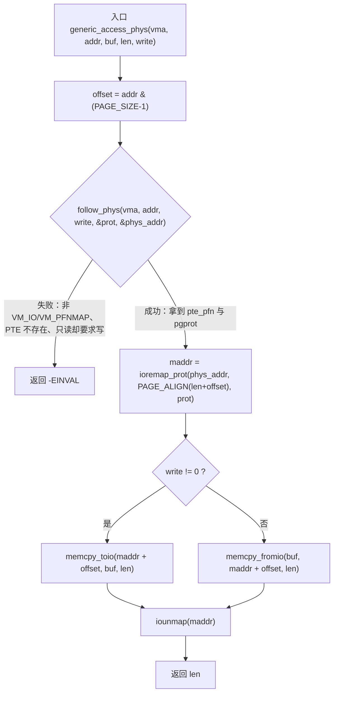
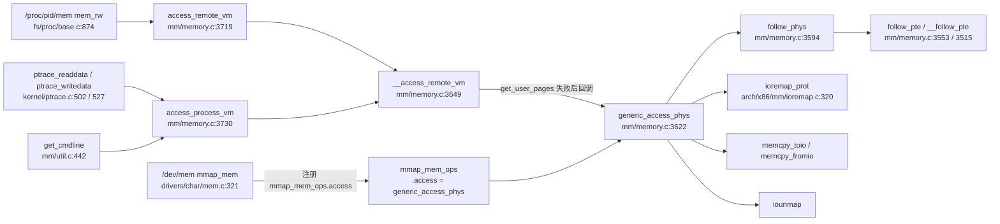

# 每日内核源码分析：generic_access_phys

- **日期**：2026-11-01
- **子系统**：mm
- **源文件**：mm/memory.c:3622-3642（Linux v4.4）
- **类型**：function（`EXPORT_SYMBOL_GPL`，依赖 `CONFIG_HAVE_IOREMAP_PROT`）

---

## 1. 功能作用

`generic_access_phys()` 是给「特殊 VMA」准备的一条**旁路访问通道**。

正常情况下，内核想读写另一个进程的地址空间（例如 ptrace 的 PEEK/POKE、`/proc/<pid>/mem`、kgdb/gdb 调试），会走 `get_user_pages()` 把用户页固定住，再 `kmap()` 访问。但 `VM_IO | VM_PFNMAP` 这类映射（典型是 `/dev/mem` mmap 出来的 MMIO、显存、设备寄存器区）没有对应的 `struct page`，`get_user_pages()` 必然失败。此时 `__access_remote_vm()` 会退而调用 `vma->vm_ops->access()`；`generic_access_phys()` 就是内核提供给驱动注册的通用实现：

1. 沿目标进程页表找到该用户地址对应的 PTE；
2. 从 PTE 取出物理地址与页保护位（`prot`）；
3. 用 `ioremap_prot()` 把这一小段物理地址临时映射到内核虚拟空间；
4. 用 `memcpy_toio()/memcpy_fromio()` 完成一次读或写；
5. `iounmap()` 立即解除映射，并返回实际传输的字节数。

它解决的问题是：**在没有 struct page 的 IO/PFN 映射上，仍然让调试器、procfs 能按字节读写目标进程可见的硬件内存**。临时 ioremap 而不是长期映射，也避免为偶尔的一次调试访问长期占用 vmalloc 地址空间。

典型使用场景：gdb/kgdb 通过 ptrace 读取被调试进程映射的设备寄存器；用户态工具通过 `/proc/<pid>/mem` 读取 `/dev/mem` 映射区域。

## 2. 关键数据结构

- **`struct vm_area_struct`**（`include/linux/mm_types.h:297`）
  - `vm_start / vm_end`：VMA 的用户虚拟地址范围，调用方已确保 `addr` 落在其中。
  - `vm_flags`：本函数只接受 `VM_IO`（0x4000，MMIO 等）或 `VM_PFNMAP`（0x400，"纯 PFN、无 struct page"）标记的 VMA。
  - `vm_mm`：所属地址空间，`follow_phys()` 用它做页表遍历。
  - `vm_page_prot`：VMA 的页保护，`/dev/mem` 在 `mmap_mem()` 中按 `phys_mem_access_prot()` 计算。
  - `vm_ops`：指向 `vm_operations_struct`，`access` 回调就在这里。
  - `vm_pgoff`：映射的物理页帧偏移，`/dev/mem` 用它确定 mmap 的物理起点。

- **`struct vm_operations_struct`**（`include/linux/mm.h:252`）
  - `access(vma, addr, buf, len, write)`（`mm.h:271`）是专门为 `access_process_vm()` 准备的钩子，注释明确写道：当 `get_user_pages()` 失败时调用，通常供可在"内存与硬件"之间切换的特殊 VMA 使用。

- **`struct mm_struct`**
  - `mmap_sem`：`__access_remote_vm()` 在进入循环前已 `down_read(&mm->mmap_sem)`，因此本函数及其 `follow_pte()` 都在 VMA 稳定的前提下执行。
  - `mm_users`：`/proc/<pid>/mem` 路径通过 `atomic_inc_not_zero()` 保证 mm 生命周期。

- **`pte_t` / `pgprot_t`**
  - `pte_pfn(pte)`：取出物理页帧号；`pte_write(pte)`：判断是否可写；`pte_pgprot(pte)` + `pgprot_val()`：把 PTE 属性还原成 `ioremap_prot()` 需要的保护值。
  - `__follow_pte()` 拒绝 `pmd_huge()` 的大页 PFN 映射。

- **`resource_size_t`**（`include/linux/types.h:167`，即 `phys_addr_t`）
  - 保存物理地址，保证 32/64 位平台都能容纳物理地址。

- **`void __iomem *`**
  - `ioremap_prot()` 返回的 IO 映射 cookie，带 `__iomem` 地址空间标记，防止被普通内存访问误用。

- **`mmap_mem_ops`**（`drivers/char/mem.c:315`）
  - `static const struct vm_operations_struct mmap_mem_ops = { .access = generic_access_phys };`
  - `/dev/mem` 的 `mmap_mem()` 在 `drivers/char/mem.c:342` 执行 `vma->vm_ops = &mmap_mem_ops;`，把本函数挂到所有 `/dev/mem` 映射上。

## 3. 核心逻辑流程图



ASCII 兜底：

```
generic_access_phys
  |
  +-- offset = addr & (PAGE_SIZE-1)
  +-- follow_phys()
  |     +-- 校验 vm_flags & (VM_IO | VM_PFNMAP)     失败 -> -EINVAL
  |     +-- follow_pte() -> __follow_pte()          失败 -> -EINVAL
  |     +-- FOLL_WRITE 且 !pte_write                失败 -> -EINVAL
  |     +-- prot = pgprot_val(pte_pgprot(pte))
  |         phys = pte_pfn(pte) << PAGE_SHIFT
  +-- ioremap_prot(phys, PAGE_ALIGN(len + offset), prot)
  +-- write ? memcpy_toio() : memcpy_fromio()
  +-- iounmap()
  +-- return len
```

关键决策点说明：

1. **只处理特殊映射**：`follow_phys()` 首先检查 `VM_IO | VM_PFNMAP`。普通匿名页/文件页仍走 `get_user_pages()` 的常规路径，不会到这里。
2. **页表命中才能继续**：`follow_pte()` 沿 PGD→PUD→PMD→PTE 逐级检查，任何一级缺失或坏页表都返回 `-EINVAL`。
3. **写权限二次校验**：即使调用方要求写，若 PTE 本身只读，也会在 `follow_phys()` 内被拒绝，避免绕过 VMA 的写保护。
4. **偏移与映射长度**：`offset` 是地址在页内的偏移；映射从 PTE 指向的物理页起点开始，长度 `PAGE_ALIGN(len + offset)` 覆盖"首页偏移 + 本次长度"。
5. **读/写分派**：写用 `memcpy_toio()`，读用 `memcpy_fromio()`，这两个 IO 拷贝原语不会对被映射的 MMIO 做普通内存的缓存/乱序假设。
6. **立即解映射**：无论读写都执行 `iounmap()`，不在内核地址空间留下长期映射。
7. **错误语义**：任何解析失败只返回 `-EINVAL`；`__access_remote_vm()` 看到 `ret <= 0` 就停止循环，把已传输字节数返回给上层。

## 4. 调用关系

### 4.1 调用者（who calls me）

`generic_access_phys()` 不是被普通 `CALL` 直接调用的，而是通过函数指针 `vma->vm_ops->access` 间接调用；注册点在 `/dev/mem`。

| 调用方 | 所在文件 | 调用场景 |
|--------|----------|----------|
| `mmap_mem`（注册回调） | `drivers/char/mem.c:321`，`mmap_mem_ops` 定义于 `315-319` | 用户 `mmap("/dev/mem", ...)` 时把 `.access = generic_access_phys` 挂到 VMA；随后对该 VMA 的 ptrace/procfs 访问才会触发 |
| `__access_remote_vm`（间接调用） | `mm/memory.c:3675-3677` | `get_user_pages()` 对 VM_IO/VM_PFNMAP 失败后，检查 `vma->vm_ops->access` 并调用 |
| `access_remote_vm` | `mm/memory.c:3719` | 供持有 `mm` 引用的内核路径使用；上游如 `/proc/<pid>/mem` 的 `mem_rw()`（`fs/proc/base.c:874`） |
| `access_process_vm` | `mm/memory.c:3730` | 供按 `task_struct` 访问的内核路径使用；上游如 `ptrace_readdata()` / `ptrace_writedata()`（`kernel/ptrace.c:502` / `527`，对应 PTRACE_PEEKDATA/POKEDATA） |
| `get_cmdline`（间接） | `mm/util.c:442` | 读取 `/proc/<pid>/cmdline` 时调用 `access_process_vm()`；目标地址通常不是 IO VMA，但同一通路 |

> 注意区分：`mmap_mem()` 只是**注册**回调，并不是在 mmap 时调用 `generic_access_phys()`；真正触发发生在后续对目标进程地址空间的跨进程读写。

### 4.2 被调用者（who I call）

- **核心路径调用**
  - `follow_phys()`（`mm/memory.c:3594`）：校验 VMA 标志、`follow_pte()`、写权限检查，输出 `prot` 与 `phys_addr`。
  - `follow_pte()`（`mm/memory.c:3553`）→ `__follow_pte()`（`mm/memory.c:3515`）：四级页表遍历，`pte_offset_map_lock()` 加 PTE 锁，`pte_present()` 校验。
  - `ioremap_prot()`（`arch/x86/mm/ioremap.c:320`）：把物理地址按 PTE 中的 cache 属性临时映射到内核虚拟空间，内部走 `__ioremap_caller()`。
  - `memcpy_toio()` / `memcpy_fromio()`（`include/asm-generic/io.h:911` / `901` 及各架构实现）：面向 IO 内存的读写原语。
  - `iounmap()`（`arch/x86/mm/ioremap.c:329` 起）：释放临时映射。

- **辅助调用**
  - `pte_pfn()`、`pte_write()`、`pte_pgprot()`、`pgprot_val()`：PTE 属性解码。
  - `PAGE_ALIGN()`：把"页内偏移 + 传输长度"向上对齐到页边界。
  - `pte_unmap_unlock()`：`follow_phys()` 的解锁与取消映射。

- **宏 / 内联**
  - `addr & (PAGE_SIZE-1)`：页内偏移计算；`PAGE_SHIFT` 用于 PFN→物理地址左移。
  - `VM_IO` / `VM_PFNMAP`：VMA 类型判定；`CONFIG_HAVE_IOREMAP_PROT` 决定整段代码是否编译（x86 在 `arch/x86/Kconfig:112` 选择该配置）。

### 4.3 调用关系图



## 5. 易错点 / 边界场景 / 设计权衡

1. **v4.4 没有检查 `ioremap_prot()` 返回值**：若 vmalloc 地址空间不足导致映射失败，`maddr` 为 `NULL`，随后 `memcpy_toio(NULL + offset, ...)` 会直接崩溃。后续内核版本补上了 `if (!maddr) return -ENOMEM;`，这是阅读老代码时最值得注意的缺陷。
2. **写权限的双重语义**：`write` 参数既表示"本次访问意图"，又作为 `FOLL_WRITE` 传给 `follow_phys()`；若 PTE 只读则统一返回 `-EINVAL`，不会尝试临时提升权限。
3. **只支持 `VM_IO | VM_PFNMAP`**：普通映射、`VM_MIXEDMAP` 不在此列；若驱动 mmap 时漏加 `VM_IO`（例如未用 `remap_pfn_range()`），访问会静默失败。
4. **不支持大页 PFN 映射**：`__follow_pte()` 对 `pmd_huge()` 直接返回 `-EINVAL`，并注释"Luckily they don't exist"；THP 化的 PFN 映射在该路径上不可用。
5. **映射长度按物理连续性假设**：`PAGE_ALIGN(len + offset)` 直接从当前 PFN 往后连续映射，**不会**按 `vma->vm_end` 裁剪。调用方应保证 `len` 不跨越 VMA 边界；否则理论上会映射到 VMA 之外的物理地址。`__access_remote_vm()` 在失败分支里也没有把 `len` 限制到页边界，这一点依赖上层（ptrace 通常 4/8 字节，`/proc/<pid>/mem` 一次最多 `PAGE_SIZE`）。
6. **锁的顺序**：上游持有 `mmap_sem` 读锁，`__follow_pte()` 再取 PTE 自旋锁；`ioremap_prot()` 会操作 vmalloc 锁且可能睡眠。阅读时要注意这里不是原子上下文，但也不能在持自旋锁的情况下调用本函数。
7. **架构差异**：整段实现由 `CONFIG_HAVE_IOREMAP_PROT` 包裹，`ioremap_prot()` 的语义与 PTE 布局因架构而异；本分析基于 x86 的 v4.4 实现。

---

## 附：核心源码片段

```c
// mm/memory.c:3622-3642 (Linux v4.4)
int generic_access_phys(struct vm_area_struct *vma, unsigned long addr,
			void *buf, int len, int write)
{
	resource_size_t phys_addr;
	unsigned long prot = 0;
	void __iomem *maddr;
	int offset = addr & (PAGE_SIZE-1);

	if (follow_phys(vma, addr, write, &prot, &phys_addr))
		return -EINVAL;

	maddr = ioremap_prot(phys_addr, PAGE_ALIGN(len + offset), prot);
	if (write)
		memcpy_toio(maddr + offset, buf, len);
	else
		memcpy_fromio(buf, maddr + offset, len);
	iounmap(maddr);

	return len;
}
EXPORT_SYMBOL_GPL(generic_access_phys);
```
