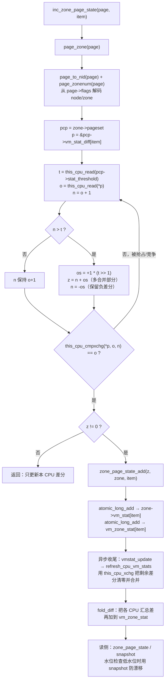
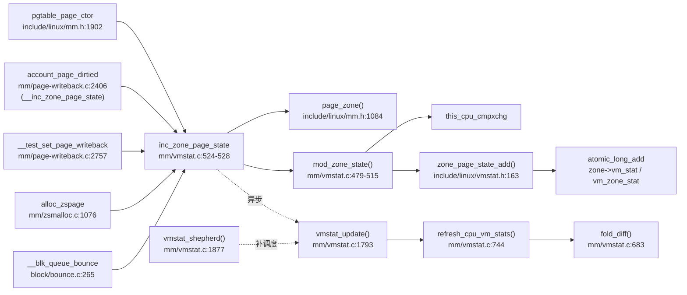

# 每日内核源码分析：inc_zone_page_state

- **日期**：2026-11-02
- **子系统**：mm
- **源文件**：mm/vmstat.c:524-528
- **类型**：function（导出符号 `EXPORT_SYMBOL`）
- **源码版本**：Linux v4.19（torvalds/linux，浅克隆校验行号）

---

## 1. 功能作用

`inc_zone_page_state()` 是内存管理统计（ZVC，Zone VM Counter）体系中最常用的**按页递增区域计数器**入口：

- 输入一个 `struct page *` 与 `enum zone_stat_item`，先通过 `page_zone()` 定位该页所属的 zone，再把该 zone 的统计项加一。
- 它不是简单地执行 `atomic_long_inc()`，而是先把增量记在**当前 CPU 的 per-CPU 差分（differential）**里；只有当差分超过阈值（`stat_threshold`）时，才把一批增量原子地“合并”进 `zone->vm_stat[]` 与全局 `vm_zone_stat[]`。这样把大量高频、跨 CPU 的原子操作，转化为少得多的全局原子操作，显著降低 cacheline 争用。
- 典型的“热点计数器”包括 `NR_PAGETABLE`（页表页）、`NR_ZONE_WRITE_PENDING`（脏页/回写页）、`NR_BOUNCE`（bounce buffer 页）、`NR_ZSPAGES`（zsmalloc 页）。
- 读侧通过 `zone_page_state()` / `zone_page_state_snapshot()` 得到（近似）计数；页面分配器的水位判断会在计数偏低时使用 snapshot，避免 per-CPU 漂移导致水位被击穿。

一句话：**它是“per-CPU 差分 + 阈值批量合并”计数器模型的高速递增入口**，用可接受的短暂不精确换取可扩展性。

## 2. 关键数据结构

### 2.1 `struct page`

页描述符，来源 `include/linux/page-flags.h` / `include/linux/mm_types.h`。本函数只依赖其 `flags` 中的编码：

- `page_zonenum(page)`：`(page->flags >> ZONES_PGSHIFT) & ZONES_MASK`（`include/linux/mm.h:841-844`），从 flags 中取出 zone 编号。
- `page_to_nid(page)`：取出 NUMA 节点编号（`NODES_PGSHIFT` 编码，见 `include/linux/mm.h:814-815, 970`）。
- `page_zone(page)`（`include/linux/mm.h:1084-1087`）：
  `&NODE_DATA(page_to_nid(page))->node_zones[page_zonenum(page)]`，即“节点 → 节点内 zone 数组 → 目标 zone”。

### 2.2 `struct zone`（`include/linux/mmzone.h:359`）

- `struct per_cpu_pageset __percpu *pageset`：每个 CPU 一份统计差分与页缓存（`mmzone.h:382`）。
- `atomic_long_t vm_stat[NR_VM_ZONE_STAT_ITEMS]`：该 zone 的“已合并”计数。位于 zone 结构尾部，读多写少。
- `unsigned long percpu_drift_mark`：漂移警戒线。当 `NR_FREE_PAGES` 低到该值以下时，水位判断改用快照读，避免 per-CPU 差分造成假安全（`mmzone.h:473-478`）。
- `watermark[NR_WMARK]`（min/low/high）：阈值计算与压力模式的依据。

### 2.3 `struct per_cpu_pageset`（`include/linux/mmzone.h:283-293`）

```c
struct per_cpu_pageset {
	struct per_cpu_pages pcp;       /* 页缓存链表、count/high/batch */
#ifdef CONFIG_NUMA
	s8 expire;
	u16 vm_numa_stat_diff[NR_VM_NUMA_STAT_ITEMS];
#endif
#ifdef CONFIG_SMP
	s8 stat_threshold;             /* 本 CPU 的合并阈值 */
	s8 vm_stat_diff[NR_VM_ZONE_STAT_ITEMS]; /* 每个统计项的待合并差分 */
#endif
};
```

- `vm_stat_diff[]` 用 **s8**（有符号 8 位）保存差分，这是阈值被硬性限制在 125 的根本原因。
- `stat_threshold` 也是 s8；理论最大值 127，代码保守地限制为 125，给 +1/-1 的“越界一步”留余量。
- 同一个 zone 在不同 CPU 上各有一份 `pageset`，因此差分是“zone × CPU × item”的二维分布。

### 2.4 `enum zone_stat_item`（`include/linux/mmzone.h:132-151`）

- 前 128 字节 cacheline 对齐放置：`NR_FREE_PAGES`、LRU 各项、`NR_ZONE_WRITE_PENDING`、`NR_MLOCK`、`NR_PAGETABLE`、`NR_KERNEL_STACK_KB`。
- 第二组 cacheline：`NR_BOUNCE`、`NR_ZSPAGES`（可选）、`NR_FREE_CMA_PAGES`。
- 注释明确按 cacheline 分组，目标就是减少不同统计项之间的伪共享。

### 2.5 全局计数器

- `atomic_long_t vm_zone_stat[NR_VM_ZONE_STAT_ITEMS]`：**全系统**按统计项汇总（`mm/vmstat.c:162`）。
- `atomic_long_t vm_node_stat[...]` / `vm_numa_stat[...]`：节点级、NUMA 级汇总。
- `zone_page_state_add()`（`include/linux/vmstat.h:163-167`）同时更新两个位置：

```c
atomic_long_add(x, &zone->vm_stat[item]);
atomic_long_add(x, &vm_zone_stat[item]);
```

## 3. 核心逻辑流程图

以 `CONFIG_SMP && CONFIG_HAVE_CMPXCHG_LOCAL`（x86 默认路径）为例，`inc_zone_page_state()` 展开为 `mod_zone_state(zone, item, +1, 1)`：



ASCII 兜底：

```text
inc_zone_page_state(page,item)
  └─ page_zone(page) ──> decode flags(node,zone) ──> zone->pageset
       └─ p = &pcp->vm_stat_diff[item]
       └─ loop: t=threshold; o=*p; n=o+1
            if n>t: z=n+t/2; n=-t/2
            cmpxchg(*p,o,n) 失败则重试
       └─ z!=0 ? atomic_add(z, zone->vm_stat[item]) + atomic_add(z, vm_zone_stat[item])
       └─ 之后由 vmstat_update/refresh_cpu_vm_stats 周期性合并剩余差分
```

关键决策点说明：

1. **先差分、后合并**：绝大多数调用只做一次 per-CPU 读写，不触碰全局 atomic；这是可扩展性的核心。
2. **阈值触发**：`n > t` 才批量溢出到 zone/global。阈值随 CPU 数与 zone 内存规模对数式增长（见 `calculate_normal_threshold`）。
3. **过冲（overstep）1 个半阈值**：溢出时并不是把差分清零，而是把 `t/2` 也算进 zone 计数，同时把差分置为 `-t/2`。这样形成**滞回（hysteresis）**：后续大约 `1.5t` 次递增才会再次触发合并，避免在阈值附近来回抖动、频繁打全局 atomic。
4. **cmpxchg 重试**：若读到的 `o` 已过期（被抢占迁移、或同 CPU 上被别的上下文更新），`this_cpu_cmpxchg` 失败并重新读取；即使迁移到新 CPU，也只会作用于新 CPU 的差分副本，不会丢计数。
5. **两种编译路径**：不支持 `HAVE_CMPXCHG_LOCAL` 的 SMP 架构使用 `local_irq_save/restore` + `__inc_zone_state()`（`mm/vmstat.c:612-622`）；UP 直接把 `inc_zone_page_state` 宏映射为 `__inc_zone_page_state`，直接原子加 `zone->vm_stat` 与 `vm_zone_stat`（`include/linux/vmstat.h:291-359`）。
6. **账目守恒**：无论怎么搬移，`zone->vm_stat[item] + Σ_cpu vm_stat_diff[item]` 始终等于真实增量；`zone_page_state()` 只读前者，因此可能滞后；`snapshot` 再把各 CPU 差分加回来（无锁、非精确）。

## 4. 调用关系

### 4.1 调用者（who calls me）

| 调用方 | 所在文件 | 调用场景 |
|--------|----------|----------|
| `pgtable_page_ctor` | `include/linux/mm.h:1902-1908` | 为页表页初始化 pte 锁成功后 `__SetPageTable`，计数 `NR_PAGETABLE` |
| `account_page_dirtied` | `mm/page-writeback.c:2406-2427` | 页首次置脏时计数 `NR_ZONE_WRITE_PENDING`；此处用 `__inc_zone_page_state` 低层版本，依赖调用方保证“相对中断原子”的上下文 |
| `__test_set_page_writeback` | `mm/page-writeback.c:2757-2807` | 页进入回写状态时计数 `NR_ZONE_WRITE_PENDING` |
| `alloc_zspage` | `mm/zsmalloc.c:1076-1112` | zsmalloc 为 zspage 分配每个物理页时计数 `NR_ZSPAGES`，失败路径对应 `dec_zone_page_state` |
| `__blk_queue_bounce` | `block/bounce.c:265-310` | 为高端内存 bio 分配 bounce buffer 页时计数 `NR_BOUNCE` |

> 说明：直接调用点不多，但很多上层路径会通过 `NR_PAGETABLE`、脏页回写等高频路径间接打到该函数；`EXPORT_SYMBOL(inc_zone_page_state)` 也允许模块使用。

### 4.2 被调用者（who I call）

- **定位/寻址**：`page_zone()`（内联）、`page_to_nid()`、`page_zonenum()`。
- **核心实现**：`mod_zone_state()`（SMP + cmpxchg 路径，`mm/vmstat.c:479-515`）；否则 `__inc_zone_state()`（`mm/vmstat.c:378-392`）。
- **原子设施**：`this_cpu_read/write`、`this_cpu_cmpxchg`（x86 为 `cmpxchg` 指令）；`local_irq_save/restore`（fallback）。
- **合并**：`zone_page_state_add()` → `atomic_long_add()`（zone 计数器 + 全局计数器）。
- **异步回收**：`vmstat_update()`（`mm/vmstat.c:1793`）→ `refresh_cpu_vm_stats()`（`744`）→ `fold_diff()`（`683`）；`vmstat_shepherd()`（`1877`）负责给“差分非零但 worker 未挂起”的 CPU 补调度。
- **阈值维护**：`calculate_normal_threshold()`（`195`）、`calculate_pressure_threshold()`（`171`）、`refresh_zone_stat_thresholds()`（`245`）、`set_pgdat_percpu_threshold()`（`290`）。

### 4.3 调用关系图



## 5. 易错点 / 边界场景 / 设计权衡

1. **`inc_zone_page_state` 与 `__inc_zone_page_state` 不是一个安全等级**：后者要求“中断已关闭，或抢占已关闭且不会被中断上下文更新”，否则 per-CPU 差分可能丢失更新；前者通过 cmpxchg/关中断承担了并发安全，代价略高。
2. **阈值被 s8 限制**：`stat_threshold` 与 `vm_stat_diff[]` 都是 s8，所以 `calculate_normal_threshold()` 把上限钳到 125。若未来改成更大阈值，必须同步修改数据类型，否则简单的一次 `++` 就可能把差分顶溢出。
3. **过冲设计不是 bug**：`inc` 溢出时 `zone` 计数会暂时**超前**（多加了 `t/2`），`dec` 溢出时暂时**滞后**；但 `zone + Σdiff` 守恒。读侧看到的是近似值，不能当作精确值用于强一致判断。
4. **漂移窗口**：任意时刻 `zone_page_state()` 与真实值的偏差可达 `在线 CPU 数 × 阈值`（每 CPU 差分可正可负）。页面分配器的 `zone_watermark_ok_safe()` 在 `free_pages < percpu_drift_mark` 时改用 `zone_page_state_snapshot()`，因此 `percpu_drift_mark` 的正确性直接影响 OOM/水位行为。
5. **kswapd 会动态调阈值**：kswapd 睡眠前恢复 `calculate_normal_threshold()`（阈值大、合并少）；被分配路径唤醒后切到 `calculate_pressure_threshold()`（阈值小、更精确），以避免“统计看起来还有空闲页、实际已跌破 min 水位”。
6. **cacheline 代价**：一次溢出合并会同时写 `zone->vm_stat` 与全局 `vm_zone_stat`，在跨 NUMA 节点时可能造成远端 cacheline bouncing；`refresh_cpu_vm_stats()` 的注释明确要求“尽量只访问本节点内存”。
7. **`page_zone()` 的前提**：page 必须是有效、未被释放复用的页。统计调用通常与页面生命周期操作绑定（分配后/置脏时/回写时），不要在页已归还伙伴系统后再按 page 指针统计。
8. **UP / 非 cmpxchg 架构行为不同**：UP 不做差分，直接原子加；没有 `HAVE_CMPXCHG_LOCAL` 的 SMP 用 `local_irq_save`。跨架构阅读源码时必须先看 `CONFIG_SMP` 与 `CONFIG_HAVE_CMPXCHG_LOCAL` 两个开关，否则会看到同一函数的多份定义（`mm/vmstat.c:524` 与 `mm/vmstat.c:612`）。

## 附：核心源码片段

```c
// mm/vmstat.c:479-528（CONFIG_HAVE_CMPXCHG_LOCAL 分支）
/*
 * Overstep mode specifies how overstep should handled:
 *     0       No overstepping
 *     1       Overstepping half of threshold
 *     -1      Overstepping minus half of threshold
 */
static inline void mod_zone_state(struct zone *zone,
       enum zone_stat_item item, long delta, int overstep_mode)
{
	struct per_cpu_pageset __percpu *pcp = zone->pageset;
	s8 __percpu *p = pcp->vm_stat_diff + item;
	long o, n, t, z;

	do {
		z = 0;  /* overflow to zone counters */

		/*
		 * The fetching of the stat_threshold is racy. ...
		 * the next counter update will apply the threshold again...
		 */
		t = this_cpu_read(pcp->stat_threshold);

		o = this_cpu_read(*p);
		n = delta + o;

		if (n > t || n < -t) {
			int os = overstep_mode * (t >> 1) ;

			/* Overflow must be added to zone counters */
			z = n + os;
			n = -os;
		}
	} while (this_cpu_cmpxchg(*p, o, n) != o);

	if (z)
		zone_page_state_add(z, zone, item);
}

void inc_zone_page_state(struct page *page, enum zone_stat_item item)
{
	mod_zone_state(page_zone(page), item, 1, 1);
}
EXPORT_SYMBOL(inc_zone_page_state);
```

```c
// include/linux/vmstat.h:163-167
static inline void zone_page_state_add(long x, struct zone *zone,
				 enum zone_stat_item item)
{
	atomic_long_add(x, &zone->vm_stat[item]);
	atomic_long_add(x, &vm_zone_stat[item]);
}
```
