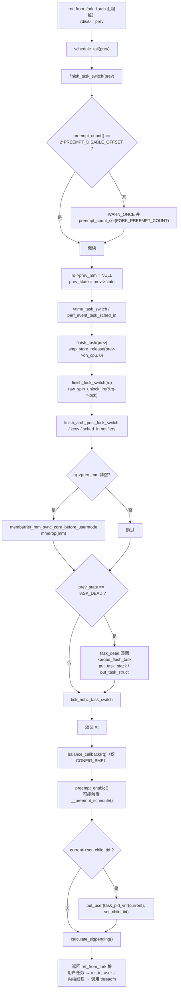
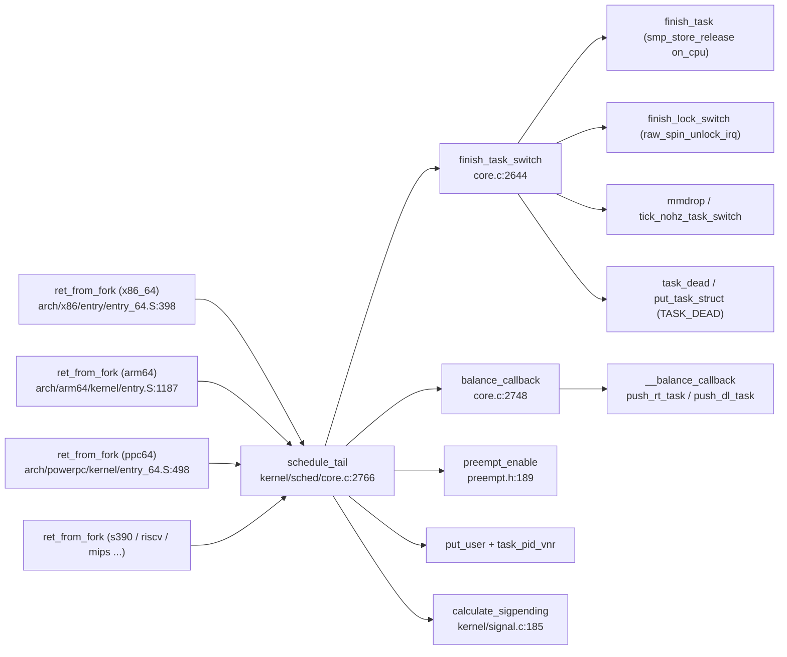

# 每日内核源码分析：schedule_tail

- **日期**：2026-11-03
- **子系统**：kernel/sched
- **源文件**：kernel/sched/core.c:2762-2788（参考内核：linux-4.19.325，4.x.y LTS）
- **类型**：function

---

## 1. 功能作用

`schedule_tail()` 是**新创建任务（fork / clone / kernel_thread 产生的子任务）第一次被调度上 CPU 后必须立即执行的收尾函数**。

新任务并不是从 `schedule()` 正常返回的：`switch_to()` 恢复的是子任务被 `copy_thread()` 预先构造的栈帧，最终跳入各架构的 `ret_from_fork` 汇编桩，由该桩以 `prev` 为参数调用 `schedule_tail()`。它承担“把上一次上下文切换真正收尾”的职责：

- 调用 `finish_task_switch(prev)`，完成前一任务（`prev`）的交接：校验并修正 `preempt_count`、读取 `prev->state`、更新 vtime / perf / kcov、清除 `prev->on_cpu`、释放 `rq->lock`、延迟 `mmdrop()`、回收 `TASK_DEAD` 任务的资源、通知 nohz 子系统任务已切换。
- 在 SMP 下执行 `balance_callback()`，运行由唤醒/迁移路径挂起的 RT / DL 负载均衡回调。
- 调用 `preempt_enable()` 恢复抢占（新任务由 `copy_thread()` 预设为 `FORK_PREEMPT_COUNT`，处于“不可抢占”状态）。
- 若创建时带 `CLONE_CHILD_SETTID`，把本任务的 TID 写回用户态 `set_child_tid` 指针。
- 调用 `calculate_sigpending()`，重新计算 `TIF_SIGPENDING`，避免 fork 期间投递给子任务的信号被漏掉。

**典型场景**：`fork()` / `clone()` / `pthread_create()` / `kthread_create()` 产生的新任务首次获得 CPU 时；普通任务之间的上下文切换**不会**经过这里——那条路径由 `context_switch()` 直接调用 `finish_task_switch()`。

---

## 2. 关键数据结构

### `struct task_struct`（`include/linux/sched.h`）

| 字段 | 与本函数的关系 |
|------|----------------|
| `prev->state` | 在 `finish_task_switch()` 中先读取，用于判断 `TASK_DEAD`；必须在清除 `on_cpu` 前读取，否则可能与并发唤醒产生 RUNNING→DEAD 双重释放 |
| `prev->on_cpu` | SMP 下由 `finish_task()` 通过 `smp_store_release()` 清零，与 `try_to_wake_up()` 的 `smp_cond_load_acquire()` 配对 |
| `set_child_tid` | `copy_process()` 依据 `CLONE_CHILD_SETTID` 设置，`schedule_tail()` 在恢复抢占后把 `task_pid_vnr(current)` 写入该用户地址 |
| `clear_child_tid` | 退出路径使用，与本函数无关，但常与 `set_child_tid` 成对理解 |
| `active_mm` / `mm` | 内核线程没有 `mm`，切换时借用 `prev->active_mm`，最终在 `finish_task_switch()` 中 `mmdrop()` |
| `sched_class` | `TASK_DEAD` 时调用 `prev->sched_class->task_dead(prev)` |
| `thread_info.flags` | `TIF_SIGPENDING` / `TIF_NEED_RESCHED` 等标志位，`calculate_sigpending()` 与 `preempt_enable()` 会间接操作 |
| `thread_info.preempt_count` | 上下文切换不变量：切换中应为 `2*PREEMPT_DISABLE_OFFSET`；`preempt_enable()` 递减后可能触发抢占 |

### `struct rq`（`kernel/sched/sched.h`）

| 字段 | 说明 |
|------|------|
| `lock` | 每个 CPU 的运行队列自旋锁；由 `prev` 在 `__schedule()` 中获取，**由 `next` 在 `finish_lock_switch()` 中释放**（跨栈的“锁交接”） |
| `curr` | 当前任务；切换后指向新任务 |
| `prev_mm` | 被切走的内核线程所借用的 `mm`，延迟到 `finish_task_switch()` 中 `mmdrop()` |
| `balance_callback` | RT / DL 调度类挂起的均衡回调链表头 |

### `struct rq_flags`

保存 `rq_pin_lock()` / `rq_unpin_lock()` 建立的 lockdep 状态，用于在“锁由另一个任务释放”这一特殊场景下保持 lockdep 记账正确。

### `preempt_count`（`include/linux/preempt.h`）

```
bits 0-7   : 抢占计数（PREEMPT_MASK）
bits 8-15  : softirq 计数
bits 16-19 : hardirq 计数
bit  20    : NMI
bit  31    : PREEMPT_NEED_RESCHED
```

`FORK_PREEMPT_COUNT = 2*PREEMPT_DISABLE_OFFSET + PREEMPT_ENABLED`，由 `copy_thread()` 写入新任务，保证新任务首次运行时 `preempt_enable()` 恰好把计数归零并重新允许抢占。

### 其他

- `struct sighand_struct`：`calculate_sigpending()` 需要持有 `current->sighand->siglock`。
- `struct callback_head`：`balance_callback` 链表节点，`func` 指向 `push_rt_task` / `push_dl_task` 等。
- `struct mm_struct`：`mmdrop()` 释放 `prev_mm`，并隐含提供 membarrier 所需的全内存屏障。

---

## 3. 核心逻辑流程图



**关键决策点说明：**

1. **`preempt_count` 校验**：切到新任务时计数必须恰好是 2 层“禁止抢占”（`schedule()` 的 `preempt_disable()` + `__schedule()` 的 `raw_spin_lock_irq()`）；异常时 WARN 并强制重置，防止计数泄漏导致永久不可抢占。
2. **先读 `prev->state`，后清 `on_cpu`**：`finish_task()` 用 release 语义清零 `on_cpu`，保证并发唤醒方看到 `on_cpu==0` 时，`prev->state` 已被本 CPU 读取，避免重复 `put_task_struct()`。
3. **释放 `rq->lock` 的时机**：在 `finish_lock_switch()` 中由“新任务”释放“旧任务获取”的锁；这是调度器刻意允许的跨栈锁交接，lockdep 需要用 `spin_release/spin_acquire` 补账。
4. **`prev_mm` 延迟释放**：`mmdrop()` 放到 rq 锁释放之后，避免持锁时做可能引起连锁操作的释放；同时它提供 membarrier 所需屏障。
5. **`TASK_DEAD` 分支**：最后一个 `schedule()` 永不返回，必须由新任务替它归还 `task_struct` 引用、栈与 kprobe 实例。
6. **`balance_callback` 必须在 `preempt_enable()` 之前**：回调假定仍在原 CPU、抢占被禁止；提前开抢占会导致任务迁移或 rq 状态错乱。
7. **`set_child_tid` 写回在开抢占之后**：`put_user()` 可能触发缺页，必须在可抢占上下文中执行；这是 `CLONE_CHILD_SETTID` 语义（子线程把自身 TID 写入父进程提供的地址）的落地点。
8. **`calculate_sigpending()` 收尾**：fork 期间父进程可能已向子进程投递信号，这里无条件置 `TIF_SIGPENDING` 再重算，确保返回用户态前不会丢信号。

---

## 4. 调用关系

### 4.1 调用者（who calls me）

`schedule_tail()` 只被**架构相关的 `ret_from_fork` / 克隆返回桩**调用，共覆盖 32 个架构文件：

| 调用方 | 所在文件 | 调用场景 |
|--------|----------|----------|
| `ret_from_fork`（x86_64） | `arch/x86/entry/entry_64.S:398`，`:401 call schedule_tail` | 新任务首次进入内核，`%rax` 传入 `prev` |
| `ret_from_fork`（arm64） | `arch/arm64/kernel/entry.S:1187`，`:1188 bl schedule_tail` | `cpu_switch_to` 恢复后进入 |
| `ret_from_fork`（powerpc64） | `arch/powerpc/kernel/entry_64.S:498,504` | 用户线程 / 内核线程两条路径 |
| `ret_from_fork`（s390） | `arch/s390/kernel/entry.S:560` | `brasl %r14,schedule_tail` |
| `ia64_invoke_schedule_tail` | `arch/ia64/kernel/entry.S:1182` | `ia64_switch_to()` 后的克隆返回 |
| `ret_from_fork`（riscv） | `arch/riscv/kernel/entry.S:294` | `tail schedule_tail` |
| `ret_from_fork`（mips / sparc / arm / m68k 等） | `arch/*/kernel/entry*.S` | 其余架构同构 |
| `context_switch`（对照路径） | `kernel/sched/core.c:2837` | **不调用** `schedule_tail`，直接 `finish_task_switch(prev)` |

> 说明：普通任务切换的“后半段”在 `__schedule()` → `context_switch()` 中完成；只有从未运行过的新任务，其“返回地址”被 `copy_thread()` 伪造成 `ret_from_fork`，才需要 `schedule_tail()` 这个用户态可见的 C 入口。

### 4.2 被调用者（who I call）

**核心路径调用**

- `finish_task_switch()` — `kernel/sched/core.c:2644`：完成切换收尾（本函数的绝对主体）。
  - `vtime_task_switch()`：虚拟运行时间统计切换。
  - `perf_event_task_sched_in()`：perf 事件切入。
  - `finish_task()` — `core.c:2542`：`smp_store_release(&prev->on_cpu, 0)`。
  - `finish_lock_switch()` — `core.c:2576`：`spin_acquire` + `raw_spin_unlock_irq(&rq->lock)`。
  - `finish_arch_post_lock_switch()`、`kcov_finish_switch()`、`fire_sched_in_preempt_notifiers()`。
  - `membarrier_mm_sync_core_before_usermode()` + `mmdrop()`。
  - `prev->sched_class->task_dead()`、`kprobe_flush_task()`、`put_task_stack()`、`put_task_struct()`（`TASK_DEAD` 路径）。
  - `tick_nohz_task_switch()`。
- `balance_callback()` — `core.c:2748` → `__balance_callback()` — `core.c:2728`：执行 RT / DL 负载均衡回调（`push_rt_task`、`push_dl_task` 等）。
- `preempt_enable()` — `include/linux/preempt.h:189`：`preempt_count_dec_and_test()`，在 `CONFIG_PREEMPT` 下可能调用 `__preempt_schedule()`。
- `put_user()` + `task_pid_vnr()`：把子任务 TID 写回用户空间。
- `calculate_sigpending()` — `kernel/signal.c:185`：持 `siglock` 设置并重算 `TIF_SIGPENDING`。

**辅助调用**

- `this_rq()`：取当前 CPU 的 `rq`（`prev` 可能已迁移到别的 CPU，必须重新取）。
- `preempt_count()` / `preempt_count_set()` / `WARN_ONCE()`：不变量校验。
- `raw_spin_unlock_irq()`：释放运行队列锁并恢复中断。

**宏 / 内联**

- `__releases(rq->lock)`：Sparse 注解，表示本函数会释放 `rq->lock`。
- `asmlinkage __visible`：汇编调用约定 + 禁止编译器做整体优化/克隆，保证符号可被汇编桩引用。
- `FORK_PREEMPT_COUNT`：新任务的初始抢占计数常量。

### 4.3 调用关系图



---

## 5. 易错点 / 边界场景 / 设计权衡

1. **跨栈锁交接是本函数最反直觉之处**：`rq->lock` 由 `prev` 在 `__schedule()` 内获取，却由 `next` 在 `finish_lock_switch()` 内释放。任何在 `schedule_tail()` 之前“提前返回用户态”的改动都会导致锁永远不释放，因此架构 `ret_from_fork` 必须无条件先调用它。
2. **`preempt_count` 不变量不可破坏**：新任务初始值为 `FORK_PREEMPT_COUNT`，与 `prev` 遗留的 2 层禁止抢占恰好衔接；若在 `copy_thread()` 或 `ret_from_fork` 中多加/少加一次 `preempt_disable()`，`WARN_ONCE` 会触发并把计数强制重置，否则调度器将永久不可抢占。
3. **`balance_callback` 与 `preempt_enable` 的顺序**：必须“先回调、后开抢占”。回调（如 `push_rt_task`）需要访问当前 CPU 的 `rq` 且假定不被迁移；提前开抢占会让 `current` 换 CPU，破坏回调前提。
4. **`put_user` 必须在开抢占之后**：写用户地址可能缺页并进入 page fault 路径，不能在原子/关抢占上下文完成。这也是 `CLONE_CHILD_SETTID` 语义被放在最后几步的原因。
5. **`TASK_DEAD` 的资源回收责任转移**：死亡任务最后一次 `schedule()` 不再返回，`task_struct`、内核栈、kprobe 实例全部由“下一个任务”在 `finish_task_switch()` 中释放；若此处漏掉 `put_task_stack()` 会泄漏栈。
6. **内存序与唤醒竞态**：`prev->state` 的读取必须先于 `on_cpu` 清零（release 语义），并与 `try_to_wake_up()` 的 acquire 配对；否则唤醒方可能在状态转换中途把 `prev` 拉到别的 CPU，造成 RUNNING→DEAD 的双重释放。
7. **`mmdrop()` 的双重角色**：既释放内核线程借用的 `mm`，又为 `membarrier` 提供“返回用户态前”的全屏障；把 `mmdrop()` 提前到持锁区间可能引发死锁（见函数注释）。
8. **仅新任务路径**：调试时若在 `schedule_tail()` 下断点，只会命中新建任务首次运行；普通切换请断在 `finish_task_switch()` 或 `context_switch()`。

---

## 附：核心源码片段

```c
/* kernel/sched/core.c:2762-2788 */
/**
 * schedule_tail - first thing a freshly forked thread must call.
 * @prev: the thread we just switched away from.
 */
asmlinkage __visible void schedule_tail(struct task_struct *prev)
	__releases(rq->lock)
{
	struct rq *rq;

	/*
	 * New tasks start with FORK_PREEMPT_COUNT, see there and
	 * finish_task_switch() for details.
	 *
	 * finish_task_switch() will drop rq->lock() and lower preempt_count
	 * and the preempt_enable() will end up enabling preemption (on
	 * PREEMPT_COUNT kernels).
	 */

	rq = finish_task_switch(prev);
	balance_callback(rq);
	preempt_enable();

	if (current->set_child_tid)
		put_user(task_pid_vnr(current), current->set_child_tid);

	calculate_sigpending();
}
```

```c
/* 关键下游：kernel/sched/core.c:2644-2723（节选） */
static struct rq *finish_task_switch(struct task_struct *prev)
	__releases(rq->lock)
{
	struct rq *rq = this_rq();
	struct mm_struct *mm = rq->prev_mm;
	long prev_state;

	if (WARN_ONCE(preempt_count() != 2*PREEMPT_DISABLE_OFFSET,
		      "corrupted preempt_count: %s/%d/0x%x\n",
		      current->comm, current->pid, preempt_count()))
		preempt_count_set(FORK_PREEMPT_COUNT);

	rq->prev_mm = NULL;
	prev_state = prev->state;
	vtime_task_switch(prev);
	perf_event_task_sched_in(prev, current);
	finish_task(prev);			/* smp_store_release(prev->on_cpu, 0) */
	finish_lock_switch(rq);			/* raw_spin_unlock_irq(&rq->lock) */
	finish_arch_post_lock_switch();
	kcov_finish_switch(current);

	fire_sched_in_preempt_notifiers(current);
	if (mm) {
		membarrier_mm_sync_core_before_usermode(mm);
		mmdrop(mm);
	}
	if (unlikely(prev_state == TASK_DEAD)) {
		if (prev->sched_class->task_dead)
			prev->sched_class->task_dead(prev);
		kprobe_flush_task(prev);
		put_task_stack(prev);
		put_task_struct(prev);
	}

	tick_nohz_task_switch();
	return rq;
}
```
