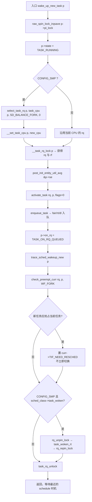
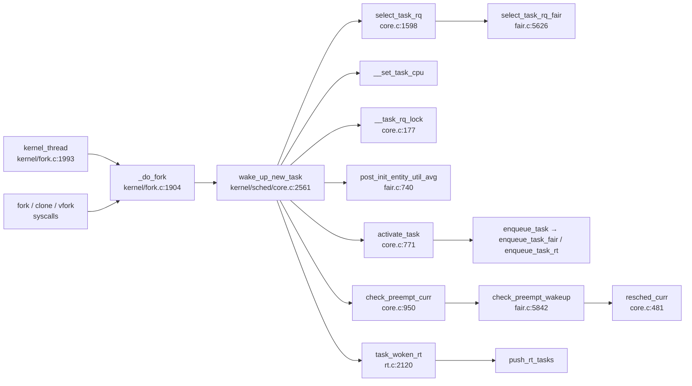

# 每日内核源码分析：wake_up_new_task

- **日期**：2026-11-04
- **子系统**：kernel/sched
- **源文件**：kernel/sched/core.c:2561-2598（基线：Linux 4.9，linux-4.x.y 系列）
- **类型**：function
- **选取方式**：随机（排除已分析的 904 个条目；`kernel/sched/core.c` 中已分析 12 个函数）

---

## 1. 功能作用

`wake_up_new_task()` 是**新建任务（fork/clone/vfork）第一次进入调度器的入口**。

`copy_process()` 只是把子进程的 `task_struct` 复制、初始化好，此时子进程还不在任何运行队列里，也不会被调度。父进程在 `_do_fork()` 拿到可用的 `p` 之后调用 `wake_up_new_task(p)`，由它完成三件事：

1. **状态转换**：把 `p->state` 置为 `TASK_RUNNING`，从此它是一颗“可运行”的任务；
2. **首次选核 + 入队**（SMP）：借助 `select_task_rq(..., SD_BALANCE_FORK, 0)` 做 fork 均衡，选一个合适的 CPU，然后 `activate_task()` 把任务压入该 CPU 的 runqueue；
3. **抢占判断**：`check_preempt_curr(rq, p, WF_FORK)` 判断新任务是否应立刻抢占当前任务；若应抢占，仅设置 `TIF_NEED_RESCHED`，**并不会当场切换**，真正的切换留给最近的 `schedule()` 时机（系统调用返回、中断返回或 `preempt_enable()`）。

典型场景：`fork()`/`pthread_create()` 创建子进程/线程、`kernel_thread()` 创建内核线程（kthreadd 的子孙）、`vfork()` 等所有进程创建路径。

---

## 2. 关键数据结构

### 2.1 `struct task_struct`（include/linux/sched.h）

| 字段 | 作用 |
|------|------|
| `raw_spinlock_t pi_lock` | 保护任务状态与调度参数的“任务级”锁；唤醒/迁移/改优先级都先持它 |
| `volatile long state` | 任务状态，本函数置为 `TASK_RUNNING`（0） |
| `int on_rq` | 是否在运行队列中；入队后置 `TASK_ON_RQ_QUEUED`，迁移中为 `TASK_ON_RQ_MIGRATING` |
| `const struct sched_class *sched_class` | 调度类（fair/rt/dl），决定 `select_task_rq`、`enqueue_task`、`check_preempt_curr`、`task_woken` 的实际实现 |
| `struct sched_entity se` | CFS 调度实体，携带 `avg`（PELT 负载/利用率）、`vruntime`、`load.weight` |
| `int prio, static_prio, normal_prio` | 动态/静态/普通优先级，决定调度类归属与抢占关系 |
| `cpumask_t cpus_allowed` | 允许运行的 CPU 集合，fork 过程中可能被修改，所以选核必须放在最后做 |

### 2.2 `struct rq`（kernel/sched/sched.h:590）

| 字段 | 作用 |
|------|------|
| `raw_spinlock_t lock` | 每个 CPU 的运行队列锁，保护 `nr_running`、`curr`、各调度子队列 |
| `unsigned int nr_running` | 该 CPU 可运行任务数（含正在跑的） |
| `struct cfs_rq cfs / rt_rq rt / dl_rq dl` | 三个调度类的子队列 |
| `struct task_struct *curr` | 当前正在该 CPU 上运行的任务，抢占判断的对手 |
| `u64 clock`、`clock_task` | rq 时钟；入队/出队前需 `update_rq_clock()` 保证统计一致 |

### 2.3 `struct sched_entity` / `struct sched_avg`（include/linux/sched.h）

- `se->avg.util_avg/util_sum`：PELT 指数衰减的 CPU 利用率均值；
- `se->avg.load_avg/load_sum`、`se->load.weight`：负载权重；
- 新建任务没有历史样本，`post_init_entity_util_avg()` 会用父 CPU 的 `cfs_rq->avg` 外推一个初值，避免新任务以“零负载”误导负载均衡。

### 2.4 `struct rq_flags` 与唤醒标志

- `rq_flags { unsigned int flags; unsigned long cookie; }`：`flags` 保存关中断标志，`cookie` 用于 lockdep 的 pin/unpin（对应 `rq_unpin_lock()/rq_repin_lock()`）。
- `WF_FORK 0x02`（kernel/sched/sched.h:1164）：告诉抢占逻辑“这是 fork 唤醒”。CFS 的 `check_preempt_wakeup()` 在 `WF_FORK` 时**不做 NEXT_BUDDY 提名**，避免新任务被盲目优待。

---

## 3. 核心逻辑流程图



ASCII 兜底版：

```text
wake_up_new_task
  ├─ lock(p->pi_lock)                 // 任务级锁，防并发唤醒/迁移
  ├─ p->state = TASK_RUNNING
  ├─ [SMP] cpu = select_task_rq(...SD_BALANCE_FORK...)
  │        __set_task_cpu(p, cpu)     // 不走 migrate_task_rq
  ├─ rq = __task_rq_lock(p)           // 循环校验，避免迁移竞态
  ├─ post_init_entity_util_avg(&p->se) // PELT 初值外推
  ├─ activate_task(rq, p, 0) → enqueue_task()
  ├─ p->on_rq = TASK_ON_RQ_QUEUED
  ├─ check_preempt_curr(rq, p, WF_FORK) → resched_curr?（只置标志）
  ├─ [SMP] task_woken（仅 RT 类实现）→ push_rt_tasks
  └─ task_rq_unlock
```

关键决策点：

1. **选核放在 `copy_process()` 之后**：fork 过程中 `cpus_allowed` 可能被改动，且先前选中的 CPU 可能被热插拔下线。
2. **必须用 `__set_task_cpu()`**：任务还没完成全部初始化，不能触发 `sched_class::migrate_task_rq`。
3. **`__task_rq_lock()` 而非 `task_rq_lock()`**：`pi_lock` 已持有，只需再拿 rq 锁；其内部 `for(;;)` 循环重试，避免“拿到锁后任务已被迁走”的窗口。
4. **`activate_task(rq, p, 0)` 的 flags=0** 表示入队前要更新 rq 时钟（`update_rq_clock`）；v4.19 改为 `ENQUEUE_NOCLOCK` + 显式 `update_rq_clock(rq)`。
5. **`check_preempt_curr()` 只“点灯”**：置 `TIF_NEED_RESCHED`，真正切换由调度点完成，中断上下文也能安全返回。
6. **`task_woken` 必须临时 unpin/repin rq->lock**：回调可能（在锁语义上）暂时放开 rq 锁，lockdep 的 pin 机制用于声明“这里允许”，避免误报。
7. **`on_rq = TASK_ON_RQ_QUEUED` 在入队后设置**：使 `task_on_rq_queued()` 为真的同时，队列统计已完成。

---

## 4. 调用关系

### 4.1 调用者（who calls me）

| 调用方 | 所在文件 | 调用场景 |
|--------|----------|----------|
| `_do_fork` | kernel/fork.c:1958 | `fork`/`clone`/`vfork` 的公共实现，`copy_process()` 成功后唤醒子任务 |
| `SYSCALL_DEFINE0(fork)` | kernel/fork.c:2000 | 用户态 `fork()` 系统调用 |
| `SYSCALL_DEFINE5/6(clone)` | kernel/fork.c:2021-2037 | 用户态 `clone()`（多架构参数变体） |
| `SYSCALL_DEFINE0(vfork)` | kernel/fork.c:2012 | 用户态 `vfork()` |
| `kernel_thread` | kernel/fork.c:1993 | 内核线程创建（`kthread_create` → `kernel_thread` → `_do_fork`），如 kthreadd |

> v4.9 中 `wake_up_new_task()` **只有 `_do_fork()` 一个直接调用点**，所以“谁唤醒新任务”等价于“谁创建任务”。

### 4.2 被调用者（who I call）

**核心路径调用**

| 被调函数 | 位置 | 说明 |
|----------|------|------|
| `select_task_rq` | kernel/sched/core.c:1598 | 按 `sched_class` 分派到 `select_task_rq_fair`（fair.c:5626）或 RT/DL 版本；单 CPU 亲和时直接 `cpumask_any` |
| `__set_task_cpu` | kernel/sched/core.c:1260 附近 | 只改 `task_cpu(p)`，不触发迁移回调 |
| `__task_rq_lock` | kernel/sched/core.c:177 | 拿 rq 锁并用 cookie 做 lockdep pin |
| `post_init_entity_util_avg` | kernel/sched/fair.c:740 | 用所在 cfs_rq 的 `util_avg` 外推新实体初值并 clamp 到 cap；UP 下为空实现（fair.c:787） |
| `activate_task` | kernel/sched/core.c:771 | `task_contributes_to_load` 时减 `nr_uninterruptible`，再 `enqueue_task` |
| `check_preempt_curr` | kernel/sched/core.c:950 | 同类调用 `check_preempt_curr`（CFS 为 `check_preempt_wakeup`，fair.c:5842）；跨类按 `for_each_class` 优先级顺序判断 |
| `sched_class->task_woken` | kernel/sched/rt.c:2120 | 仅 RT 实现 `task_woken_rt`：若当前 CPU 有更低优先级的 RT 任务则 `push_rt_tasks` |

**辅助调用**

- `raw_spin_lock_irqsave / raw_spin_unlock_irqrestore`（`p->pi_lock`）
- `raw_spin_lock / raw_spin_unlock`（`rq->lock`）
- `rq_unpin_lock / rq_repin_lock`（lockdep 注释）
- `trace_sched_wakeup_new`（tracepoint，无 trace 时为空）
- `task_rq_unlock`（释放 rq 锁与 `pi_lock`）

**宏 / 内联**

- `task_cpu(p)` / `task_rq(p)`、`task_on_rq_queued(p)`
- `update_rq_clock(rq)`（`flags` 未带 `ENQUEUE_NOCLOCK` 时由 `enqueue_task` 内部调用）
- `WF_FORK` 标志、`TASK_ON_RQ_QUEUED` 状态值

### 4.3 调用关系图



---

## 5. 易错点 / 边界场景 / 设计权衡

1. **“唤醒”≠“运行”**。`wake_up_new_task()` 只入队 + 置 `TIF_NEED_RESCHED`；若当前处于中断上下文或 `CONFIG_PREEMPT=n`，子任务可能要等到最近的调度点才真正上 CPU。这是“唤醒不进入 schedule()”的核心设计（见 `__schedule` 头部注释）。
2. **两把锁的顺序固定为 `pi_lock` → `rq->lock`**，全局所有任务迁移路径都遵守该顺序；反过来写会死锁。`__task_rq_lock()` 断言 `pi_lock` 已持有，并用 `for(;;)` + `task_on_rq_migrating` 自旋处理迁移竞态。
3. **为什么不能提前选核**：`copy_process()` 期间用户可通过 `sched_setaffinity` 改 `cpus_allowed`（`CLONE` 参数也可能影响），且目标 CPU 可能热插拔消失。因此在“最后一刻”才 `select_task_rq`。
4. **`WF_FORK` 的语义**：CFS 抢占判断里，`NEXT_BUDDY` 提名被 `!(wake_flags & WF_FORK)` 限制，避免 fork 风暴时新任务把 buddy 抢走；同时它不影响 `WAKEUP_PREEMPTION` 的常规抢占计算。
5. **`post_init_entity_util_avg()` 是“统计魔法”而非“必须”**：它只在 SMP + FAIR 有意义。若新任务是 RT/DL，函数会提前 `return`（fair.c:760-775）；UP 编译时是空函数，读代码时容易误以为漏了初始化。
6. **`task_woken` 只在 RT 类实现**（fair.c 无 `task_woken`），因为 RT 需要“把任务推给空闲 CPU”来降低调度延迟；CFS 的 fork 均衡已在 `select_task_rq_fair` 完成。读 `if (p->sched_class->task_woken)` 时不要以为所有调度类都会进。
7. **v4.9 → v4.19 变化**：新增 `p->recent_used_cpu = task_cpu(p)`（给 `select_task_rq_fair` 的 `prev_cpu` 提供更准确的“上次使用 CPU”）；`activate_task(rq, p, ENQUEUE_NOCLOCK)` + 显式 `update_rq_clock(rq)`；`lockdep_unpin_lock` 换成 `rq_unpin_lock` 封装。5.x 之后该函数逻辑基本稳定，仅 `sched_class` 钩子与 PELT 初值细节继续演进。

---

## 附：核心源码片段（Linux v4.9, kernel/sched/core.c:2561-2598）

```c
/*
 * wake_up_new_task - wake up a newly created task for the first time.
 *
 * This function will do some initial scheduler statistics housekeeping
 * that must be done for every newly created context, then puts the task
 * on the runqueue and wakes it.
 */
void wake_up_new_task(struct task_struct *p)
{
	struct rq_flags rf;
	struct rq *rq;

	raw_spin_lock_irqsave(&p->pi_lock, rf.flags);
	p->state = TASK_RUNNING;
#ifdef CONFIG_SMP
	/*
	 * Fork balancing, do it here and not earlier because:
	 *  - cpus_allowed can change in the fork path
	 *  - any previously selected cpu might disappear through hotplug
	 *
	 * Use __set_task_cpu() to avoid calling sched_class::migrate_task_rq,
	 * as we're not fully set-up yet.
	 */
	__set_task_cpu(p, select_task_rq(p, task_cpu(p), SD_BALANCE_FORK, 0));
#endif
	rq = __task_rq_lock(p, &rf);
	post_init_entity_util_avg(&p->se);

	activate_task(rq, p, 0);
	p->on_rq = TASK_ON_RQ_QUEUED;
	trace_sched_wakeup_new(p);
	check_preempt_curr(rq, p, WF_FORK);
#ifdef CONFIG_SMP
	if (p->sched_class->task_woken) {
		/*
		 * Nothing relies on rq->lock after this, so its fine to
		 * drop it.
		 */
		lockdep_unpin_lock(&rq->lock, rf.cookie);
		p->sched_class->task_woken(rq, p);
		lockdep_repin_lock(&rq->lock, rf.cookie);
	}
#endif
	task_rq_unlock(rq, p, &rf);
}
```
