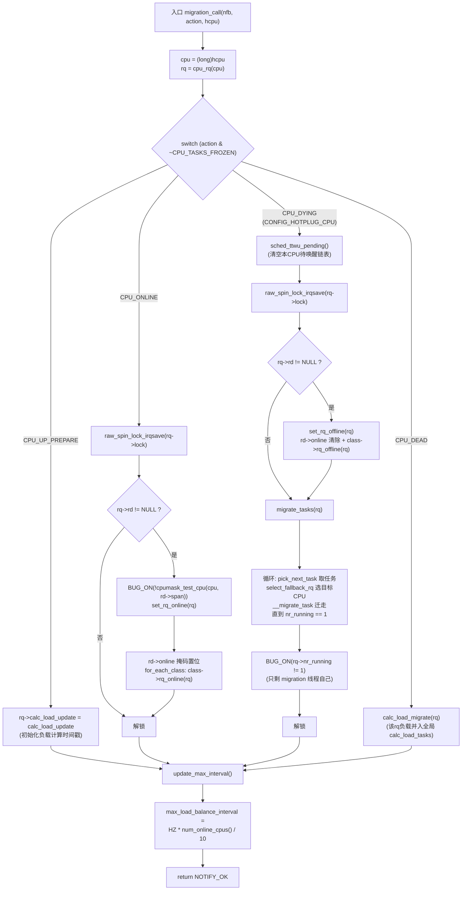
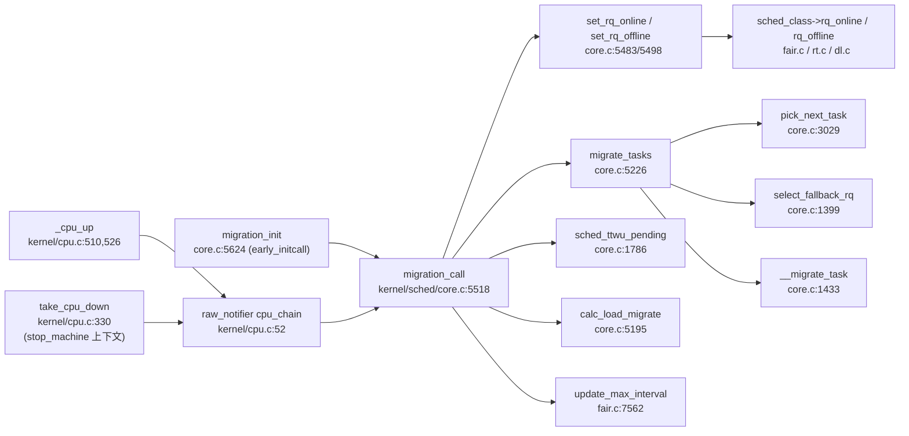

# 每日内核源码分析：migration_call

- **日期**：2026-11-05
- **子系统**：kernel/sched
- **源文件**：kernel/sched/core.c:5518-5564（Linux v4.4）
- **类型**：function

---

## 1. 功能作用

`migration_call` 是调度器注册到 **CPU 热插拔（CPU hotplug）通知链**上的回调函数，是调度子系统感知「CPU 上线 / 下线」事件的入口。

它解决的核心问题：**当一个 CPU 在系统运行中动态上线或下线时，调度器必须同步更新该 CPU 运行队列（runqueue）的状态，并在 CPU 彻底消失之前，把队列上所有可运行任务强制迁移到其他在线 CPU**，保证：

- 新上线的 CPU 能立即被调度器纳入负载均衡范围（挂入 root domain 的 online 掩码，通知各 sched_class）；
- 即将下线的 CPU 不会被继续分发新任务，其上残留任务被安全「疏散」；
- 全局负载统计（load average）与负载均衡周期参数随在线 CPU 数动态调整。

它被调用的典型场景：

- 管理员执行 `echo 0 > /sys/devices/system/cpu/cpuN/online` 拔下 CPU；
- 系统挂起 / 恢复（suspend/resume）过程中 CPU 被冻结再恢复（走 `*_FROZEN` 变体）；
- 内核启动早期由 `migration_init()` 直接调用，为启动 CPU（boot CPU）做同样的初始化。

注册优先级为 `CPU_PRI_MIGRATION`（=10），仅次于 perf 子系统（`CPU_PRI_PERF`=20），确保**任务迁移先于几乎所有其他子系统的热插拔回调完成**——其他模块看到「CPU 下线」事件时，调度器早已把任务撤空。

## 2. 关键数据结构

- `struct notifier_block migration_notifier`（kernel/sched/core.c:5571）：通知块，`.notifier_call = migration_call`，`.priority = CPU_PRI_MIGRATION`。定义于 include/linux/cpu.h:76（`CPU_PRI_MIGRATION = 10`，`CPU_PRI_PERF = 20`）。
- **热插拔动作码**（include/linux/cpu.h:83-108）：`CPU_ONLINE(0x2)`、`CPU_UP_PREPARE(0x3)`、`CPU_DOWN_PREPARE(0x5)`、`CPU_DEAD(0x7)`、`CPU_DYING(0x8)`，以及修饰位 `CPU_TASKS_FROZEN(0x10)`（suspend 路径使用）。
- `struct rq`（kernel/sched/sched.h）：每 CPU 运行队列。本函数涉及字段：
  - `rq->rd`：指向所属的 `struct root_domain`（根调度域，记录 `span`/`online` CPU 掩码）；
  - `rq->online`：该队列是否在线的标志；
  - `rq->calc_load_update`：该队列下一次参与全局负载计算的时间戳；
  - `rq->nr_running`：队列上可运行任务数；
  - `rq->stop`：指向该 CPU 的 stop 线程（`migrate_tasks()` 会临时将其置 NULL）。
- `struct fake_task` / `fake_sched_class`（core.c:5203-5217）：迁移循环中喂给 `pick_next_task()` 的占位「前一个任务」，优先级设为 `MAX_PRIO + 1` 以避免触发 RT/DL 的 pull 逻辑。
- 全局变量 `calc_load_update`（jiffies 值）与 `calc_load_tasks`（全局活跃负载计数）。

## 3. 核心逻辑流程图



关键决策点解读：

1. **`action & ~CPU_TASKS_FROZEN`**：屏蔽 FROZEN 修饰位，使系统挂起/恢复（frozen）路径与普通热插拔路径复用同一套处理逻辑，避免重复代码。
2. **`CPU_ONLINE` 中的 `BUG_ON(!cpumask_test_cpu(cpu, rq->rd->span))`**：防御性断言——上线的 CPU 必须在其根调度域的 span 内，否则说明调度域配置出错，属于不可恢复的内核态逻辑错误。
3. **`set_rq_online()` / `set_rq_offline()` 内部以 `rq->online` 为幂等条件**：重复事件（如 UP_CANCELED 后再 UP）不会重复触发 sched_class 回调。
4. **`CPU_DYING` 先调 `sched_ttwu_pending()`**：本 CPU 即将离线，挂在其 `wake_list` 无锁链表上的待唤醒任务必须当场处理掉，否则这些唤醒请求会随 CPU 消失而丢失。
5. **`migrate_tasks()` 的终止条件 `rq->nr_running == 1`**：在 stop_machine 上下文中执行本回调的 migration 线程本身占 1 个名额，其余任务必须全部迁走；`BUG_ON` 校验这一不变式。
6. **结尾无条件调用 `update_max_interval()`**：无论是上线还是下线事件，都按当前在线 CPU 数重算最大负载均衡间隔（CPU 越多间隔越大，以牺牲均衡延迟换取更少的跨 CPU 干扰）。

## 4. 调用关系

### 4.1 调用者（who calls me）

| 调用方 | 所在文件 | 调用场景 |
|--------|----------|----------|
| `__cpu_notify` / `cpu_notify`（经 `cpu_chain` 通知链） | kernel/cpu.c:210-223 | 所有热插拔事件的统一分发入口 |
| `_cpu_up` → `__cpu_notify(CPU_UP_PREPARE)` / `cpu_notify(CPU_ONLINE)` | kernel/cpu.c:510,526 | CPU 上线流程 |
| `take_cpu_down` → `cpu_notify(CPU_DYING)` | kernel/cpu.c:330 | CPU 下线流程，stop_machine 回调中（关中断、单线程上下文） |
| `cpu_notify_nofail(CPU_DEAD ...)` | kernel/cpu.c:228-231 | CPU 下线完成后 |
| `migration_init`（直接调用 ×2 + `register_cpu_notifier`） | kernel/sched/core.c:5624-5633 | 启动早期为 boot CPU 手工触发 `CPU_UP_PREPARE`/`CPU_ONLINE`，再把回调挂入通知链 |

### 4.2 被调用者（who I call）

- **核心路径调用**：
  - `set_rq_online(rq)`（core.c:5483）→ `cpumask_set_cpu` + `for_each_class(class)->rq_online(rq)`；
  - `set_rq_offline(rq)`（core.c:5498）→ `class->rq_offline(rq)` + `cpumask_clear_cpu(rd->online)`；
  - `migrate_tasks(rq)`（core.c:5226）→ `update_rq_clock` → 循环 `pick_next_task` / `put_prev_task` / `select_fallback_rq` / `__migrate_task`；
  - `sched_ttwu_pending()`（core.c:1786）：排空本 CPU 的 `wake_list` 无锁链表；
  - `calc_load_migrate(rq)`（core.c:5195）→ `calc_load_fold_active` + `atomic_long_add(calc_load_tasks)`；
  - `update_max_interval()`（fair.c:7562）：重算 `max_load_balance_interval`。
- **辅助调用**：`cpu_rq(cpu)`（per-cpu 取 rq 宏）、`raw_spin_lock_irqsave/irqrestore`、`cpumask_test_cpu`、`smp_processor_id`。
- **宏 / 内联**：`for_each_class`（sched.h 中遍历全局 sched_class 链表）、`BUG_ON`、`NOTIFY_OK`。

### 4.3 调用关系图（Mermaid）



## 5. 易错点 / 边界场景 / 设计权衡

1. **优先级数值越小反而「越靠后」**：内核通知链按 priority 降序执行，`CPU_PRI_MIGRATION=10` 小于 `CPU_PRI_PERF=20`，所以注释说「高优先级注册、但要低于 perf」——perf 先收事件，migration 第二，其余默认 0 优先级的子系统都在任务迁移完成后才被通知。阅读时不要望文生义。
2. **为什么用 `raw_notifier` 而不是阻塞式通知链**：`CPU_DYING` 在 `take_cpu_down()`（stop_machine 回调）中分发，此时全机只剩当前 CPU 在跑、中断已关，绝不能睡眠，因此整个链路必须是原子上下文安全的。
3. **`BUG_ON(rq->nr_running != 1)` 的「1」是 migration 线程自己**：本回调就在该 CPU 的 migration/stop 线程上下文中执行，迁移完成后队列上应只剩它；若断言失败说明有任务漏迁或并发窗口被意外打开。
4. **`migrate_tasks()` 临时置 `rq->stop = NULL`**：stop 线程永远符合调度条件，不摘掉会让 `pick_next_task` 死循环选中它；这是针对「选择循环」的一个显式 fudge，读完要记得恢复（结尾 `rq->stop = stop`）。
5. **迁移循环中的「放锁—拿 pi_lock—再拿 rq->lock」**：修改 `task_struct::cpus_allowed` 的规则要求同时持有 `pi_lock` 和 `rq->lock`，持其一即可稳定掩码。此处短暂释放 `rq->lock` 之所以安全，是因为处于 stop_machine 且 `!cpu_active`，负载均衡不会插手；`lockdep_pin_lock/unpin_lock` 是告诉 lockdep「这是有意为之」。
6. **`CPU_DEAD` 才做 `calc_load_migrate` 而非 `CPU_DYING`**：`CPU_DYING` 时全局负载计数要等 `migrate_tasks()` 落定后才有意义，而 `CPU_DEAD` 事件到来时队列已空、计数稳定，注释中明确写了「Assumes we're called after migrate_tasks()」。两个事件的先后顺序是这个设计的隐含契约。
7. **跨版本差异**：v4.4 使用老式 `register_cpu_notifier` 接口；自 v4.6 起内核逐步切换到 `cpuhp_setup_state()` 状态机接口（v4.10 后老式接口被移除），`migration_call` 在后续版本被拆成 `sched_cpu_starting/shed_cpu_dying` 等分散的 cpuhp 回调。

---

## 附：核心源码片段

```c
// kernel/sched/core.c:5518-5564 (Linux v4.4)
/*
 * migration_call - callback that gets triggered when a CPU is added.
 * Here we can start up the necessary migration thread for the new CPU.
 */
static int
migration_call(struct notifier_block *nfb, unsigned long action, void *hcpu)
{
	int cpu = (long)hcpu;
	unsigned long flags;
	struct rq *rq = cpu_rq(cpu);

	switch (action & ~CPU_TASKS_FROZEN) {

	case CPU_UP_PREPARE:
		rq->calc_load_update = calc_load_update;
		break;

	case CPU_ONLINE:
		/* Update our root-domain */
		raw_spin_lock_irqsave(&rq->lock, flags);
		if (rq->rd) {
			BUG_ON(!cpumask_test_cpu(cpu, rq->rd->span));

			set_rq_online(rq);
		}
		raw_spin_unlock_irqrestore(&rq->lock, flags);
		break;

#ifdef CONFIG_HOTPLUG_CPU
	case CPU_DYING:
		sched_ttwu_pending();
		/* Update our root-domain */
		raw_spin_lock_irqsave(&rq->lock, flags);
		if (rq->rd) {
			BUG_ON(!cpumask_test_cpu(cpu, rq->rd->span));
			set_rq_offline(rq);
		}
		migrate_tasks(rq);
		BUG_ON(rq->nr_running != 1); /* the migration thread */
		raw_spin_unlock_irqrestore(&rq->lock, flags);
		break;

	case CPU_DEAD:
		calc_load_migrate(rq);
		break;
#endif
	}

	update_max_interval();

	return NOTIFY_OK;
}

/*
 * Register at high priority so that task migration (migrate_all_tasks)
 * happens before everything else.  This has to be lower priority than
 * the notifier in the perf_event subsystem, though.
 */
static struct notifier_block migration_notifier = {
	.notifier_call = migration_call,
	.priority = CPU_PRI_MIGRATION,
};
```
