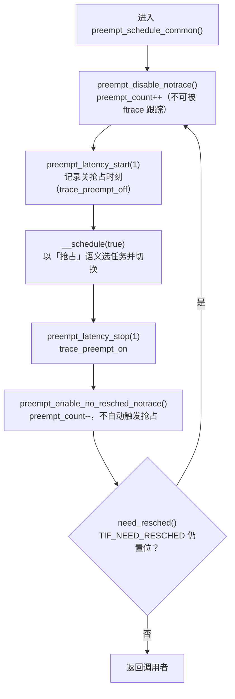
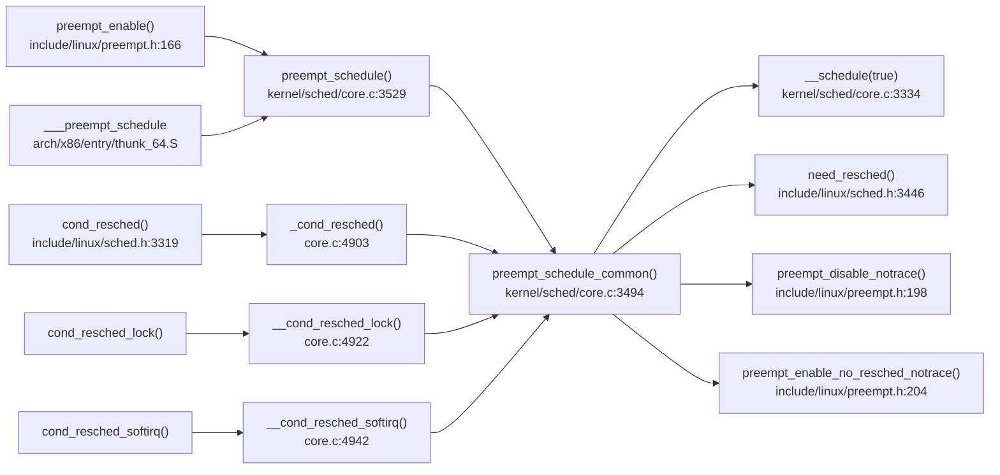

# 每日内核源码分析：preempt_schedule_common

- **日期**：2026-11-06
- **子系统**：kernel/sched
- **源文件**：kernel/sched/core.c:3494-3521（上游源码 torvalds/linux v4.9）
- **类型**：function（static，抢占公共执行体）

---

## 1. 功能作用

`preempt_schedule_common()` 是**内核抢占的公共执行体**：把「现在应该让出 CPU」这件事真正落实为一次上下文切换。

它解决的核心问题是：内核里的抢占请求（`TIF_NEED_RESCHED`）随时可能被设置（定时器 tick、唤醒更高优先级任务、中断返回等），但**不能在任何位置立即切换**——必须等到「抢占计数为 0、且中断已开启」的安全点。`preempt_schedule_common()` 就是这些安全点最终汇聚到的执行逻辑：

- 在**可抢占内核**（`CONFIG_PREEMPT=y`）中，由 `preempt_enable()` 在抢占计数递减到 0、且 NEED_RESCHED 已置位时经 `preempt_schedule()` 进入。
- 在**不可抢占内核**（`!CONFIG_PREEMPT`）中，由 `cond_resched()` / `cond_resched_lock()` / `cond_resched_softirq()` 等**显式自愿调度点**进入。

它的主体是一个 `do { ... } while (need_resched())` 循环，反复调用 `__schedule(true)`，其中 `preempt=true` 明确告诉主调度器：

> 这是**内核抢占**，当前任务仍然可运行（不是主动睡眠），不要把它从运行队列上摘下来，也不要用睡眠路径的统计口径。

因此 `__schedule(true)` 不会执行 `deactivate_task()`，`prev->nivcsw`（非自愿切换计数）会递增，`trace_sched_switch(preempt=true, ...)` 也会标记这次切换为抢占。

## 2. 关键数据结构

### 2.1 `preempt_count`（per-CPU 位域整数）

定义：`arch/x86/include/asm/preempt.h`（通用布局在 `include/linux/preempt.h`）

```
| NMI(1bit) | HARDIRQ(4bit) | SOFTIRQ(8bit) | PREEMPT(8bit) |
                            bit31: PREEMPT_NEED_RESCHED (反向折叠)
```

- `PREEMPT_OFFSET = 1<<0`：每执行一次 `preempt_disable()` 加 1；为 0 才允许抢占。
- `SOFTIRQ_OFFSET`、`HARDIRQ_OFFSET`、`NMI_OFFSET`：分别表示软中断、硬中断、NMI 上下文，任何一项非 0 都不可抢占。
- `PREEMPT_NEED_RESCHED = 0x80000000`（最高位）：**反向表示**「不需要调度」。置位 = 不需要 resched，清零 = 需要 resched。
- `preempt_count()` 读取时用 `& ~PREEMPT_NEED_RESCHED` 屏蔽该位，因此对普通代码来说它仍是一个「非 0 即不可抢占」的计数。

> 设计精妙点：把 NEED_RESCHED 折叠进抢占计数的最高位，使得 `preempt_enable()` 只需一条 `decl` 指令，递减结果为 0 就同时意味着「计数归零 + 需要调度」。

### 2.2 `TIF_NEED_RESCHED` 与 `need_resched()`

- 标志位位于 `thread_info->flags`（`include/linux/thread_info.h`）。
- `need_resched()`（`include/linux/sched.h:3446`）→ `tif_need_resched()`（`include/linux/thread_info.h:110`）→ `test_thread_flag(TIF_NEED_RESCHED)`。
- 与 `should_resched(offset)` 的区别：后者直接比较 per-CPU 原始 `__preempt_count` 是否等于 `offset`（利用上面的折叠位），用于 `preempt_enable()` 的快速路径。

### 2.3 `struct task_struct` / `struct rq`（被 `__schedule` 消费）

`preempt_schedule_common()` 本身不直接操作它们，但语义依赖：

- `current->state`：抢占路径下 `__schedule` **不读也不改**它（因为 `preempt=true`）。
- `rq->curr`、`rq->nr_switches`、`prev->nivcsw`：由 `__schedule(true)` 更新。
- `prev->thread_info.flags`：`TIF_NEED_RESCHED` 在 `__schedule` 内被 `clear_tsk_need_resched(prev)` 清除，同时 `clear_preempt_need_resched()` 清除折叠位。

### 2.4 `enum ctx_state`（相邻函数使用）

`preempt_schedule_notrace()` 用 `exception_enter()/exception_exit()` 包裹 `__schedule`，以处理「从用户态返回但尚未调用 `user_exit()`」的场景；`preempt_schedule_common()` 不做这件事，因为它只在内核上下文的安全点被调用。

## 3. 核心逻辑流程图



关键决策点说明：

1. **进入前的门槛不在本函数内**：`preempt_schedule()` 用 `if (!preemptible()) return;` 拦截「抢占计数非 0 或中断关闭」的情况；`cond_resched()` 系列先用 `should_resched()` 判断。本函数被调用时，必然已处于可抢占安全点。
2. **先关抢占再做事**：`__schedule()` 的注释明确要求「must be called with preemption disabled」，否则调度器内部数据结构可能被再次抢占破坏。
3. **`_notrace` 版本是关键**：这里刻意使用 `preempt_disable_notrace()` / `preempt_enable_no_resched_notrace()`，避免函数追踪器在 `preempt_count_add/sub` 上挂钩子导致**无限递归**（见第 5 节）。
4. **`preempt=true` 改变调度语义**：跳过 `!preempt && prev->state` 分支，不 `deactivate_task`，不触发 `wq_worker_sleeping`，统计记入 `nivcsw`（非自愿切换）。
5. **循环而不是单次**：`__schedule()` 返回后到 `need_resched()` 检查之间，中断可能再次置位 `TIF_NEED_RESCHED`（例如刚切回的任务又被更高优先级任务抢占），所以必须重新检查。
6. **`preempt_latency_start/stop(1)` 参数 1 的含义**：此时 `preempt_disable_notrace()` 刚把计数从 0 加到 1，`preempt_count() == 1` 表示「刚刚进入关抢占状态」，tracepoint 借此记录关抢占的精确起点与延迟。

## 4. 调用关系

### 4.1 调用者（who calls me）

| 调用方 | 所在文件 | 调用场景 |
|--------|----------|----------|
| `preempt_schedule()` | `kernel/sched/core.c:3529`（调用点 3538） | 可抢占内核的**主抢占入口**；由 `preempt_enable()` / `preempt_check_resched()` 经 `__preempt_schedule()` → 汇编 thunk `___preempt_schedule`（`arch/x86/entry/thunk_64.S`）跳入 |
| `_cond_resched()` | `kernel/sched/core.c:4903`（调用点 4906） | `!CONFIG_PREEMPT` 内核中 `cond_resched()` 的实现（`include/linux/sched.h:3319` 宏），在显式安全点自愿让出 CPU |
| `__cond_resched_lock()` | `kernel/sched/core.c:4922`（调用点 4932） | `cond_resched_lock()`：释放 spinlock → 调度 → 重新加锁 |
| `__cond_resched_softirq()` | `kernel/sched/core.c:4942`（调用点 4948） | `cond_resched_softirq()`：`local_bh_enable()` → 调度 → `local_bh_disable()` |

> 注：`preempt_schedule_irq()`（`core.c:3603`，中断返回路径）是**兄弟入口**，它自己维护 `do { local_irq_enable(); __schedule(true); local_irq_disable(); } while (need_resched())` 循环，**不调用** `preempt_schedule_common()`；`preempt_schedule_notrace()` 同样有独立循环（额外用 `exception_enter/exit` 处理用户态上下文）。

### 4.2 被调用者（who I call）

**核心路径调用**

- `__schedule(true)`（`kernel/sched/core.c:3334`）：真正的主调度器，完成 `pick_next_task` → `context_switch`。
- `need_resched()`：决定循环是否继续。

**辅助调用**

- `preempt_disable_notrace()` → `__preempt_count_inc()` → `__preempt_count_add()` → `raw_cpu_add_4()`。
- `preempt_latency_start(1)` / `preempt_latency_stop(1)`：仅在 `CONFIG_PREEMPT && (CONFIG_DEBUG_PREEMPT || CONFIG_PREEMPT_TRACER)` 下展开，内部调用 `trace_preempt_off/on`、`get_lock_parent_ip()`。
- `preempt_enable_no_resched_notrace()` → `__preempt_count_dec()`。

**宏 / 内联**

- `preemptible()`：`preempt_count() == 0 && !irqs_disabled()`（在 `preempt_schedule` 中使用）。
- `should_resched(0)`：`raw_cpu_read_4(__preempt_count) == 0`，一次比较完成「可抢占 + 需调度」判定。
- `__sched`：把函数放入 `.sched.text` 段，便于调度器/调试器识别。
- `notrace`：禁止 ftrace 对该函数插桩。

### 4.3 调用关系图（Mermaid）



## 5. 易错点 / 边界场景 / 设计权衡

1. **为什么要 `_notrace`？**
   `preempt_count_add/sub` 本身可能被 ftrace 插桩；如果插桩代码里又调用 `preempt_enable_notrace()`，此时 `NEED_RESCHED` 仍置位，就会再次进入 `preempt_schedule_common()` → 无限递归。因此这里必须用**不触发追踪**的加/减计数版本。这也解释了为什么这段代码要拆成「先 `preempt_disable_notrace()` 关抢占，再 `preempt_latency_start(1)` 单独记录延迟」两步。

2. **为什么用 `preempt_enable_no_resched_notrace()` 而不是 `preempt_enable()`？**
   `preempt_enable()` 在计数归零且 NEED_RESCHED 置位时会**自动再调一次** `preempt_schedule()`，与函数自身的 `do-while` 重复，导致递归/重复调度。这里用 `_no_resched` 版本把「是否再调度」的判断完全交给循环条件。

3. **`preempt_latency_start(1)` 的 `1` 不是随便写的**
   它表示「刚刚关抢占后的期望计数」。只有 `preempt_count() == 1` 时才记录 `trace_preempt_off`，避免在嵌套关抢占（计数 > 1）时误报延迟起点。该调用在未开启 `CONFIG_DEBUG_PREEMPT/PREEMPT_TRACER` 时是空内联，**零开销**。

4. **抢占语义 vs 睡眠语义**
   `__schedule(true)` 下：不 `deactivate_task`、不处理 `prev->state`、不做 `wq_worker_sleeping`、切换计数记为 `nivcsw`。如果误传 `false`，正在运行的任务会被从运行队列摘下（或触发 "scheduling while atomic" 类问题），这是常见 bug 源。

5. **不可抢占内核里的「抢占」**
   `!CONFIG_PREEMPT` 时，`_cond_resched()` 也会调用本函数并传 `true`。这并不矛盾：`cond_resched()` 只是「当前任务仍可运行，但在安全点自愿让出 CPU」，语义上同属非自愿切换，不涉及睡眠出队。

6. **版本差异**
   - v4.4 的 `preempt_schedule_common()` **没有** `preempt_latency_start/stop` 调用，只有 disable → `__schedule` → enable 三段；延迟追踪是后续版本补进来的。
   - v4.9 起为本文分析的形态；`preempt_schedule_irq()` 与 `preempt_schedule_notrace()` 始终维持各自的独立循环，不要把它们和本函数混为一谈。

7. **`__schedule()` 内部会清标志**
   `clear_tsk_need_resched(prev)` + `clear_preempt_need_resched()` 发生在选完 next 之后。如果 `need_resched()` 在循环开头为真、但 `__schedule()` 因某种原因没有真正切换（`prev == next`），标志已被清除，不会死循环——这是循环能安全退出的前提。

## 附：核心源码片段

```c
/* kernel/sched/core.c:3494-3521 (Linux v4.9) */
static void __sched notrace preempt_schedule_common(void)
{
	do {
		/*
		 * Because the function tracer can trace preempt_count_sub()
		 * and it also uses preempt_enable/disable_notrace(), if
		 * NEED_RESCHED is set, the preempt_enable_notrace() called
		 * by the function tracer will call this function again and
		 * cause infinite recursion.
		 *
		 * Preemption must be disabled here before the function
		 * tracer can trace. Break up preempt_disable() into two
		 * calls. One to disable preemption without fear of being
		 * traced. The other to still record the preemption latency,
		 * which can also be traced by the function tracer.
		 */
		preempt_disable_notrace();
		preempt_latency_start(1);
		__schedule(true);
		preempt_latency_stop(1);
		preempt_enable_no_resched_notrace();

		/*
		 * Check again in case we missed a preemption opportunity
		 * between schedule and now.
		 */
	} while (need_resched());
}
```

```c
/* kernel/sched/core.c:3529-3541 —— 可抢占内核的主入口 */
asmlinkage __visible void __sched notrace preempt_schedule(void)
{
	/*
	 * If there is a non-zero preempt_count or interrupts are disabled,
	 * we do not want to preempt the current task. Just return..
	 */
	if (likely(!preemptible()))
		return;

	preempt_schedule_common();
}
NOKPROBE_SYMBOL(preempt_schedule);
EXPORT_SYMBOL(preempt_schedule);
```

```c
/* arch/x86/include/asm/preempt.h —— 抢占计数与 NEED_RESCHED 折叠 */
#define PREEMPT_ENABLED	(0 + PREEMPT_NEED_RESCHED)

static __always_inline int preempt_count(void)
{
	return raw_cpu_read_4(__preempt_count) & ~PREEMPT_NEED_RESCHED;
}

static __always_inline bool should_resched(int preempt_offset)
{
	return unlikely(raw_cpu_read_4(__preempt_count) == preempt_offset);
}
```
