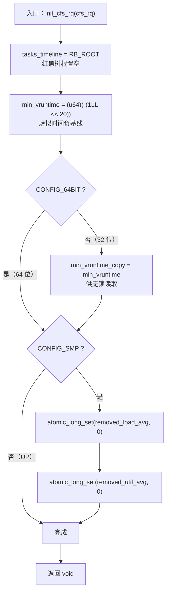
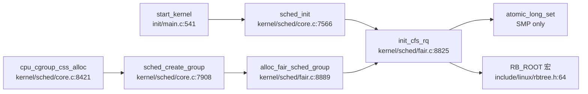

# 每日内核源码分析：init_cfs_rq

- **日期**：2026-11-07
- **子系统**：kernel/sched
- **源文件**：kernel/sched/fair.c:8825-8836
- **类型**：function
- **内核版本**：Linux 4.9.337（linux-4.9.y，HEAD `87a72e81764d`）

---

## 1. 功能作用

`init_cfs_rq()` 是 CFS（完全公平调度器）运行队列的**早期初始化入口**。它不做内存分配，也不获取运行队列锁，只负责给一个刚刚创建、尚未对外发布的 `struct cfs_rq` 写入必须显式初始化的字段：

1. 把红黑树根 `tasks_timeline` 置为空树，之后 `enqueue_entity()` 才能安全地插入调度实体；
2. 设置虚拟时间基线 `min_vruntime`，为后续 `update_min_vruntime()`、`place_entity()` 和跨 CPU 迁移时的 `vruntime` 归一化提供起点；
3. 在 32 位内核上同步 `min_vruntime_copy`，供无锁读取路径使用；
4. 在 SMP 内核上把 `removed_load_avg` / `removed_util_avg` 清零，避免新队列继承垃圾的“待扣减负载”。

典型调用场景有两个：

- 系统启动时，`sched_init()` 为每个 possible CPU 的根运行队列 `rq->cfs` 调用一次；
- 创建 task group（cgroup CPU 子系统）时，`alloc_fair_sched_group()` 为每个 possible CPU 的组调度队列调用一次。

它初始化的是“队列骨架”，不是完整运行队列。大量字段依赖调用方使用 `kzalloc()` 或静态零初始化，`init_cfs_rq()` 只补齐那些**不能依赖零值语义**的字段。

## 2. 关键数据结构

### 2.1 `struct cfs_rq`（`kernel/sched/sched.h:391`）

CFS 在每个 CPU、每个 task group 上各有一个 `cfs_rq`。本函数直接触碰的字段：

| 字段 | 作用 | 本函数中的处理 |
|------|------|----------------|
| `tasks_timeline` | 以 `se->vruntime` 为键的红黑树根，保存可运行实体 | `RB_ROOT`，即 `{ NULL }`，构造空树 |
| `min_vruntime` | 队列的虚拟时间下界/基线，单调推进 | 写成 `(u64)(-(1LL << 20))`，约 `-1.048 ms` 的有符号值 |
| `min_vruntime_copy` | 仅 `!CONFIG_64BIT`；与 `min_vruntime` 配对，供 32 位平台无锁稳定读取 | 初始化为 `min_vruntime` 的副本 |
| `removed_load_avg` | 仅 `CONFIG_SMP`；待从队列负载均值中扣减的 load 和 | `atomic_long_set(..., 0)` |
| `removed_util_avg` | 仅 `CONFIG_SMP`；待扣减的 util 和 | `atomic_long_set(..., 0)` |

本函数**没有**初始化、但依赖调用方零初始化的关键字段包括：

- `load`、`nr_running`、`exec_clock`；
- `rb_leftmost`、`curr`、`next`、`last`、`skip`；
- `avg`、`runnable_load_sum`、`runnable_load_avg`；
- `rq`、`tg`、`leaf_cfs_rq_list`、CFS bandwidth 相关字段。

其中 `rb_leftmost` 尤其重要：`pick_next_entity()` 会直接使用这棵红黑树的最左节点缓存；如果 `cfs_rq` 所在内存没有被清零，仅调用 `init_cfs_rq()` 并不能保证 `rb_leftmost == NULL`。

### 2.2 `struct sched_entity`（`include/linux/sched.h:1349`）

调度实体是红黑树的节点载体：

- `run_node`：嵌入 `tasks_timeline` 的 `rb_node`；
- `vruntime`：实体已经获得的虚拟运行时间，是红黑树的排序键；
- `my_q`：组调度实体“拥有”的下一级 `cfs_rq`，用于层级 CFS；
- `load`：实体权重，参与 `vruntime` 增量和负载计算。

`init_cfs_rq()` 只初始化队列，不初始化实体；实体由 `init_tg_cfs_entry()` / `init_entity_runnable_average()` 等负责。

### 2.3 `struct rq`（`kernel/sched/sched.h:618`）与 `struct task_group`（`kernel/sched/sched.h:271`）

- `struct rq` 内嵌 `struct cfs_rq cfs`，根队列在 `sched_init()` 中初始化。
- `struct task_group` 持有 `struct cfs_rq **cfs_rq` 和 `struct sched_entity **se` 数组，每个 possible CPU 一组；新组的队列来自 `kzalloc_node()`，随后调用本函数。

### 2.4 `struct rb_root`（`include/linux/rbtree.h:43`）与 `RB_ROOT`

```c
struct rb_root {
	struct rb_node *rb_node;
};
#define RB_ROOT	(struct rb_root) { NULL, }
```

`RB_ROOT` 是复合字面量，展开后等价于把 `tasks_timeline.rb_node` 置为 `NULL`；`RB_EMPTY_ROOT()` 通过读取该指针判断空树。

## 3. 核心逻辑流程图



关键决策点说明：

1. **空树初始化**：`tasks_timeline` 必须为空，否则首次 `enqueue_entity()` 会沿无效的 `rb_node` 链接；
2. **负基线**：`min_vruntime` 不是绝对时间戳，而是一个很小的有符号负值，用来给初始 `vruntime = 0` 的实体留出相对位置，避免新队列从 0 基线开始时的边界竞争；
3. **32 位分支**：只有 `!CONFIG_64BIT` 才存在 `min_vruntime_copy`，因为 64 位读取本身原子；
4. **SMP 分支**：`removed_load_avg` / `removed_util_avg` 只在 SMP 构建中存在，UP 构建没有这两个字段；
5. **无循环、无错误返回**：这是纯初始化函数，没有分配失败路径，也没有锁；
6. **条件编译而非运行时分支**：`CONFIG_64BIT`、`CONFIG_SMP` 在编译期决定代码形态；
7. **初始化边界**：函数结束后队列可被入队，但完整可用仍依赖 `init_tg_cfs_entry()` 等补齐 `rq`、`tg`、`curr` 和带宽字段。

## 4. 调用关系

### 4.1 调用者（who calls me）

Linux 4.9.337 源码中仅检索到 **2 个直接调用点**，以下全部列出：

| 调用方 | 所在文件 | 调用场景 |
|--------|----------|----------|
| `sched_init` | `kernel/sched/core.c:7640` | 启动阶段，为每个 possible CPU 初始化 `rq->cfs` |
| `alloc_fair_sched_group` | `kernel/sched/fair.c:8917` | 新建 task group 时，为每个 possible CPU 初始化组队列 |

对应的间接上游路径：

| 上游入口 | 路径 | 场景 |
|----------|------|------|
| `start_kernel` | `init/main.c:541` → `sched_init()` → `init_cfs_rq()` | 内核启动 |
| `cpu_cgroup_css_alloc` | `kernel/sched/core.c:8421` → `sched_create_group()` → `alloc_fair_sched_group()` → `init_cfs_rq()` | cgroup CPU 控制器创建新组 |
| `sched_create_group` | `kernel/sched/core.c:7908`，在 `alloc_fair_sched_group()` 内调用本函数 | 通用 task group 创建路径 |

### 4.2 被调用者（who I call）

- **核心路径调用**：无。本函数是叶子初始化函数，不调用调度器核心逻辑。
- **辅助调用**：
  - `atomic_long_set()`（仅在 `CONFIG_SMP` 下出现两次）：清零 `removed_load_avg`、`removed_util_avg`；
  - `RB_ROOT` 宏（编译期复合字面量）：清空红黑树根，不产生函数调用。
- **宏 / 内联**：
  - `atomic_long_set` 在 `include/asm-generic/atomic-long.h` 中按字长和内联方式展开；
  - `RB_ROOT` 直接展开为 `(struct rb_root){ NULL, }`。

### 4.3 调用关系图



## 5. 易错点 / 边界场景 / 设计权衡

1. **它不是“完整构造函数”**：`init_cfs_rq()` 只写 4 类字段，`rb_leftmost`、`curr`、`next`、`last`、`skip`、`load`、`avg` 等全部依赖调用方的零初始化。若用 `kmalloc()` 而非 `kzalloc()`，即使调用本函数，队列仍可能带着垃圾指针进入调度路径。
2. **`min_vruntime` 不能用普通无符号比较**：它被写成 `(u64)(-(1LL << 20))`，语义上接近 `-1.048 ms`。CFS 通过 `max_vruntime()` / `min_vruntime()` 先转成 `s64` 差值再比较；直接对 `u64` 使用 `<` 会把负基线误判为极大值。
3. **`min_vruntime_copy` 是 32 位平台的无锁读协议**：读者在 `migrate_task_rq_fair()` 中先读 copy、`smp_rmb()`、再读主值，直到两者一致。初始化阶段必须先写入 copy，否则读者可能无限自旋；本函数在队列发布前完成该写入。
4. **SMP 原子字段是“延迟扣减”机制**：`remove_entity_load_avg()` 把实体负载加到 `removed_*`，随后 `update_cfs_rq_load_avg()` 用 `atomic_long_xchg(..., 0)` 取走并扣减。新队列若不清零，会把不属于自己的负载算进去，导致负载均衡和频率选择偏差。
5. **没有锁，调用时机是契约的一部分**：函数假设 `cfs_rq` 尚未被其他 CPU 看到。根队列在 `sched_init()` 中于启动阶段初始化；组队列在 `alloc_fair_sched_group()` 中先 `kzalloc_node()` 再初始化，之后才挂到 `tg->cfs_rq[cpu]`。若在队列已上线后重复调用，会清空红黑树并破坏正在运行的实体。
6. **红黑树与 `rb_leftmost` 是两个独立状态**：`RB_ROOT` 只清 `tasks_timeline.rb_node`；`rb_leftmost` 是独立缓存，必须靠零初始化。只重置树根而不重置 `rb_leftmost`，`pick_next_entity()` 仍可能解引用旧节点。
7. **跨版本差异**：4.9 的 `min_vruntime` 初值和 `removed_*` 字段布局与后续版本可能不同；若迁移到 5.x/6.x，应重新核对结构体字段和初始化策略，不能直接复用本笔记的字段清单。

## 附：核心源码片段

```c
// kernel/sched/fair.c:8825-8836
void init_cfs_rq(struct cfs_rq *cfs_rq)
{
	cfs_rq->tasks_timeline = RB_ROOT;
	cfs_rq->min_vruntime = (u64)(-(1LL << 20));
#ifndef CONFIG_64BIT
	cfs_rq->min_vruntime_copy = cfs_rq->min_vruntime;
#endif
#ifdef CONFIG_SMP
	atomic_long_set(&cfs_rq->removed_load_avg, 0);
	atomic_long_set(&cfs_rq->removed_util_avg, 0);
#endif
}
```
