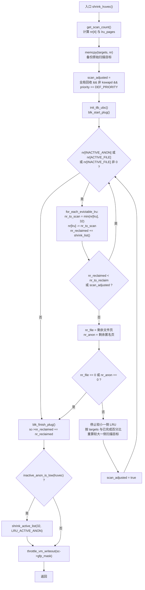
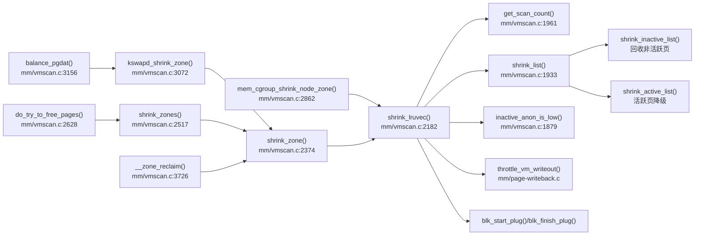

# 每日内核源码分析：shrink_lruvec

- **日期**：2026-11-08
- **子系统**：mm
- **源文件**：mm/vmscan.c:2182-2297（Linux v4.4）
- **类型**：function

---

## 1. 功能作用

`shrink_lruvec()` 是页面回收（page reclaim）路径中的**单个 LRU 向量回收器**。它同时服务于两条主干路径：

- **直接回收（direct reclaim）**：分配内存失败时由进程自己同步回收；
- **后台回收（kswapd）**：内核线程在内存水位偏低时异步回收。

一个 `lruvec` 代表「某个 zone 在某个 memcg 视角下」的 4 条 LRU 链表：匿名页/文件页 × 活跃/非活跃。`shrink_lruvec()` 的核心职责是：

1. 调用 `get_scan_count()` 决定这一轮每条 LRU 各扫描多少页（受 `swappiness`、`priority`、历史回收命中率、zone 大小等影响）；
2. 以 `SWAP_CLUSTER_MAX`（32 页）为批次调用 `shrink_list()`，避免长时间持锁与一次性产生过多 I/O；
3. 达到 `nr_to_reclaim` 后，按原始扫描目标**按比例修正**匿名页与文件页的剩余扫描量，防止一侧被"过度惩罚"；
4. 收尾时若匿名非活跃页偏少，则从活跃匿名链表中降级一批页；最后做脏页写回节流。

它本身不直接释放页面：真正把非活跃页摘链、尝试回写/换出、释放或放回 LRU 的工作在 `shrink_inactive_list()` / `shrink_page_list()` 中完成；对活跃链表，`shrink_list()` 只做降级（deactivate），不回收。

---

## 2. 关键数据结构

### `struct lruvec`（include/linux/mmzone.h:216）

```c
struct lruvec {
	struct list_head lists[NR_LRU_LISTS];
	struct zone_reclaim_stat reclaim_stat;
#ifdef CONFIG_MEMCG
	struct zone *zone;
#endif
};
```

- `lists[]`：4 条 LRU 链表（匿名/文件 × 活跃/非活跃），外加 `LRU_UNEVICTABLE`；实际可回收的只有前 4 条。
- `reclaim_stat`：记录最近扫描/回转（rotated）的页数，`get_scan_count()` 用它计算匿名页与文件页的相对价值。
- `zone`：仅在 `CONFIG_MEMCG` 下存在；`lruvec_zone()` 通过它（或 `container_of`）反查所属 zone。

### `struct scan_control`（mm/vmscan.c:61）

回收过程的"上下文/预算"：

| 字段 | 含义 |
|------|------|
| `nr_to_reclaim` | 本轮期望回收的页数 |
| `gfp_mask` | 触发回收的分配掩码，决定能否回写、能否换出等 |
| `order` | 分配阶数，高阶分配会配合内存规整 |
| `priority` | 扫描优先级；实际扫描量约为 `size >> priority`，越小越激进 |
| `may_writepage` / `may_unmap` / `may_swap` | 是否允许回写脏页 / 解除映射 / 换出匿名页 |
| `target_mem_cgroup` | memcg 定向回收的目标 cgroup |
| `nr_scanned` / `nr_reclaimed` | 累计扫描页数 / 已回收页数（跨层级累加） |

### `enum lru_list` 与索引算术（include/linux/mmzone.h:171）

```c
#define LRU_BASE   0
#define LRU_ACTIVE 1
#define LRU_FILE   2

enum lru_list {
	LRU_INACTIVE_ANON = LRU_BASE,                    /* 0 */
	LRU_ACTIVE_ANON   = LRU_BASE + LRU_ACTIVE,       /* 1 */
	LRU_INACTIVE_FILE = LRU_BASE + LRU_FILE,         /* 2 */
	LRU_ACTIVE_FILE   = LRU_BASE + LRU_FILE + LRU_ACTIVE, /* 3 */
	LRU_UNEVICTABLE,
	NR_LRU_LISTS
};
```

`shrink_lruvec()` 中大量使用 `lru = LRU_BASE/LRU_FILE`、`lru + LRU_ACTIVE` 这类**枚举值算术**来同时定位"非活跃/活跃"两条链表，依赖上述取值的连续性。

### 其他

- `SWAP_CLUSTER_MAX = 32UL`（include/linux/swap.h:157）：单次批处理上限。
- `struct blk_plug`：`blk_start_plug()/blk_finish_plug()` 把回收过程中产生的回写 I/O 合并提交，减少设备排队开销。
- `lru_pages`（输出参数）：本 lruvec 中被纳入扫描的 LRU 页总量，供上层按比例缩放 slab 回收量（`shrink_slab()`）。

---

## 3. 核心逻辑流程图



要点说明：

1. **先算预算再扫描**：`get_scan_count()` 一次性给出 4 条链表的扫描量，`targets[]` 保存原始值，后续比例修正都以它为基准。
2. **循环条件刻意排除 `LRU_ACTIVE_ANON`**：活跃匿名页本身不直接回收，只有非活跃匿名页耗尽（或被降级）才需要继续；活跃链表仅在被判定"非活跃不足"时降级。
3. **小步批处理**：每轮每条 LRU 最多扫 32 页，`shrink_list()` 对活跃链表只降级、对非活跃链表才真正回收。
4. **提前退出条件**：回收量未达标或处于 `scan_adjusted` 状态时继续；达标后才进入"比例修正"，且只修正一次。
5. **比例修正**：当文件页剩余目标多于匿名页（或反之）时，直接停掉较小一侧，把较大一侧的剩余目标压缩到"较小一侧已完成的百分比"，避免在已经失衡的 LRU 上继续猛扫。
6. **任一侧归零即 break**：注释称之为 "vindictive"——不在对手已经扫空后继续单方面进攻，保证只做一次比例微调。
7. **收尾再平衡**：匿名非活跃页不足时，从活跃匿名链表降级 32 页，维持 active/inactive 比例。
8. **写回节流**：`throttle_vm_writeout()` 防止回收路径疯狂产生脏页，把设备写队列打爆。

ASCII 兜底版本：

```text
shrink_lruvec
  -> get_scan_count(nr[], lru_pages)
  -> targets[] = nr[]
  -> scan_adjusted = global_reclaim && !current_is_kswapd && priority == DEF_PRIORITY
  -> init_tlb_ubc(); blk_start_plug()
  -> while (nr[INACTIVE_ANON] || nr[ACTIVE_FILE] || nr[INACTIVE_FILE])
       for lru in 0..3:
           if nr[lru]:
               nr_to_scan = min(nr[lru], 32)
               nr[lru] -= nr_to_scan
               nr_reclaimed += shrink_list(lru, nr_to_scan, lruvec, sc)
       if (nr_reclaimed < nr_to_reclaim || scan_adjusted) continue
       nr_file = nr[INACTIVE_FILE] + nr[ACTIVE_FILE]
       nr_anon = nr[INACTIVE_ANON] + nr[ACTIVE_ANON]
       if (!nr_file || !nr_anon) break
       较小一侧清零, 较大一侧按百分比重算, scan_adjusted = true
  -> blk_finish_plug()
  -> sc->nr_reclaimed += nr_reclaimed
  -> if (inactive_anon_is_low(lruvec)) shrink_active_list(32, LRU_ACTIVE_ANON)
  -> throttle_vm_writeout(sc->gfp_mask)
```

---

## 4. 调用关系

### 4.1 调用者（who calls me）

`shrink_lruvec()` 是 `vmscan.c` 内部的 `static` 函数，只有两个直接调用点，但通过上层路径覆盖了内核全部页面回收场景：

| 调用方 | 所在文件 | 调用场景 |
|--------|----------|----------|
| `shrink_zone()` → `shrink_lruvec()` | `mm/vmscan.c:2410` | 单个 zone（逐个 memcg 的 lruvec）回收；直接回收与 kswapd 的公共主路径 |
| `mem_cgroup_shrink_node_zone()` → `shrink_lruvec()` | `mm/vmscan.c:2892` | memcg soft limit 回收，`priority` 固定为 0，只针对目标 cgroup |
| `do_try_to_free_pages()` → `shrink_zones()` → `shrink_zone()` | `mm/vmscan.c:2628` / `2517` / `2374` | 直接回收入口（`try_to_free_pages` 调用） |
| `balance_pgdat()` → `kswapd_shrink_zone()` → `shrink_zone()` | `mm/vmscan.c:3156` / `3072` / `3113` | kswapd 后台回收主循环 |
| `__zone_reclaim()` → `shrink_zone()` | `mm/vmscan.c:3759` | 配置了 zone reclaim 时的本地 zone 回收 |

### 4.2 被调用者（who I call）

- **核心路径调用**
  - `get_scan_count()`：计算 4 条 LRU 的扫描配额，并输出 `lru_pages`。
  - `shrink_list()`：按 LRU 类型分派——活跃链表走 `shrink_active_list()` 降级，非活跃链表走 `shrink_inactive_list()` 回收。
  - `shrink_active_list()`：收尾时对 `LRU_ACTIVE_ANON` 做一次 32 页的降级。
  - `inactive_anon_is_low()`：判断匿名非活跃页是否不足，需要再平衡。
  - `throttle_vm_writeout()`（mm/page-writeback.c）：按脏页阈值节流。
- **辅助调用**
  - `blk_start_plug()` / `blk_finish_plug()`：合并回收产生的块层 I/O。
  - `init_tlb_ubc()`：初始化当前任务的批量 TLB flush 状态（`CONFIG_ARCH_WANT_BATCHED_UNMAP_TLB_FLUSH`）。
  - `memcpy()`：备份扫描目标。
- **宏 / 内联**
  - `global_reclaim(sc)`：是否全局回收（而非 memcg 定向回收）。
  - `current_is_kswapd()`：当前是否 kswapd 线程。
  - `for_each_evictable_lru(lru)`：遍历 0..3，跳过 `LRU_UNEVICTABLE`。
  - `min()`、`LRU_BASE/LRU_FILE/LRU_ACTIVE` 枚举算术。

### 4.3 调用关系图（Mermaid）



---

## 5. 易错点 / 边界场景 / 设计权衡

1. **枚举算术是隐式契约**。`lru += LRU_ACTIVE`、`lru + LRU_FILE` 依赖 `LRU_BASE=0 / LRU_ACTIVE=1 / LRU_FILE=2` 且 4 条可回收 LRU 连续排列。若新增 LRU 类型或调整顺序，比例修正代码会静默出错。
2. **`scan_adjusted` 不是"已调整"而是"允许继续不受目标限制"**。全局直接回收在 `DEF_PRIORITY` 下即使已达标也继续多扫一批（流式读写场景下 kswapd 跟不上）；memcg/kswapd 则达标后进入比例修正。初值计算与后续置位语义要区分清楚。
3. **`+1` 防除零并定义比例基准**。`scan_target = targets[anon 两条] + 1`，`percentage = nr_anon * 100 / scan_target`。分子是"剩余未扫"，因此 `100 - percentage` 表示"较小一侧已完成的百分比"，用它限制较大一侧，保证两类页按原始配额同步推进。
4. **`break` 条件体现"不欺负弱者"**。`if (!nr_file || !nr_anon) break;`：一侧已扫空时不再继续压榨另一侧；同时因为 `scan_adjusted` 只置位一次，整个调用最多做一次比例微调，避免震荡。
5. **批大小 32 的权衡**。`SWAP_CLUSTER_MAX` 既限制单次持 `lru_lock` 的时间，又让 `blk_plug` 有机会合并 I/O；过大会拉长延迟，过小则锁与调度开销占比过高。
6. **`lru_pages` 语义是"参与扫描的 LRU 规模"而非"已扫描量"**。`get_scan_count()` 在 `SCAN_FILE`/`SCAN_ANON` 模式下会把被排除类型的 `size` 置 0，因此上层 `shrink_slab()` 用它缩放 slab 回收量时，得到的是与当前回收方向一致的规模。
7. **`priority` 的指数效应**。扫描量约 `size >> priority`；`priority` 每加 1 扫描量减半，直至 `DEF_PRIORITY`（12）。低优先级（数值大）下若 `scan == 0`，`get_scan_count()` 的第二遍 `force_scan` 会兜底至少扫 32 页，避免小 zone/memcg 永远轮不到回收。
8. **活跃链表"扫描"不等于回收**。`shrink_list()` 对活跃 LRU 返回 0，只可能把页降级到非活跃链表；因此 `nr_reclaimed` 不会因扫活跃页而增加，循环可能多转几轮才达标。

---

## 附：核心源码片段

```c
// mm/vmscan.c:2179-2297 (Linux v4.4)
/*
 * This is a basic per-zone page freer.  Used by both kswapd and direct reclaim.
 */
static void shrink_lruvec(struct lruvec *lruvec, int swappiness,
			  struct scan_control *sc, unsigned long *lru_pages)
{
	unsigned long nr[NR_LRU_LISTS];
	unsigned long targets[NR_LRU_LISTS];
	unsigned long nr_to_scan;
	enum lru_list lru;
	unsigned long nr_reclaimed = 0;
	unsigned long nr_to_reclaim = sc->nr_to_reclaim;
	struct blk_plug plug;
	bool scan_adjusted;

	get_scan_count(lruvec, swappiness, sc, nr, lru_pages);

	/* Record the original scan target for proportional adjustments later */
	memcpy(targets, nr, sizeof(nr));

	/*
	 * Global reclaiming within direct reclaim at DEF_PRIORITY is a normal
	 * event that can occur when there is little memory pressure e.g.
	 * multiple streaming readers/writers. Hence, we do not abort scanning
	 * when the requested number of pages are reclaimed when scanning at
	 * DEF_PRIORITY on the assumption that the fact we are direct
	 * reclaiming implies that kswapd is not keeping up and it is best to
	 * do a batch of work at once. For memcg reclaim one check is made to
	 * abort proportional reclaim if either the file or anon lru has already
	 * dropped to zero at the first pass.
	 */
	scan_adjusted = (global_reclaim(sc) && !current_is_kswapd() &&
			 sc->priority == DEF_PRIORITY);

	init_tlb_ubc();

	blk_start_plug(&plug);
	while (nr[LRU_INACTIVE_ANON] || nr[LRU_ACTIVE_FILE] ||
					nr[LRU_INACTIVE_FILE]) {
		unsigned long nr_anon, nr_file, percentage;
		unsigned long nr_scanned;

		for_each_evictable_lru(lru) {
			if (nr[lru]) {
				nr_to_scan = min(nr[lru], SWAP_CLUSTER_MAX);
				nr[lru] -= nr_to_scan;

				nr_reclaimed += shrink_list(lru, nr_to_scan,
							    lruvec, sc);
			}
		}

		if (nr_reclaimed < nr_to_reclaim || scan_adjusted)
			continue;

		/*
		 * For kswapd and memcg, reclaim at least the number of pages
		 * requested. Ensure that the anon and file LRUs are scanned
		 * proportionally what was requested by get_scan_count(). We
		 * stop reclaiming one LRU and reduce the amount scanning
		 * proportional to the original scan target.
		 */
		nr_file = nr[LRU_INACTIVE_FILE] + nr[LRU_ACTIVE_FILE];
		nr_anon = nr[LRU_INACTIVE_ANON] + nr[LRU_ACTIVE_ANON];

		/*
		 * It's just vindictive to attack the larger once the smaller
		 * has gone to zero.  And given the way we stop scanning the
		 * smaller below, this makes sure that we only make one nudge
		 * towards proportionality once we've got nr_to_reclaim.
		 */
		if (!nr_file || !nr_anon)
			break;

		if (nr_file > nr_anon) {
			unsigned long scan_target = targets[LRU_INACTIVE_ANON] +
						targets[LRU_ACTIVE_ANON] + 1;
			lru = LRU_BASE;
			percentage = nr_anon * 100 / scan_target;
		} else {
			unsigned long scan_target = targets[LRU_INACTIVE_FILE] +
						targets[LRU_ACTIVE_FILE] + 1;
			lru = LRU_FILE;
			percentage = nr_file * 100 / scan_target;
		}

		/* Stop scanning the smaller of the LRU */
		nr[lru] = 0;
		nr[lru + LRU_ACTIVE] = 0;

		/*
		 * Recalculate the other LRU scan count based on its original
		 * scan target and the percentage scanning already complete
		 */
		lru = (lru == LRU_FILE) ? LRU_BASE : LRU_FILE;
		nr_scanned = targets[lru] - nr[lru];
		nr[lru] = targets[lru] * (100 - percentage) / 100;
		nr[lru] -= min(nr[lru], nr_scanned);

		lru += LRU_ACTIVE;
		nr_scanned = targets[lru] - nr[lru];
		nr[lru] = targets[lru] * (100 - percentage) / 100;
		nr[lru] -= min(nr[lru], nr_scanned);

		scan_adjusted = true;
	}
	blk_finish_plug(&plug);
	sc->nr_reclaimed += nr_reclaimed;

	/*
	 * Even if we did not try to evict anon pages at all, we want to
	 * rebalance the anon lru active/inactive ratio.
	 */
	if (inactive_anon_is_low(lruvec))
		shrink_active_list(SWAP_CLUSTER_MAX, lruvec,
				   sc, LRU_ACTIVE_ANON);

	throttle_vm_writeout(sc->gfp_mask);
}
```
