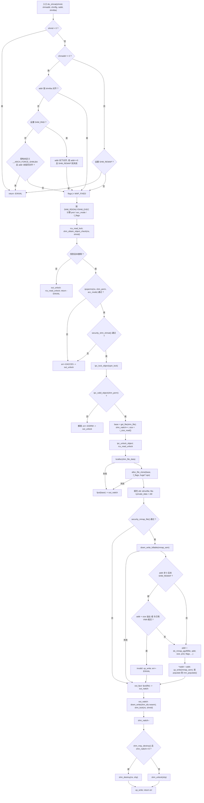
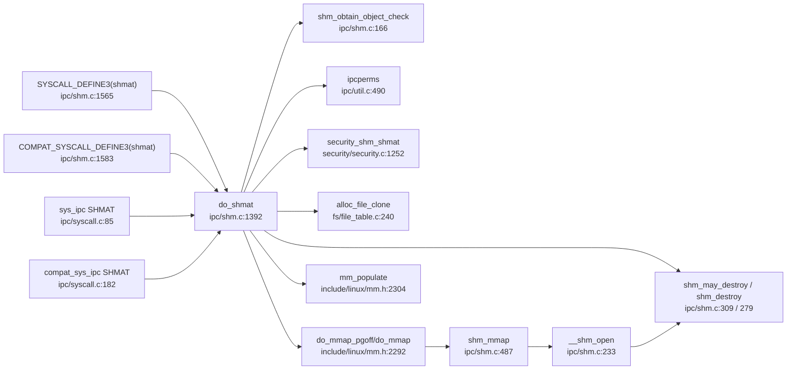

# 每日内核源码分析：do_shmat

- **日期**：2026-11-09
- **子系统**：ipc（System V 共享内存，与 mm 子系统深度耦合）
- **源文件**：ipc/shm.c:1392-1563（linux v4.19）
- **类型**：function

---

## 1. 功能作用

`do_shmat()` 是 System V 共享内存 `shmat(2)` 在内核中的**真正工作函数**，负责把一个已存在的共享内存段（由 `shmget` 创建的 `shmid` 标识）映射到当前进程的用户地址空间。

它的名字极具迷惑性：注释明确写着 **"Despite the name, this is NOT a direct system call entrypoint"**。因为它需要把映射结果地址通过内核指针 `raddr` 回传，并且对齐粒度 `shmlba` 由架构决定（ARM 上为 `4 * PAGE_SIZE`，用于避免 VIVT cache alias），所以真正的系统调用入口 `SYSCALL_DEFINE3(shmat)`、`COMPAT_SYSCALL_DEFINE3(shmat)` 以及老的 `sys_ipc()` 复用入口都只是薄包装。

一次成功的调用会完成四件事：

1. **地址合法性处理**：按 `SHM_RND` 向下对齐、按 `SHM_REMAP` 决定是否允许覆盖已有 VMA；
2. **权限与安全检查**：`ipcperms()` 检查 `shm_perm` 的读写执行位，`security_shm_shmat()` 走 LSM 钩子；
3. **构造"外层 file"**：为本次 attach 克隆一个独立的 `struct file`，其 `private_data` 指向新分配的 `struct shm_file_data`，再以该 file 为参数执行 `do_mmap_pgoff()` 建立 VMA；
4. **维护 attach 计数**：先在 `shmid_kernel` 上临时 `shm_nattch++` 占位，防止并发 `IPC_RMID` 把段拆掉；映射完成（或失败）后在 `out_nattch` 中回退该计数，若此时计数归零且段已被标记删除，则立即销毁。

典型使用场景：数据库（Oracle/PostgreSQL）共享缓冲区、进程间大块数据共享、tmpfs/hugepage 共享内存（`is_file_hugepages()` 分支）。

---

## 2. 关键数据结构

### 2.1 `struct shmid_kernel`（ipc/shm.c:52-68，内核私有）

共享内存段的**元数据对象**，也是 IPC idr 中挂载的对象：

| 字段 | 含义 |
|------|------|
| `struct kern_ipc_perm shm_perm` | 通用 IPC 权限块（含 `id`、`key`、`mode`、`cuid/cgid`、自旋锁 `lock`、`deleted` 标志），是 RCU/idr 管理的载体 |
| `struct file *shm_file` | 指向**真正的** shmem/tmpfs 文件（每个段只有一份） |
| `unsigned long shm_nattch` | 当前 attach 数量；0 且已 `IPC_RMID` 时触发销毁 |
| `unsigned long shm_segsz` | 段大小（字节） |
| `time64_t shm_atim/dtim/ctim` | 最近 attach / detach / 变更时间 |
| `struct pid *shm_cprid/lprid` | 创建者 / 最后操作者 pid |
| `struct user_struct *mlock_user` | `SHM_LOCK` 锁定内存时的记账用户 |
| `struct task_struct *shm_creator` + `shm_clist` | 创建者及其链表，用于进程退出时清理 |

### 2.2 `struct shm_file_data`（ipc/shm.c:74-79）

每次 attach 生成的**外层 file 的私有数据**，把"本次映射"与"段本体"解耦：

```c
struct shm_file_data {
    int id;                                  /* shmid，用于回查 shmid_kernel */
    struct ipc_namespace *ns;                /* 所属 IPC 命名空间 */
    struct file *file;                       /* 真正的 shmem 文件（持有引用） */
    const struct vm_operations_struct *vm_ops; /* 下层文件 mmap 后产生的 vm_ops */
};
#define shm_file_data(file) (*((struct shm_file_data **)&(file)->private_data))
```

> 注意 `file->private_data` 被复用为 `struct file *`（见 `shm_file_data()` 宏），这是 VFS 中少见的"私有数据套娃"用法。

### 2.3 两套 file/vm 操作表

- `shm_file_operations`（ipc/shm.c:554）：`.mmap = shm_mmap`、`.release = shm_release`、`.fsync`、`.get_unmapped_area`、`.fallocate`。
- `shm_file_operations_huge`（ipc/shm.c:567）：内容与普通版相同，**仅用于让 `is_file_shm_hugepages()` 能通过 `f_op` 指针区分 hugepage 映射**（见 1578 行比较）。
- `shm_vm_ops`（ipc/shm.c:581）：`.open = shm_open`、`.close = shm_close`、`.fault`、`.split`、`.pagesize`，NUMA 下还有 `.set_policy/.get_policy`。

### 2.4 关键宏与常量

- `shm_ids(ns)` = `(ns)->ids[IPC_SHM_IDS]`：每个 IPC namespace 一套 idr/rhashtable/rwsem。
- `SHM_DEST`(01000)：段已被 `IPC_RMID`，最后一个 detach 时销毁。
- `SHMLBA`：attach 地址对齐粒度；ARM 定义为 `4 * PAGE_SIZE` 并定义 `__ARCH_FORCE_SHMLBA`（arch/arm/include/asm/shmparam.h:10-15），强制走 SHMLBA 检查。
- `COMPAT_SHMLBA`：32 位兼容进程在 64 位内核上的对齐粒度（arch/arm64 为 `4 * PAGE_SIZE`）。

---

## 3. 核心逻辑流程图



关键决策点说明：

1. **对齐分支**：`SHM_RND` 把用户给的任意地址向下取整到 `shmlba` 边界；但若取整后变成 0 且同时要求 `SHM_REMAP`，必须拒绝——否则会试图在 NULL 处覆盖映射。
2. **`__ARCH_FORCE_SHMLBA` 的意义**：未定义的架构（如 x86，页大小即 cache 行大小）只要求页对齐；ARM 这类 VIPT/VIVT cache 架构要求 4 页对齐以避免 alias，因此宏存在时直接 `goto out`。
3. **`SHM_REMAP` 语义**：表示"即使目标区间已有映射也强行覆盖"。在未给 `addr` 时它没有意义，直接 `-EINVAL`。
4. **临时 `shm_nattch++`**：在释放自旋锁/RCU 之前先把计数加上，相当于"占位引用"，防止并发的 `shmctl(IPC_RMID)` 看到计数为 0 而立刻 `shm_destroy()`，把 `shp->shm_file` 释放掉。
5. **`get_file(shp->shm_file)`**：把真正的 shmem 文件引用住，保证后续 `alloc_file_clone()` 以及 VMA 生命周期内该 file 不会失效。
6. **`out_nattch` 回退**：无论成功失败都回到这里减计数；若映射失败且段已 `SHM_DEST`，这次 `-1` 会让计数归零，从而在 `shm_ids.rwsem` 写锁下安全销毁。
7. **错误路径一致性**：`out_fput` 只 `fput(file)`，由 `shm_release()` 负责级联释放 `sfd->file` 与 `sfd`，避免重复释放。

---

## 4. 调用关系

### 4.1 调用者（who calls me）

| 调用方 | 所在文件 | 调用场景 |
|--------|----------|----------|
| `SYSCALL_DEFINE3(shmat)` | ipc/shm.c:1565 | 原生 `shmat(2)`，传入 `SHMLBA`，成功后 `force_successful_syscall_return()` 防止高位地址被当成 errno |
| `COMPAT_SYSCALL_DEFINE3(shmat)` | ipc/shm.c:1583 | 32 位兼容进程，传入 `compat_ptr()` 与 `COMPAT_SHMLBA` |
| `sys_ipc()` 的 `SHMAT` 分支 | ipc/syscall.c:85 | 老的 16/32 位复用系统调用 `sys_ipc` |
| `compat_sys_ipc()` 的 `SHMAT` 分支 | ipc/syscall.c:182 | 兼容模式下的旧 `sys_ipc`，额外做 `compat_ptr()` |
| `do_shmat()` 声明/ENOSYS stub | include/linux/shm.h:17 / :27 | 未开启 `CONFIG_SYSVIPC` 时返回 `-ENOSYS` |

> 注意 `do_shmat` 没有 `EXPORT_SYMBOL`，它是内核内部接口，模块无法直接调用。

### 4.2 被调用者（who I call）

**核心路径调用**

- `shm_obtain_object_check()`（ipc/shm.c:166）：在 `shm_ids` 的 idr 中按 id 查找并 `container_of` 成 `shmid_kernel`，不做加锁（调用者持有 RCU）。
- `ipcperms()`（ipc/util.c:490）：根据 euid/egid 与 `kern_ipc_perm` 的 mode 计算 granted_mode，必要时检查 `CAP_IPC_OWNER`。
- `security_shm_shmat()`（security/security.c:1252）：LSM 钩子（SELinux/AppArmor 的 `shm_shmat`）。
- `alloc_file_clone()`（fs/file_table.c:240）：复用 base file 的 `f_path`/`f_mapping` 克隆出新的 `struct file`，并绑定 `shm_file_operations[_huge]`。
- `do_mmap_pgoff()` → `do_mmap()`（include/linux/mm.h:2292 / mm/mmap.c）：真正建立 VMA；内部还会回调 `shm_mmap()` → `__shm_open()` 使 `shm_nattch` 再加 1。
- `mm_populate()` → `__mm_populate()`（include/linux/mm.h:2304 / mm/gup.c:1233）：`MAP_POPULATE` 时预取页表。

**辅助/同步调用**

- `ipc_lock_object()`（ipc/util.h:180）= `spin_lock(&perm->lock)`；`ipc_valid_object()`（ipc/util.h:209）检查 `perm->deleted`。
- `shm_lock()`（ipc/shm.c:180）：RCU 查 idr → 自旋锁 → 校验有效性，返回已加锁对象。
- `down_write_killable(&current->mm->mmap_sem)`：持有 `mmap_sem` 写锁期间修改 VMA 树。
- `find_vma_intersection()`（include/linux/mm.h:2408）：防止 `MAP_FIXED` 静默覆盖已有映射。
- `get_file()` / `fput()` / `kzalloc()` / `kfree()` / `i_size_read()` / `file_inode()`。
- `shm_may_destroy()`（ipc/shm.c:309）、`shm_destroy()`（ipc/shm.c:279）、`shm_unlock()`（宏）。

**宏 / 内联**

- `shm_file_data(file)`、`shm_ids(ns)`、`is_file_hugepages()`、`IS_ERR_VALUE()`、`PTR_ERR()`。
- `security_mmap_file()` 在 `CONFIG_SECURITY` 关闭时为空内联。

### 4.3 调用关系图



---

## 5. 易错点 / 边界场景 / 设计权衡

1. **`shm_nattch` 的"临时占位"极易误读**：`do_shmat` 里的 `shm_nattch++` 并不是最终 attach 计数（真正的 +1 发生在 `shm_mmap → __shm_open`）。它只是防止在"查找到对象"到"建立映射"这段窗口内被 `IPC_RMID` 销毁；`out_nattch` 的 `--` 必须与它配对，否则会泄漏计数导致段永远无法销毁。
2. **ID 复用（ID reuse）检测**：`sfd->file` 与 `shp->shm_file` 的比较（`__shm_open`，ipc/shm.c:246）用于识别"shmid 已被删除并被新段复用"的场景，典型触发者是 `remap_file_pages()` 模拟路径——它只靠 file 引用重新 `->mmap()`，此时 `shmid` 已不代表原来的段。
3. **锁顺序**：`do_shmat` 先 `rcu_read_lock` + `ipc_lock_object`（自旋锁）完成引用/计数，再 `rcu_read_unlock`，之后才获取 `mmap_sem`（可能睡眠）；最后 `out_nattch` 再取 `shm_ids.rwsem`（写锁）→ `shm_lock`（自旋锁）。**自旋锁内绝不做 `do_mmap` 这类可能睡眠的操作**，这是把"引用保护"和"实际映射"拆成两段的原因。
4. **`#ifndef __ARCH_FORCE_SHMLBA` 的条件编译陷阱**：x86 上 `addr & ~PAGE_MASK` 才失败；ARM 上由于宏存在，只要 `addr` 未按 `SHMLBA` 对齐、且未设置 `SHM_RND`，就会直接失败——同一份代码在不同架构行为不同。
5. **`*raddr = addr` 在错误路径也会写入**：`do_mmap_pgoff` 返回 `IS_ERR_VALUE` 时仍先赋值再判断，`addr` 其实是个错误编码。这是历史遗留；调用者必须先看返回值 `err` 再看 `raddr`。
6. **`force_successful_syscall_return()` 的必要性**：用户态 `shmat` 返回的地址可能落在 `-4095..-1` 区间（高地址映射），若不做标记，syscall 返回路径会把它误判为 `errno`。
7. **`MAP_FIXED` + `find_vma_intersection`**：内核不用 `MAP_FIXED_NOREPLACE`（4.19 尚未引入该 flag），而是显式检查区间相交，避免静默覆盖用户已有映射；溢出检查 `addr + size < addr` 防止 32 位回绕。
8. **hugepage 特判**：只有 `is_file_hugepages(base)` 为真才克隆 `shm_file_operations_huge`，从而让后续 `is_file_shm_hugepages()` 能区分；两者行为相同，纯属类型标记技巧。

---

## 附：核心源码片段

```c
/* ipc/shm.c:1385-1563 (linux v4.19, 部分注释略) */
/*
 * Fix shmaddr, allocate descriptor, map shm, add attach descriptor to lists.
 *
 * NOTE! Despite the name, this is NOT a direct system call entrypoint. The
 * "raddr" thing points to kernel space, and there has to be a wrapper around
 * this.
 */
long do_shmat(int shmid, char __user *shmaddr, int shmflg,
	      ulong *raddr, unsigned long shmlba)
{
	struct shmid_kernel *shp;
	unsigned long addr = (unsigned long)shmaddr;
	unsigned long size;
	struct file *file, *base;
	int err;
	unsigned long flags = MAP_SHARED;
	unsigned long prot;
	int acc_mode;
	struct ipc_namespace *ns;
	struct shm_file_data *sfd;
	int f_flags;
	unsigned long populate = 0;

	err = -EINVAL;
	if (shmid < 0)
		goto out;

	if (addr) {
		if (addr & (shmlba - 1)) {
			if (shmflg & SHM_RND) {
				addr &= ~(shmlba - 1);  /* round down */
				if (!addr && (shmflg & SHM_REMAP))
					goto out;
			} else
#ifndef __ARCH_FORCE_SHMLBA
				if (addr & ~PAGE_MASK)
#endif
					goto out;
		}
		flags |= MAP_FIXED;
	} else if ((shmflg & SHM_REMAP))
		goto out;

	if (shmflg & SHM_RDONLY) {
		prot = PROT_READ;
		acc_mode = S_IRUGO;
		f_flags = O_RDONLY;
	} else {
		prot = PROT_READ | PROT_WRITE;
		acc_mode = S_IRUGO | S_IWUGO;
		f_flags = O_RDWR;
	}
	if (shmflg & SHM_EXEC) {
		prot |= PROT_EXEC;
		acc_mode |= S_IXUGO;
	}

	ns = current->nsproxy->ipc_ns;
	rcu_read_lock();
	shp = shm_obtain_object_check(ns, shmid);
	if (IS_ERR(shp)) {
		err = PTR_ERR(shp);
		goto out_unlock;
	}

	err = -EACCES;
	if (ipcperms(ns, &shp->shm_perm, acc_mode))
		goto out_unlock;

	err = security_shm_shmat(&shp->shm_perm, shmaddr, shmflg);
	if (err)
		goto out_unlock;

	ipc_lock_object(&shp->shm_perm);

	/* check if shm_destroy() is tearing down shp */
	if (!ipc_valid_object(&shp->shm_perm)) {
		ipc_unlock_object(&shp->shm_perm);
		err = -EIDRM;
		goto out_unlock;
	}

	/* 防止 shm_file 指针在 remap_file_pages() 模拟期间失效 */
	base = get_file(shp->shm_file);
	shp->shm_nattch++;
	size = i_size_read(file_inode(base));
	ipc_unlock_object(&shp->shm_perm);
	rcu_read_unlock();

	err = -ENOMEM;
	sfd = kzalloc(sizeof(*sfd), GFP_KERNEL);
	if (!sfd) {
		fput(base);
		goto out_nattch;
	}

	file = alloc_file_clone(base, f_flags,
			  is_file_hugepages(base) ?
				&shm_file_operations_huge :
				&shm_file_operations);
	err = PTR_ERR(file);
	if (IS_ERR(file)) {
		kfree(sfd);
		fput(base);
		goto out_nattch;
	}

	sfd->id = shp->shm_perm.id;
	sfd->ns = get_ipc_ns(ns);
	sfd->file = base;
	sfd->vm_ops = NULL;
	file->private_data = sfd;

	err = security_mmap_file(file, prot, flags);
	if (err)
		goto out_fput;

	if (down_write_killable(&current->mm->mmap_sem)) {
		err = -EINTR;
		goto out_fput;
	}

	if (addr && !(shmflg & SHM_REMAP)) {
		err = -EINVAL;
		if (addr + size < addr)
			goto invalid;
		if (find_vma_intersection(current->mm, addr, addr + size))
			goto invalid;
	}

	addr = do_mmap_pgoff(file, addr, size, prot, flags, 0, &populate, NULL);
	*raddr = addr;
	err = 0;
	if (IS_ERR_VALUE(addr))
		err = (long)addr;
invalid:
	up_write(&current->mm->mmap_sem);
	if (populate)
		mm_populate(addr, populate);

out_fput:
	fput(file);

out_nattch:
	down_write(&shm_ids(ns).rwsem);
	shp = shm_lock(ns, shmid);
	shp->shm_nattch--;
	if (shm_may_destroy(ns, shp))
		shm_destroy(ns, shp);
	else
		shm_unlock(shp);
	up_write(&shm_ids(ns).rwsem);
	return err;

out_unlock:
	rcu_read_unlock();
out:
	return err;
}
```
