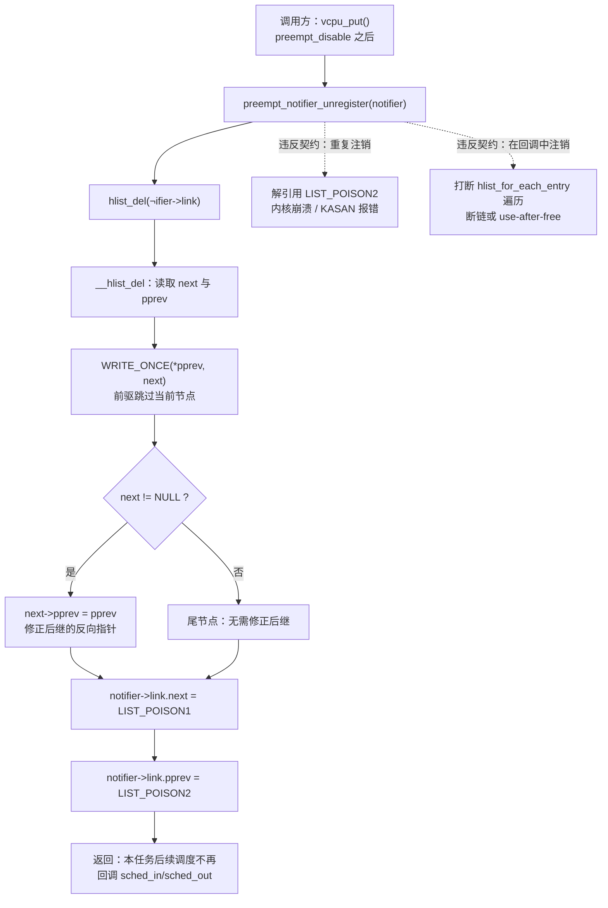
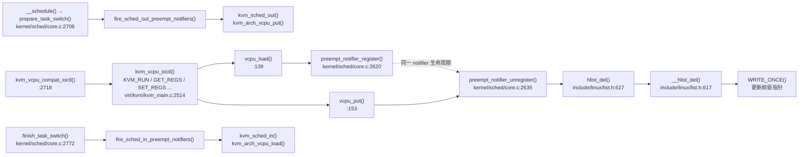

# 每日内核源码分析：preempt_notifier_unregister

- **日期**：2026-11-10
- **子系统**：kernel/sched
- **源文件**：kernel/sched/core.c:2635-2638
- **类型**：function（导出符号，`EXPORT_SYMBOL_GPL`）

---

## 1. 功能作用

`preempt_notifier_unregister()` 是「抢占通知器」（preemption notifier）机制的注销入口：它把调用者此前通过 `preempt_notifier_register()` 挂到 **当前任务** `current->preempt_notifiers` 哈希链表上的节点摘除。注销完成后，该任务再次被调度器抢占或重新上 CPU 时，调度器不再调用该通知器的 `sched_out()` / `sched_in()` 回调。

这个函数本身只有一行 `hlist_del()`，但它是 KVM 虚拟化正确性链条上的关键一环。典型场景是 KVM 的 vCPU 线程：

1. 用户态执行 `KVM_RUN`，内核在 `vcpu_load()` 中调用 `preempt_notifier_register()`，把 `kvm_vcpu.preempt_notifier` 挂到当前 vCPU 线程的 `preempt_notifiers` 链表；
2. vCPU 线程在 guest 模式下运行，可能被更高优先级任务**抢占**；
3. 调度器在 `__schedule()` 中先调用 `fire_sched_out_preempt_notifiers(prev, next)`，KVM 的 `kvm_sched_out()` 借机执行 `kvm_arch_vcpu_put()`，把 vCPU 的硬件状态保存到内存；
4. vCPU 线程再次被调度上 CPU 时，`finish_task_switch()` 调用 `fire_sched_in_preempt_notifiers(current)`，KVM 的 `kvm_sched_in()` 执行 `kvm_arch_vcpu_load()`，在**新的 CPU** 上恢复 vCPU 状态；
5. `KVM_RUN` 返回用户态前，`vcpu_put()` 调用 `preempt_notifier_unregister()` 摘除通知器，之后该线程的正常调度不再触发 KVM 回调。

如果没有这套机制，vCPU 线程在 guest 运行期间被抢占后，KVM 可能来不及保存/迁移 vCPU 的 FPU、段寄存器、VMCS/VMCB 等 per-CPU 状态，导致 guest 状态损坏或跨 CPU 恢复错误。

## 2. 关键数据结构

### `struct preempt_notifier`（include/linux/preempt.h:282-285）

```c
struct preempt_notifier {
	struct hlist_node link;   /* 挂入 task_struct.preempt_notifiers 的链表节点 */
	struct preempt_ops *ops;  /* 回调函数表 */
};
```

- `link`：嵌入式哈希链表节点。因为挂在 `task_struct` 上，节点生命周期必须覆盖整个注册周期。
- `ops`：指向 `preempt_ops`，决定被调度时调用哪些函数。通常通过 `container_of()` 从该成员反推出宿主对象，例如 KVM 的 `preempt_notifier_to_vcpu()`。

### `struct preempt_ops`（include/linux/preempt.h:269-273）

```c
struct preempt_ops {
	void (*sched_in)(struct preempt_notifier *notifier, int cpu);
	void (*sched_out)(struct preempt_notifier *notifier,
			  struct task_struct *next);
};
```

- `sched_in`：任务即将被重新调度上 CPU 时调用，参数是目标 CPU 编号。**调用时未持有 rq 锁、中断已打开**。
- `sched_out`：任务刚被抢占时调用，参数是抢走 CPU 的下一个任务。**调用时持有 rq 锁、中断关闭**。这一上下文差异是接口契约的一部分，回调实现必须遵守。

### `task_struct.preempt_notifiers`（include/linux/sched.h:1514-1515）

```c
#ifdef CONFIG_PREEMPT_NOTIFIERS
	/* list of struct preempt_notifier: */
	struct hlist_head preempt_notifiers;
#endif
```

每个任务各有一条通知器链表，因此注册/注销天然是「per-task」语义：只能操作 `current` 自己的链表，不需要全局锁。

### `struct hlist_node` 与毒化指针（include/linux/list.h:617-632）

`hlist_del()` 的实现是：

```c
static inline void __hlist_del(struct hlist_node *n)
{
	struct hlist_node *next = n->next;
	struct hlist_node **pprev = n->pprev;

	WRITE_ONCE(*pprev, next);
	if (next)
		next->pprev = pprev;
}

static inline void hlist_del(struct hlist_node *n)
{
	__hlist_del(n);
	n->next = LIST_POISON1;
	n->pprev = LIST_POISON2;
}
```

- `hlist` 是「头指针 + 节点内 `pprev` 二级指针」结构，删除时只需改前驱的指针和后继的 `pprev`，时间复杂度 O(1)。
- `hlist_del()` 会把被删节点的 `next/pprev` 写成 `LIST_POISON1/2`，主动暴露「重复使用已删除节点」的 bug。对应的 `hlist_del_init()` 则会重新初始化节点，允许安全地重复删除。
- `WRITE_ONCE()` 保证编译器不会把这次写入拆分或重排，配合调用方的 `preempt_disable()` 形成单任务上下文下的可见性保证。

### 静态键 `preempt_notifier_key`（kernel/sched/core.c:2602）

```c
static struct static_key preempt_notifier_key = STATIC_KEY_INIT_FALSE;
```

- 初始为 false，`preempt_notifier_inc()/dec()` 在 KVM 创建/销毁 VM 时增减引用计数（`virt/kvm/kvm_main.c:665`、`:738`）。
- 调度器热路径用 `static_key_false(&preempt_notifier_key)` 做 jump label 判断：没有 VM 时，`fire_sched_*_preempt_notifiers()` 几乎退化为一条 nop，不产生遍历开销。
- 注意：`preempt_notifier_unregister()` **不检查**这个静态键，它只负责摘链；即便键为 false，摘链也必须正确完成。

## 3. 核心逻辑流程图



ASCII 兜底：

```text
preempt_notifier_unregister(notifier)
  |
  +-> hlist_del(&notifier->link)
        |
        +-> __hlist_del(n)
              next  = n->next
              pprev = n->pprev
              *pprev = next          // 前驱跳过 n
              if (next) next->pprev = pprev
        |
        +-> n->next  = LIST_POISON1  // 主动毒化
        +-> n->pprev = LIST_POISON2
  |
  +-> return (之后调度器不再回调该 notifier)
```

关键决策点：

1. **没有参数校验、没有加锁、没有静态键判断**：函数假定 `notifier` 一定处于已注册状态，且当前上下文就是注册它的任务。
2. **O(1) 摘链**：`hlist` 的双向二级指针设计使删除无需遍历，适合调度器这种对延迟敏感的场景。
3. **删除后毒化**：`LIST_POISON1/2` 不是空指针，重复注销会立刻以非法地址访问暴露问题，而不是静默破坏链表。
4. **注销与「不再回调」是同一件事**：摘链后，`fire_sched_in/out_preempt_notifiers()` 的 `hlist_for_each_entry()` 自然看不到该节点，无需额外状态位。
5. **失败路径不存在**：函数返回 `void`，调用者无法感知「节点本来就不在链表中」；这属于调用方契约责任。

## 4. 调用关系

### 4.1 调用者（who calls me）

在 Linux v4.9 中，直接调用者只有 KVM 的 vCPU 收尾路径：

| 调用方 | 所在文件 | 调用场景 |
|--------|----------|----------|
| `vcpu_put()` | `virt/kvm/kvm_main.c:153-161` | vCPU 线程结束一次「占用 vCPU」：先 `kvm_arch_vcpu_put()`，再 `preempt_notifier_unregister()`，最后解除 `vcpu->mutex` |
| `kvm_vcpu_ioctl()` 的 `out:` 标签 | `virt/kvm/kvm_main.c:2711` | 所有 vCPU ioctl（含 `KVM_RUN`、`KVM_GET_REGS`、`KVM_SET_REGS` 等）统一收尾 |
| `KVM_RUN` 分支 | `virt/kvm/kvm_main.c:2539-2543` | 进入 guest 前 `vcpu_load()`，`kvm_arch_vcpu_ioctl_run()` 返回后走 `out:` 执行 `vcpu_put()` |
| `kvm_vcpu_compat_ioctl()` | `virt/kvm/kvm_main.c:2718` | 32 位兼容路径，最终仍调用 `kvm_vcpu_ioctl()` |
| KVM 模块/VM 生命周期（间接） | `virt/kvm/kvm_main.c:665,738` | `kvm_create_vm()` 调 `preempt_notifier_inc()`，`kvm_destroy_vm()` 调 `preempt_notifier_dec()`，保证静态键在存在 VM 时为真 |

> 由于 `preempt_notifier_unregister()` 是 `EXPORT_SYMBOL_GPL`，树外 GPL 模块理论上也可以调用；但树内唯一用户是 KVM。

### 4.2 被调用者（who I call）

- **核心路径调用**：
  - `hlist_del()`（`include/linux/list.h:627`）——实际完成摘链；
  - `__hlist_del()`（`include/linux/list.h:617`）——被 `hlist_del()` 内联展开，修改前驱/后继指针；
  - `WRITE_ONCE()`（`include/linux/compiler.h`）——保证指针对前驱的写入是单次、不可拆分的。
- **辅助调用**：无。函数不分配内存、不加锁、不打印、不睡眠。
- **宏 / 内联**：
  - `LIST_POISON1` / `LIST_POISON2`——删除后写入的毒化地址；
  - `container_of()`——不在本函数内，但回调方（如 `preempt_notifier_to_vcpu()`）依赖它从 `link` 反推宿主结构。

### 4.3 调用关系图



## 5. 易错点 / 边界场景 / 设计权衡

1. **只能在 notifier 所属任务上下文调用**。链表是 `current->preempt_notifiers` 的 per-task 结构，`register` 和 `unregister` 都隐式操作「当前任务」。如果在 A 任务里注销属于 B 任务的 notifier，会摘错链表，造成 B 的任务链表损坏。
2. **绝不能在 `sched_in`/`sched_out` 回调内部注销自己**。内核注释明确写着 “This is *not* safe to call from within a preemption notifier.” 原因是 `fire_sched_*_preempt_notifiers()` 使用 `hlist_for_each_entry()` 正向遍历，删除当前节点会把 `next` 毒化成 `LIST_POISON1`，遍历器随后解引用它，导致断链或 use-after-free。
3. **`hlist_del()` vs `hlist_del_init()` 的选择**。这里用 `hlist_del()`，节点被毒化而不是重置。因此：
   - 重复调用 `preempt_notifier_unregister()` = 解引用 `LIST_POISON2`，会立刻崩溃；
   - 但 KVM 的 `preempt_notifier_init()` 会重新 `INIT_HLIST_NODE()`，`hlist_add_head()` 也会重写 `next/pprev`，所以「合法地重新注册」是安全的；
   - 选 `hlist_del()` 是「fail fast」的调试友好设计，而不是为了支持幂等注销。
4. **无锁设计依赖调用方关抢占**。函数内部不加锁，是因为约定调用者保证「当前任务不会在摘链过程中被调度走」：KVM 在 `vcpu_put()` 中先 `preempt_disable()`，再 `kvm_arch_vcpu_put()` 和 `preempt_notifier_unregister()`。若调用方忘记关抢占，理论上可能出现「刚判断完链表就被抢占、调度器并发遍历同一链表」的竞态。
5. **`sched_out` 与 `sched_in` 的上下文不对称**。`sched_out` 在 rq 锁持有、IRQ 关闭时执行，必须短小、不能睡眠；`sched_in` 在 rq 锁释放、IRQ 打开后执行，可以做一些更重的工作。回调实现若假设两者上下文相同，容易触发死锁或「scheduling while atomic」。
6. **静态键的引用计数粒度是 VM，不是 vCPU**。`preempt_notifier_inc()` 在 `kvm_create_vm()` 中调用一次，`dec()` 在 `kvm_destroy_vm()` 中调用一次。只要还有一个 VM 存在，所有任务调度都会走通知器遍历分支；注销本身不参与该计数。
7. **编译开关**。整组接口位于 `#ifdef CONFIG_PREEMPT_NOTIFIERS` 内，KVM 在 `arch/x86/kvm/Kconfig:26` 通过 `select PREEMPT_NOTIFIERS` 强制打开。关闭该配置时，`preempt_notifier_register/unregister` 根本不存在，调度器侧的回调也被空内联替代。

---

## 附：核心源码片段

```c
// kernel/sched/core.c:2602-2639
static struct static_key preempt_notifier_key = STATIC_KEY_INIT_FALSE;

void preempt_notifier_inc(void)
{
	static_key_slow_inc(&preempt_notifier_key);
}
EXPORT_SYMBOL_GPL(preempt_notifier_inc);

void preempt_notifier_dec(void)
{
	static_key_slow_dec(&preempt_notifier_key);
}
EXPORT_SYMBOL_GPL(preempt_notifier_dec);

/**
 * preempt_notifier_register - tell me when current is being preempted & rescheduled
 * @notifier: notifier struct to register
 */
void preempt_notifier_register(struct preempt_notifier *notifier)
{
	if (!static_key_false(&preempt_notifier_key))
		WARN(1, "registering preempt_notifier while notifiers disabled\n");

	hlist_add_head(&notifier->link, &current->preempt_notifiers);
}
EXPORT_SYMBOL_GPL(preempt_notifier_register);

/**
 * preempt_notifier_unregister - no longer interested in preemption notifications
 * @notifier: notifier struct to unregister
 *
 * This is *not* safe to call from within a preemption notifier.
 */
void preempt_notifier_unregister(struct preempt_notifier *notifier)
{
	hlist_del(&notifier->link);
}
EXPORT_SYMBOL_GPL(preempt_notifier_unregister);
```

关键上下游（节选）：

```c
// virt/kvm/kvm_main.c:139-161
int vcpu_load(struct kvm_vcpu *vcpu)
{
	int cpu;

	if (mutex_lock_killable(&vcpu->mutex))
		return -EINTR;
	cpu = get_cpu();
	preempt_notifier_register(&vcpu->preempt_notifier);
	kvm_arch_vcpu_load(vcpu, cpu);
	put_cpu();
	return 0;
}

void vcpu_put(struct kvm_vcpu *vcpu)
{
	preempt_disable();
	kvm_arch_vcpu_put(vcpu);
	preempt_notifier_unregister(&vcpu->preempt_notifier);
	preempt_enable();
	mutex_unlock(&vcpu->mutex);
}
```

```c
// kernel/sched/core.c:2641-2670 —— 调度器如何消费这些通知器
static void __fire_sched_in_preempt_notifiers(struct task_struct *curr)
{
	struct preempt_notifier *notifier;

	hlist_for_each_entry(notifier, &curr->preempt_notifiers, link)
		notifier->ops->sched_in(notifier, raw_smp_processor_id());
}

static __always_inline void fire_sched_in_preempt_notifiers(struct task_struct *curr)
{
	if (static_key_false(&preempt_notifier_key))
		__fire_sched_in_preempt_notifiers(curr);
}

static void
__fire_sched_out_preempt_notifiers(struct task_struct *curr,
				   struct task_struct *next)
{
	struct preempt_notifier *notifier;

	hlist_for_each_entry(notifier, &curr->preempt_notifiers, link)
		notifier->ops->sched_out(notifier, next);
}
```
