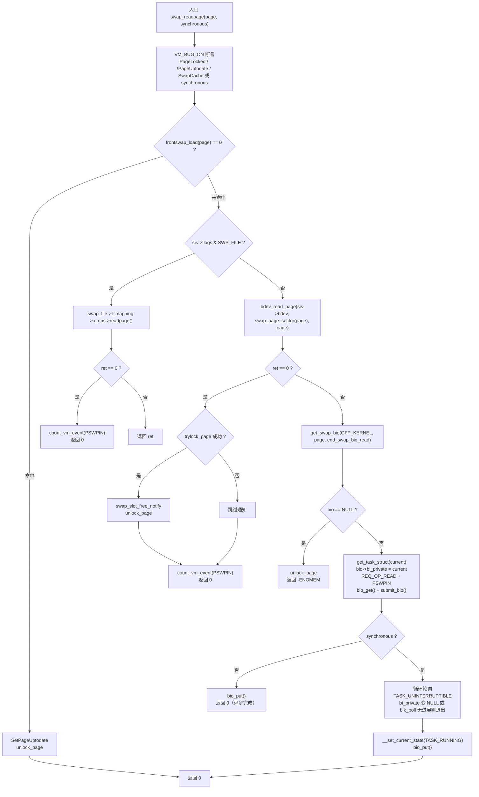
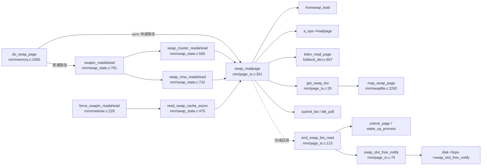

# 每日内核源码分析：swap_readpage

- **日期**：2026-11-11
- **内核版本**：Linux v4.19（linux-4.x.y 系列）
- **子系统**：mm（内存管理 / 换页）
- **源文件**：mm/page_io.c:351-420
- **类型**：function

---

## 1. 功能作用

`swap_readpage()` 是**换入（swap-in）路径的最后一段**：把一个已经加锁、且 `page->private` 中保存了 swap 槽位号（`swp_entry_t.val`）的 `struct page`，从交换后端读回内存，成功后置 `PG_uptodate` 并解锁，唤醒等待该页的任务。

它把"后端差异"统一收敛在同一个入口里，按优先级依次尝试四层通道：

1. **frontswap**：内存中的压缩交换缓存（zswap 等）。命中即完成，不触及块设备。
2. **SWP_FILE**：以文件为载体的交换区，走 `address_space_operations->readpage`。
3. **`bdev_read_page()`**：块设备驱动实现了 `block_device_operations->rw_page` 时，可用"页级同步读写"绕过通用 bio 层。
4. **通用异步 bio**：以上都不适用时，构造 `REQ_OP_READ` bio 提交给块层。

参数 `synchronous` 专门服务 `do_swap_page()` 的**独占页快速换入**优化：当交换设备被标记为 `SWP_SYNCHRONOUS_IO`（后端足够快，异步反而有调度开销）且该 swap 槽位引用计数为 1 时，可以跳过 swap cache，直接换入并**忙轮询**等待完成，避免进程睡眠/唤醒的开销。

典型调用场景：缺页异常换入（`do_swap_page`）、交换预读（`swapin_readahead`）、`madvise(MADV_WILLNEED)` 触发的强制换入。

---

## 2. 关键数据结构

### `struct page`（include/linux/mm_types.h）

| 字段/标志 | 在本函数中的语义 |
|---|---|
| `PG_locked` | 入口断言必须已加锁；I/O 完成回调负责解锁 |
| `PG_uptodate` | 数据可用的标志，成功路径置位 |
| `PG_swapcache` | 页是否挂在 swap cache；同步快速路径允许不在 cache 中 |
| `PG_error` | `end_swap_bio_read()` 在 I/O 失败时置位并清 `PG_uptodate` |
| `PG_readahead` | 由预读调用者在读入后设置，供下一次预读决策 |
| `page->private` | 保存 `swp_entry_t.val`，是定位 swap 槽位的唯一线索 |

### `struct swap_info_struct`（include/linux/swap.h:231-276）

交换区描述符。本函数用到：

- `flags`：`SWP_FILE`(1<<7) 表示文件型交换区；`SWP_BLKDEV`(1<<6) 表示块设备交换区；`SWP_SYNCHRONOUS_IO`(1<<11) 表示后端"快"到值得同步轮询。
- `bdev`：交换块设备；`swap_file`：文件型交换区对应的 `struct file`。
- `swap_map` / `max`：槽位使用计数与容量，配合 `__swap_count()` 判断独占页。

### `struct bio`（include/linux/blk_types.h）

- `bi_iter.bi_sector`：由 `map_swap_page()` 换算出的起始扇区。
- `bi_end_io`：完成回调，这里是 `end_swap_bio_read`。
- `bi_private`：保存 `current` 的 `task_struct *`，完成时置 `NULL` 作为"完成"信号。
- `bi_status`：I/O 错误状态。
- `bi_disk`：用于取 `disk->queue` 做 `blk_poll()`。

### `struct block_device_operations`（include/linux/blkdev.h:1978、1989）

- `int (*rw_page)(struct block_device *, sector_t, struct page *, unsigned int)`：页级直接读写。
- `void (*swap_slot_free_notify)(struct block_device *, unsigned long)`：通知驱动"该换出槽位可以提前释放"（典型用途：zram 释放压缩副本、SSD 减少无谓写入）。

### 其他

- `struct address_space` / `address_space_operations->readpage`：文件型交换区的读入口。
- `struct task_struct`：`get_task_struct(current)` 保活，避免 OOM killer 在缺页重试检查时访问已释放的任务。
- `swp_entry_t`、`pte_to_swp_entry()`、`__swap_count()`：从 PTE 到 swap 槽位、再到引用计数的换算链。

---

## 3. 核心逻辑流程图



**流程要点**

1. **三层前置短路**：frontswap → SWP_FILE → `bdev_read_page`，任一成功就直接返回；只有全部不适用/不支持时才落到通用 bio。
2. **断言顺序**：`!PageSwapCache(page) && !synchronous` 才报错——同步快速路径的页本来就不在 swap cache，这是刻意放行的组合。
3. **`bdev_read_page` 的返回约定**：返回 0 才算成功；返回 `-EOPNOTSUPP` 或其他非 0 值都会继续走 bio 路径，即"页级接口不可用"不等于致命错误。
4. **bio 生命周期**：提交前 `bio_get()` 多持一个引用，因为完成回调可能立刻执行并 `bio_put()`；轮询方在结束时再 `bio_put()`，避免 use-after-free。
5. **同步轮询**：仅 `synchronous == true` 时进入循环；`bi_private == NULL` 表示完成回调已跑过，`blk_poll()` 返回 false 表示队列不支持轮询或无新完成。退出后不睡眠，由调用方 `lock_page_or_retry()` 兜底（若尚未解锁则睡眠等待）。
6. **完成回调**：`end_swap_bio_read()` 负责 `SetPageUptodate`、`swap_slot_free_notify`、`unlock_page`、清 `bi_private`、`bio_put`、`wake_up_process`、`put_task_struct`。

---

## 4. 调用关系

### 4.1 调用者（who calls me）

| 调用方 | 所在文件 | 调用场景 |
|---|---|---|
| `do_swap_page` | `mm/memory.c:2900` | 交换页缺页异常；独占页且在 `SWP_SYNCHRONOUS_IO` 设备上时，于 2954 行直接 `swap_readpage(page, true)` |
| `swapin_readahead` | `mm/swap_state.c:791` | 换入预读总入口，按 VMA 场景分派到 cluster/VMA 预读 |
| `swap_cluster_readahead` | `mm/swap_state.c:566` | 按 `page_cluster` 窗口批量预读连续槽位，602 行以 `synchronous=false` 发起 |
| `swap_vma_readahead` | `mm/swap_state.c:732` | 基于 VMA 内 swap PTE 分布的智能预读，764 行发起异步读 |
| `read_swap_cache_async` | `mm/swap_state.c:475` | 保证页进入 swap cache 后发起读，483 行调用 |
| `force_swapin_readahead` | `mm/madvise.c:228` | `MADV_WILLNEED` 对匿名页范围做强制换入 |
| `force_shm_swapin_readahead` | `mm/madvise.c:242` | `MADV_WILLNEED` 对 shmem 页范围做强制换入 |

### 4.2 被调用者（who I call）

- **核心路径**
  - `frontswap_load()`（`include/linux/frontswap.h:88`）：查询前端交换缓存。
  - `mapping->a_ops->readpage()`：文件型交换区的读页方法。
  - `bdev_read_page()`（`fs/block_dev.c:657`）：调用 `bio->bi_disk->fops->rw_page()`。
  - `get_swap_bio()`（`mm/page_io.c:29`）：分配 bio、`map_swap_page()` 求扇区、`bio_add_page()` 挂页。
  - `submit_bio()` / `blk_poll()`：提交 I/O 与轮询完成。
  - `end_swap_bio_read()`（`mm/page_io.c:123`）：完成回调。
- **辅助调用**
  - `get_task_struct()` / `put_task_struct()`：任务保活。
  - `count_vm_event(PSWPIN)`：统计换入页数。
  - `unlock_page()` / `trylock_page()`、`wake_up_process()`、`bio_get()` / `bio_put()`。
- **宏 / 内联**
  - `PageSwapCache`、`PageLocked`、`PageUptodate`、`VM_BUG_ON_PAGE`。
  - `page_swap_info()` → `swp_swap_info()`（`mm/swapfile.c:3477`）。
  - `swap_page_sector()` → `__page_file_index()` / `swp_offset()`。
  - `bio_set_op_attrs()`、`READ_ONCE` / `WRITE_ONCE`。

### 4.3 调用关系图



---

## 5. 易错点 / 边界场景 / 设计权衡

1. **非 0 返回值不等于错误**：`bdev_read_page()` 返回 `-EOPNOTSUPP` 表示"驱动没实现 `rw_page`"，此时必须继续走通用 bio；代码用 `if (!ret)` 而不是 `if (ret < 0 && ret != -EOPNOTSUPP)`，把所有非 0 都当作"降级"，真实 I/O 错误也会被重试一次，属于"页级接口乐观降级"的取舍。
2. **同步路径的页不在 swap cache**：`do_swap_page` 先 `set_page_private(page, entry.val)` 再调用本函数，因此 `page_swap_info()` 仍能定位交换区；但 `swap_slot_free_notify()` 必须自己检查 `PageSwapCache()`，否则会误操作非 swapcache 页。
3. **`trylock_page()` 的原因**：`bdev_read_page()` 可能在返回前就已经同步完成并解锁页面，直接 `lock_page()` 会自我死锁；用 `trylock_page()` 拿不到锁就跳过槽位释放通知，属于"尽力而为"的优化。
4. **`bio_get()` / `bio_put()` 配对**：`submit_bio()` 后完成回调可能在任意 CPU 上立即执行；调用者必须先持有一个引用再提交，轮询结束后释放，否则存在 UAF/双重释放风险。
5. **轮询协议与内存序**：完成侧 `WRITE_ONCE(bio->bi_private, NULL)`，轮询侧 `READ_ONCE(bio->bi_private)`，用 `bi_private` 而不是 `bi_status` 做"完成"标志，避免与 `bio_put()` 释放竞争。
6. **`get_task_struct(current)` 的目的**：注释明确指出 OOM killer 可能在缺页重试检查中访问 `current`；若不保活，任务被回收后回调里的 `wake_up_process(waiter)` / `put_task_struct()` 可能触碰已释放对象。
7. **失败路径**：bio 分配失败只解锁并返回 `-ENOMEM`，页保持非 uptodate，由上层重试或报 OOM；块 I/O 失败由 `end_swap_bio_read()` 置 `PG_error`、清 `PG_uptodate`，上层据此决定 SIGBUS / 重试。
8. **前端缓存优先的代价**：frontswap 命中路径完全不碰磁盘，但要求后端把数据放在内存中；这也意味着同一页可能同时存在 frontswap 副本与磁盘副本，`swap_slot_free_notify()` 的通知语义必须由驱动保证幂等。

---

## 附：核心源码片段

```c
// mm/page_io.c:351-420 (Linux v4.19)
int swap_readpage(struct page *page, bool synchronous)
{
	struct bio *bio;
	int ret = 0;
	struct swap_info_struct *sis = page_swap_info(page);
	blk_qc_t qc;
	struct gendisk *disk;

	VM_BUG_ON_PAGE(!PageSwapCache(page) && !synchronous, page);
	VM_BUG_ON_PAGE(!PageLocked(page), page);
	VM_BUG_ON_PAGE(PageUptodate(page), page);
	if (frontswap_load(page) == 0) {
		SetPageUptodate(page);
		unlock_page(page);
		goto out;
	}

	if (sis->flags & SWP_FILE) {
		struct file *swap_file = sis->swap_file;
		struct address_space *mapping = swap_file->f_mapping;

		ret = mapping->a_ops->readpage(swap_file, page);
		if (!ret)
			count_vm_event(PSWPIN);
		return ret;
	}

	ret = bdev_read_page(sis->bdev, swap_page_sector(page), page);
	if (!ret) {
		if (trylock_page(page)) {
			swap_slot_free_notify(page);
			unlock_page(page);
		}

		count_vm_event(PSWPIN);
		return 0;
	}

	ret = 0;
	bio = get_swap_bio(GFP_KERNEL, page, end_swap_bio_read);
	if (bio == NULL) {
		unlock_page(page);
		ret = -ENOMEM;
		goto out;
	}
	disk = bio->bi_disk;
	/*
	 * Keep this task valid during swap readpage because the oom killer may
	 * attempt to access it in the page fault retry time check.
	 */
	get_task_struct(current);
	bio->bi_private = current;
	bio_set_op_attrs(bio, REQ_OP_READ, 0);
	count_vm_event(PSWPIN);
	bio_get(bio);
	qc = submit_bio(bio);
	while (synchronous) {
		set_current_state(TASK_UNINTERRUPTIBLE);
		if (!READ_ONCE(bio->bi_private))
			break;

		if (!blk_poll(disk->queue, qc))
			break;
	}
	__set_current_state(TASK_RUNNING);
	bio_put(bio);

out:
	return ret;
}
```
