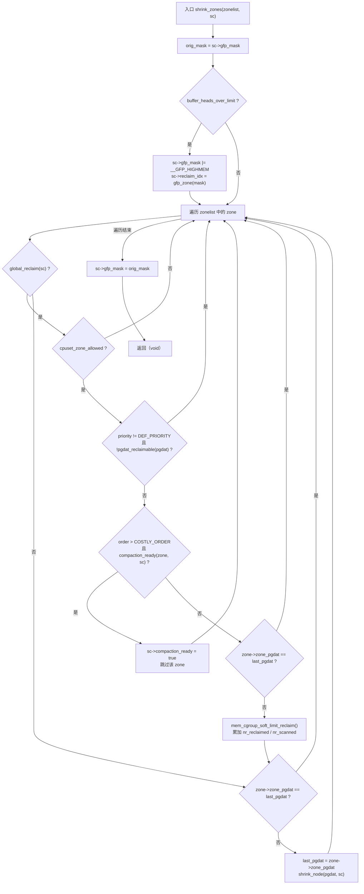
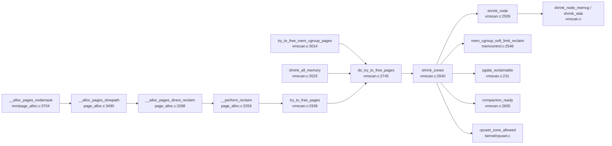

# 每日内核源码分析：shrink_zones

- **日期**：2026-11-12
- **子系统**：mm（内存管理 / 页面回收）
- **源文件**：mm/vmscan.c:2640-2727（Linux v4.9，linux-4.x.y 系列）
- **类型**：function（static，直接回收的「按节点择区」调度器）

---

## 1. 功能作用

`shrink_zones()` 是 **直接回收（direct reclaim）路径的前置调度器**：当进程在 `__alloc_pages_nodemask()` 中分配内存失败、进入慢速路径时，最终会经由 `do_try_to_free_pages()` 调用它。

它本身**不扫描任何页面**，职责是回答三个问题，然后把真正的扫描工作交给 `shrink_node()`：

1. **扫哪些 zone**：按分配请求对应的 zonelist 迭代，只考虑 `reclaim_idx`（由 `gfp_zone(gfp_mask)` 得出的最高可用 zone）以内、且在 `sc->nodemask` 允许的 NUMA 节点上的 zone。
2. **哪些 zone 不必扫**：global reclaim 下跳过 cpuset 不允许的 zone；跳过看起来「回收不动」的节点（`pgdat_reclaimable()` 为假）；对高阶分配，如果 `compaction_ready()` 判定压缩已经够用，则不再回收，直接置 `sc->compaction_ready`，让上层跳出回收循环去尝试内存压缩。
3. **每个节点只扫一次**：通过 `last_pgdat` 去重，避免 zonelist 按 zone 排序（`ZONELIST_ORDER_ZONE`）时同一个 NUMA 节点被重复 `shrink_node()`。

此外，它还做两件「顺带」的事：

- 对全局回收，先调用 `mem_cgroup_soft_limit_reclaim()`，从超过 soft limit 的 memcg 中「偷」页面，并把回收/扫描计数累加进 `sc`。
- 若系统 buffer_head 总量超过上限（`buffer_heads_over_limit`），临时给 `sc->gfp_mask` 打上 `__GFP_HIGHMEM`，让 HIGHMEM 也进入扫描范围（HIGHMEM 页可能钉住了低端内存里的 buffer_head），函数返回前恢复原始 mask。

> 典型调用场景：用户进程 `malloc`/缺页触发的直接回收、memcg 达到 limit 的 cgroup 回收、以及休眠（hibernation）前的 `shrink_all_memory()`。

---

## 2. 关键数据结构

### 2.1 `struct scan_control`（mm/vmscan.c:62-111）

回收过程的「上下文总线」，`shrink_zones` 读写的核心对象。

| 字段 | 语义 | 本函数中的作用 |
|------|------|----------------|
| `nr_to_reclaim` | 本次希望回收的页数 | 由上层判断是否达到目标（本函数不直接读） |
| `gfp_mask` | 触发回收的分配掩码 | 传入 `mem_cgroup_soft_limit_reclaim`；`buffer_heads_over_limit` 时被临时加 `__GFP_HIGHMEM` 后恢复 |
| `order` | 分配阶数 | 传给 soft limit 回收与 `compaction_ready` |
| `nodemask` | 允许的 NUMA 节点掩码 | 作为 zonelist 迭代的节点过滤条件 |
| `target_mem_cgroup` | 命中 limit 的 memcg；NULL 表示全局回收 | 决定 `global_reclaim(sc)` 的真假，从而走不同的跳过逻辑 |
| `priority` | 扫描优先级，0..DEF_PRIORITY | `!= DEF_PRIORITY` 时才允许按 `pgdat_reclaimable` 跳过节点 |
| `reclaim_idx` | 允许回收的最高 zone 类型 | zonelist 迭代上界；被 buffer_head 逻辑动态抬高 |
| `may_writepage/may_unmap/may_swap/may_thrash` | 回收动作开关 | 子函数使用，本函数不直接改 |
| `compaction_ready` | 某 zone 已适合压缩 | 本函数置位，供 `do_try_to_free_pages` 提前跳出 |
| `nr_scanned` | 已扫描页数 | 累加 soft limit 回收的扫描量 |
| `nr_reclaimed` | 已回收页数 | 累加 soft limit 回收的回收量 |

### 2.2 `struct zonelist` / `struct zoneref`（include/linux/mmzone.h:557-580）

```c
struct zoneref { struct zone *zone; int zone_idx; };
struct zonelist { struct zoneref _zonerefs[MAX_ZONES_PER_ZONELIST + 1]; };
```

`zonelist` 是「首选 zone + 降级备选 zone」的候选序列，第一个元素是分配目标，之后按优先级递减。`zoneref` 缓存 `zone_idx`，避免迭代时反复解引用大结构。`shrink_zones` 用 `for_each_zone_zonelist_nodemask(zone, z, zonelist, sc->reclaim_idx, sc->nodemask)` 遍历它。

### 2.3 `struct zone`（include/linux/mmzone.h:346 起）与 `pg_data_t`（typedef `pglist_data`，:597 起）

- `zone->zone_pgdat`：zone 所属 NUMA 节点，是 `last_pgdat` 去重与 `shrink_node()` 的入参来源。
- `zone->watermark[NR_WMARK]`：`compaction_ready()` 里用 `high_wmark_pages(zone) + compact_gap(order)` 判断是否已为压缩留足空闲页。
- `pgdat->node_id`：传给 memcg soft limit 回收。

### 2.4 关键全局变量

- `int buffer_heads_over_limit`（fs/buffer.c:3359）：buffer_head 总量是否超限，`free_buffer_head`/`buffer_init` 侧维护。
- `static bool global_reclaim(struct scan_control *sc)`（vmscan.c:154-195）：CONFIG_MEMCG 打开时为 `!sc->target_mem_cgroup`，否则恒真。

### 2.5 相关枚举 `enum zone_type`（mmzone.h:289）

`ZONE_DMA → ZONE_DMA32 → ZONE_NORMAL → ZONE_HIGHMEM → ZONE_MOVABLE → ZONE_DEVICE`，数值即 zone 优先级；`reclaim_idx` 用其数值作迭代上界。

---

## 3. 核心逻辑流程图



**关键决策点说明：**

1. **buffer_head 提权**：只影响本次调用的 `sc->gfp_mask` 与 `reclaim_idx`，返回前必须恢复；否则会污染调用方后续按原掩码进行的判断。
2. **cpuset 过滤**：全局回收要尊重 cpuset 的内存节点约束，使用 `GFP_KERNEL | __GFP_HARDWALL`。
3. **不可回收节点跳过**：`pgdat_reclaimable()` 判断「已扫描页数 < 可回收页数 × 6」；不满足说明该节点大部分页是钉住/不可回收的，交给 kswapd 慢慢轮询，避免直接回收者空转。
4. **首轮必扫**：`sc->priority == DEF_PRIORITY` 时不做上述跳过，保证第一次回收尝试始终覆盖所有候选节点，防止误判导致假性 OOM。
5. **compaction 让路**：仅对 `order > PAGE_ALLOC_COSTLY_ORDER(3)` 且开启 `CONFIG_COMPACTION`；`compaction_ready()` 结合 `compaction_suitable()` 和高水位判断，认为压缩能成功时停止回收，避免为大页分配做无谓的破坏性回收。
6. **节点去重**：`last_pgdat` 保证 zoned 排序的 zonelist 中同一节点只 `shrink_node()` 一次；对全局回收，第一个去重检查同时还保证 soft limit 回收每节点只做一次。
7. **memcg 软限制回收**：仅在 global reclaim 且通过去重后执行，属于「顺带收割」，其计数直接并入 `sc`。

**ASCII 兜底：**

```
shrink_zones(zonelist, sc)
  orig = sc->gfp_mask
  if buffer_heads_over_limit: promote __GFP_HIGHMEM; reclaim_idx = gfp_zone
  for each zone in zonelist[<=reclaim_idx, nodemask]:
      if global_reclaim:
          if !cpuset_zone_allowed: continue
          if priority != DEF_PRIORITY and !pgdat_reclaimable: continue
          if CONFIG_COMPACTION and order > COSTLY and compaction_ready:
                 sc->compaction_ready = 1; continue
          if zone->pgdat == last_pgdat: continue
          soft_limit_reclaim(...) -> sc->nr_reclaimed/nr_scanned
      if zone->pgdat == last_pgdat: continue
      last_pgdat = zone->pgdat
      shrink_node(zone->pgdat, sc)
  sc->gfp_mask = orig
```

---

## 4. 调用关系

### 4.1 调用者（who calls me）

| 调用方 | 所在文件 | 调用场景 |
|--------|----------|----------|
| `do_try_to_free_pages` | mm/vmscan.c:2761 | **唯一直接调用者**；在 `--sc->priority` 的循环里每轮调用一次 |
| `try_to_free_pages` | mm/vmscan.c:2938（经 2967 调用 `do_try_to_free_pages`） | 直接回收入口，来自页面分配慢速路径 |
| `__perform_reclaim` | mm/page_alloc.c:3259（3274 调 `try_to_free_pages`） | 分配器封装：设置 `PF_MEMALLOC`、做延迟统计 |
| `__alloc_pages_direct_reclaim` | mm/page_alloc.c:3288 | 慢速路径中的一次直接回收尝试 |
| `__alloc_pages_slowpath` / `__alloc_pages_nodemask` | mm/page_alloc.c:3490 / 3704 | 最终上游：伙伴系统分配失败后的 OOM 前回收 |
| `try_to_free_mem_cgroup_pages` | mm/vmscan.c:3014（经 3049 调用） | memcg 达到 limit 时的 limit 回收 |
| `shrink_all_memory` | mm/vmscan.c:3525（经 3547 调用） | 休眠（hibernation）前尽量回收内存 |

> 注意：kswapd 后台回收（`balance_pgdat` → `kswapd_shrink_node` → `shrink_node`）**不经过** `shrink_zones`，两者共用 `shrink_node` 作为下层引擎。

### 4.2 被调用者（who I call）

**核心路径调用**

- `shrink_node(pgdat, sc)`（vmscan.c:2509）：按 memcg 层级 + 全局两个维度真正扫描 LRU、回收 slab。
- `mem_cgroup_soft_limit_reclaim(pgdat, order, gfp_mask, &nr_soft_scanned)`（mm/memcontrol.c:2546）：从 soft limit 超额的 memcg 收割页面。
- `compaction_ready(zone, sc)`（vmscan.c:2605）：判断是否该让位给内存压缩；内部调用 `compaction_suitable()`、`zone_watermark_ok_safe()`。
- `pgdat_reclaimable(pgdat)`（vmscan.c:231）：基于 `NR_PAGES_SCANNED` 与可回收页数的启发式判断。
- `cpuset_zone_allowed(zone, GFP_KERNEL|__GFP_HARDWALL)`（kernel/cpuset.c）。

**辅助调用**

- `gfp_zone(gfp_mask)`（include/linux/gfp.h）：由掩码推导最高 zone。
- `global_reclaim(sc)`（vmscan.c:154/186）：判断全局/ memcg 回收。
- `zone_idx(zone)`、`min()`：内联工具。

**宏 / 内联**

- `for_each_zone_zonelist_nodemask(zone, z, zonelist, highidx, nodemask)`（mmzone.h:1001）：展开为 `first_zones_zonelist()` / `next_zones_zonelist()`（mm/mmzone.c）的迭代。
- `IS_ENABLED(CONFIG_COMPACTION)`：编译期分支，关闭压缩时代码消失。

### 4.3 调用关系图



---

## 5. 易错点 / 边界场景 / 设计权衡

1. **`gfp_mask` 的「借改」必须还原**：`buffer_heads_over_limit` 分支临时改写 `sc->gfp_mask` 和 `sc->reclaim_idx`，若提前 `return` 或后续新增分支漏掉恢复，会污染调用方的后续分配/回收判断。这是典型的「共享上下文就地修改」风险点。
2. **`last_pgdat` 的两处检查语义不同**：全局回收分支里的第一处去重（2697）同时挡住了「重复做 memcg soft limit 回收」；循环末尾的第二处（2716）才是挡住「重复 `shrink_node`」。把两者合并会改变 soft limit 回收的语义。
3. **默认优先级必须全扫**：`priority == DEF_PRIORITY` 时不应用 `pgdat_reclaimable` 跳过，否则可能因统计滞后（`NR_PAGES_SCANNED`）误判节点不可回收，直接跳到 OOM。
4. **compaction 让路有门槛**：只有 `order > PAGE_ALLOC_COSTLY_ORDER` 才考虑；小阶分配即使压缩可行也照常回收，避免频繁小分配被压缩路径拖慢。
5. **memcg 回收不走 cpuset/节点可回收性判断**：这些检查包在 `global_reclaim(sc)` 内，因为 memcg limit 回收的目标是「该 cgroup 的用量」，而不是全局节点健康度；对 memcg 场景套用全局启发式会误伤。
6. **无锁设计依赖 zone 稳定性**：函数本身不取 zone 锁，仅靠 zonelist 迭代与 `zone->zone_pgdat` 指针读取；真正的并发保护发生在 `shrink_node` 内部（lruvec 锁、page lock）。memory hotplug 场景下 zone 可能变化，故迭代宏与 `get_online_mems()` 等机制需要配合（本路径依赖分配器已做的稳定性保证）。
7. **返回值缺失**：`void` 返回，所有「是否回收到足够页面」的判断都靠 `sc->nr_reclaimed/nr_scanned` 由上层完成；调试时不能从返回值判断效果。

---

## 附：核心源码片段

```c
// mm/vmscan.c:2640-2727 (Linux v4.9)
static void shrink_zones(struct zonelist *zonelist, struct scan_control *sc)
{
	struct zoneref *z;
	struct zone *zone;
	unsigned long nr_soft_reclaimed;
	unsigned long nr_soft_scanned;
	gfp_t orig_mask;
	pg_data_t *last_pgdat = NULL;

	/*
	 * If the number of buffer_heads in the machine exceeds the maximum
	 * allowed level, force direct reclaim to scan the highmem zone as
	 * highmem pages could be pinning lowmem pages storing buffer_heads
	 */
	orig_mask = sc->gfp_mask;
	if (buffer_heads_over_limit) {
		sc->gfp_mask |= __GFP_HIGHMEM;
		sc->reclaim_idx = gfp_zone(sc->gfp_mask);
	}

	for_each_zone_zonelist_nodemask(zone, z, zonelist,
					sc->reclaim_idx, sc->nodemask) {
		if (global_reclaim(sc)) {
			if (!cpuset_zone_allowed(zone,
						 GFP_KERNEL | __GFP_HARDWALL))
				continue;

			if (sc->priority != DEF_PRIORITY &&
			    !pgdat_reclaimable(zone->zone_pgdat))
				continue;	/* Let kswapd poll it */

			if (IS_ENABLED(CONFIG_COMPACTION) &&
			    sc->order > PAGE_ALLOC_COSTLY_ORDER &&
			    compaction_ready(zone, sc)) {
				sc->compaction_ready = true;
				continue;
			}

			if (zone->zone_pgdat == last_pgdat)
				continue;

			nr_soft_scanned = 0;
			nr_soft_reclaimed = mem_cgroup_soft_limit_reclaim(zone->zone_pgdat,
						sc->order, sc->gfp_mask,
						&nr_soft_scanned);
			sc->nr_reclaimed += nr_soft_reclaimed;
			sc->nr_scanned += nr_soft_scanned;
			/* need some check for avoid more shrink_zone() */
		}

		/* See comment about same check for global reclaim above */
		if (zone->zone_pgdat == last_pgdat)
			continue;
		last_pgdat = zone->zone_pgdat;
		shrink_node(zone->zone_pgdat, sc);
	}

	/*
	 * Restore to original mask to avoid the impact on the caller if we
	 * promoted it to __GFP_HIGHMEM.
	 */
	sc->gfp_mask = orig_mask;
}
```
