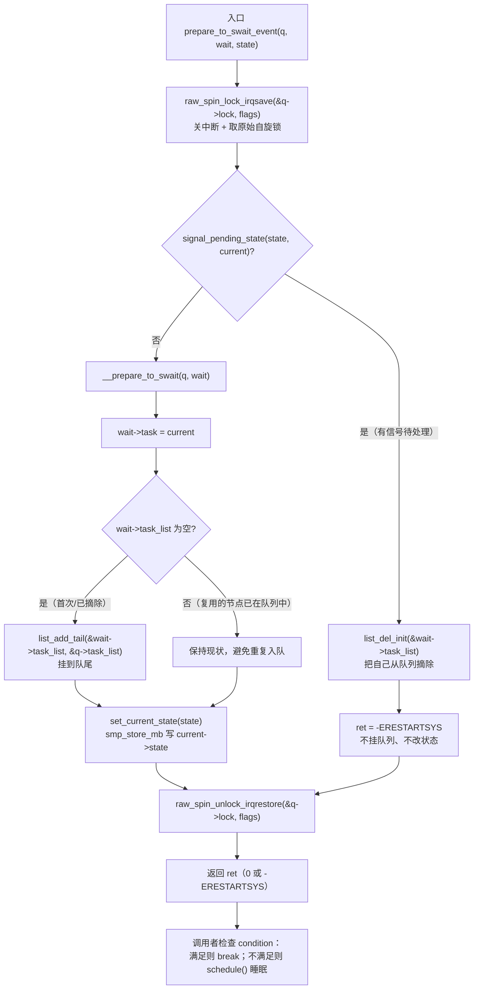
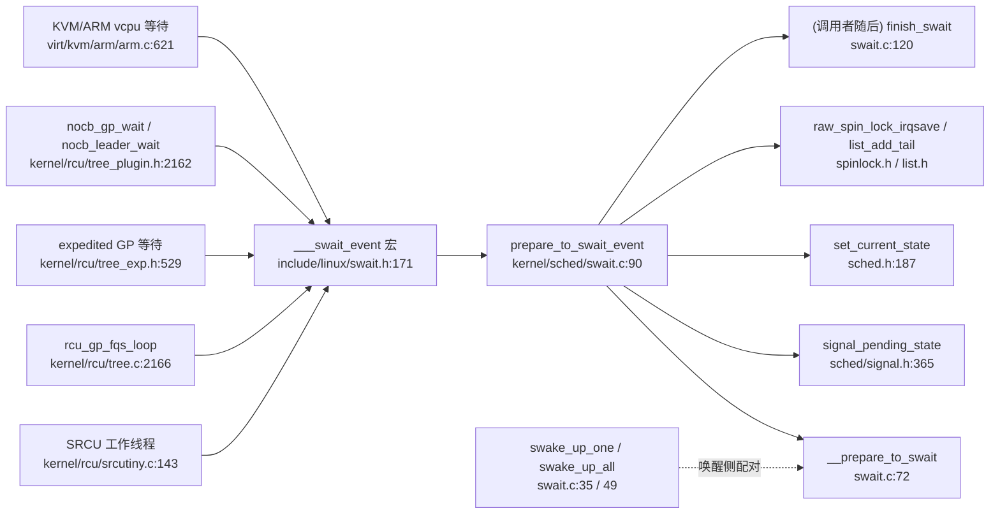

# 每日内核源码分析：prepare_to_swait_event

- **日期**：2026-11-13
- **子系统**：sched（kernel/sched/）
- **源文件**：kernel/sched/swait.c:90-110（定义），上下文 70-130
- **类型**：function（导出符号 `EXPORT_SYMBOL(prepare_to_swait_event)`）
- **内核版本**：v4.19（linux-4.x.y）

---

## 1. 功能作用

`prepare_to_swait_event()` 是 **simple wait queue（简单等待队列，swait）** 的“入队 + 置状态”原语，是等待循环里“睡觉前最后一步”的准备工作：

1. 在 `swait_queue_head` 的自旋锁保护下，把调用者的 `swait_queue` 节点挂到等待队列尾部；
2. 将当前任务状态设置为调用者指定的 `state`（如 `TASK_INTERRUPTIBLE` / `TASK_UNINTERRUPTIBLE` / `TASK_IDLE`）；
3. 如果发现**已经有信号待处理**，则不挂队列，直接返回 `-ERESTARTSYS`，让调用者放弃睡眠。

它本身**不睡眠**，睡眠由调用者随后执行 `schedule()` 完成。典型使用模式是宏 `___swait_event()`（include/linux/swait.h:171-193）里的死循环：

```c
for (;;) {
    long __int = prepare_to_swait_event(&wq, &__wait, state);  // 入队 + set_current_state
    if (condition)          // 条件已满足，不再睡
        break;
    if (interruptible && __int)   // 有信号，返回 -ERESTARTSYS
        goto out;
    schedule();             // 真正让出 CPU
}
finish_swait(&wq, &__wait);
```

**swait 与普通 waitqueue 的定位差异**（include/linux/swait.h 头注释写得很直白）：

| 维度 | waitqueue（wait.h） | simple waitqueue（swait.h） |
|------|---------------------|-----------------------------|
| 队列锁 | `spinlock_t` | `raw_spinlock_t`（RT 下也可用） |
| 排他语义 | 有 exclusive / 非 exclusive | **全部 exclusive**，一次只唤醒一个 |
| 唤醒回调 | 支持 `wait_queue_func_t` | **不支持**自定义回调，固定 `wake_up_process()` |
| 任务状态 | 可在同一队列混用 | 所有唤醒统一 `TASK_NORMAL`，避免 O(n) 状态匹配 |
| 持锁/关中断时延 | 不保证上界 | **有严格上界**（`swake_up_all` 每次唤醒都会放锁） |

因此 swait 只在“需要确定性实时时延”的极少数场景使用：RCU（SRCU、grace period kthread、NOCB kthread）、KVM/ARM vCPU 上下电等待等。头文件甚至直接标注它是 “BROKEN wait-queues … should never be used”，除非确有实时约束。

## 2. 关键数据结构

### `struct swait_queue_head`（include/linux/swait.h:56-59）

```c
struct swait_queue_head {
    raw_spinlock_t     lock;       /* 保护 task_list 的原始自旋锁，可在 -RT 下使用 */
    struct list_head   task_list;  /* 等待者链表头，FIFO 入队 */
};
```

- `lock` 必须是 `raw_spinlock_t`：swait 的目标是硬实时/中断上下文安全，`spinlock_t` 在 `CONFIG_PREEMPT_RT` 下会睡眠。
- `task_list` 是双向链表，`prepare_to_swait_event()` 用 `list_add_tail()` 追加，唤醒端取 `list_first_entry()`，形成 **FIFO** 唤醒顺序（但不是严格公平，因为唤醒后仍需抢 CPU）。

### `struct swait_queue`（include/linux/swait.h:61-64）

```c
struct swait_queue {
    struct task_struct *task;      /* 指向等待者任务，__prepare_to_swait 里填 current */
    struct list_head    task_list; /* 挂入 head->task_list 的节点 */
};
```

- 通常用 `DECLARE_SWAITQUEUE(name)` 在栈上声明并初始化（`task = current`，`task_list` 自环）。
- 一个 `swait_queue` 可被**复用**：`__prepare_to_swait()` 先判断 `list_empty()`，已挂队就不再重复插入，配合循环重试。

### 关联的全局/隐式状态

- `current`：每个 CPU 的当前任务指针（`get_current()`，x86 走 `%gs`/`current_task`，ARM 走 `sp` 或 `thread_info`），本函数用它填充 `wait->task`。
- `current->state`：任务状态字段，由 `set_current_state()` 写入。
- `signal_pending_state()`（include/linux/sched/signal.h:365）：读取 `current->pending.signal`、`signal->flags`，判断该 `state` 下是否应被信号打断。

### 等待语义参考（宏，include/linux/swait.h:171-193）

- `___swait_event()`：通用等待循环，`prepare → 检查条件 → schedule → finish`。
- 上层封装：`swait_event_exclusive`、`swait_event_interruptible_exclusive`、`swait_event_timeout_exclusive`、`swait_event_idle_exclusive` 等，只是 `state` 与 `cmd`（`schedule()` 或 `schedule_timeout()`）不同。

## 3. 核心逻辑流程图



ASCII 兜底版本：

```text
prepare_to_swait_event(q, wait, state)
  |
  +-- raw_spin_lock_irqsave(&q->lock)
  |     |
  |     +-- signal_pending_state(state, current) ?
  |     |     YES -> list_del_init(&wait->task_list); ret = -ERESTARTSYS
  |     |     NO  -> __prepare_to_swait(): wait->task = current;
  |     |            if (list_empty) list_add_tail(...);
  |     |            set_current_state(state)
  |     |
  |     +-- raw_spin_unlock_irqrestore(&q->lock)
  |
  +-- return ret
```

**关键决策点说明：**

1. **先锁队列、再检查信号、再入队**：检查与入队在同一把 `q->lock` 下完成，保证唤醒端 `swake_up_one()` 要么看到“我还没入队”，要么看到“我已入队且状态已设置”，不存在“已入队但状态未设置”的中间窗口。
2. **信号分支必须 `list_del_init()`**：如果本任务此前已挂在队列上（复用节点），而这次重试发现信号待处理，必须摘除自己；否则后续 `swake_up_one()` 会把唯一的唤醒名额浪费在一个马上返回 `-ERESTARTSYS` 的任务上，导致真正需要的等待者**丢失唤醒**（对应源码注释 “subsequent swake_up_one() must not see us”）。
3. **`list_empty()` 判断**：允许调用者在循环中反复调用本函数；已入队时不重复插入，防止链表损坏。
4. **`set_current_state()` 而非 `__set_current_state()`**：前者内含 `smp_store_mb()` 全屏障，确保“状态写入”先于后续条件检查，避免刚设状态就被唤醒方观察到 `TASK_RUNNING` 与睡眠状态交错而丢失唤醒。
5. **`raw_spin_lock_irqsave`**：进入本函数时可能处于进程上下文但需要防中断（`swake_up_one` 可在中断上下文调用），`irqsave` 变体保存并恢复中断标志，保证 RT 下的确定性。
6. **返回值语义**：只有“有信号且 state 允许被中断”才返回 `-ERESTARTSYS`；`TASK_UNINTERRUPTIBLE`/`TASK_IDLE` 状态不会被信号打断，恒返回 0。

## 4. 调用关系

### 4.1 调用者（who calls me）

直接调用点只有一个宏（编译器展开到每个使用 swait 宏的地方），实际业务调用者如下：

| 调用方 | 所在文件 | 调用场景 |
|--------|----------|----------|
| `___swait_event`（宏） | include/linux/swait.h:179 | 所有 swait 等待宏的统一入口，展开为 `prepare_to_swait_event()` |
| `srcu_might_be_idle` 所在的 SRCU 工作线程 | kernel/rcu/srcutiny.c:143 | `swait_event_exclusive()` 等待 SRCU 读者退出，随后回调 CB |
| `rcu_gp_fqs_loop` | kernel/rcu/tree.c:2166 | `swait_event_idle_exclusive()` 等待 grace period 的 fqs 标记 |
| `sync_rcu_exp_done_unlocked` 路径 | kernel/rcu/tree_exp.h:529 | `swait_event_timeout_exclusive()` 等待 expedited GP 完成 |
| `nocb_gp_wait` / `nocb_leader_wait` | kernel/rcu/tree_plugin.h:2162 / 2191 | NOCB（offloaded callbacks）kthread 等待回调到达 |
| `kvm_arch_vcpu_ioctl_run` 相关路径 | virt/kvm/arm/arm.c:621 | `swait_event_interruptible_exclusive()` 等待 vCPU 重新上电 |

### 4.2 被调用者（who I call）

- **核心路径调用**
  - `__prepare_to_swait()`（kernel/sched/swait.c:72-77）：填充 `wait->task`，必要时 `list_add_tail()`。
  - `signal_pending_state()`（include/linux/sched/signal.h:365，内联）：判断该 state 下是否有信号需要打断。
  - `set_current_state()`（include/linux/sched.h:187，`smp_store_mb` 版本）：写 `current->state` 并建立内存屏障。
- **辅助调用**
  - `raw_spin_lock_irqsave()` / `raw_spin_unlock_irqrestore()`：队列锁，关/开中断。
  - `list_del_init()`、`list_empty()`、`list_add_tail()`：链表操作。
  - `signal_pending()` → `__fatal_signal_pending()`（`SIGKILL` 判断）。
- **宏 / 内联**
  - `unlikely()`：编译期分支预测提示。
  - `current` 宏（`get_current()`）：取当前任务。
  - `EXPORT_SYMBOL()`：导出给模块使用，因此调用者可能不在内核树内（如外部 KVM 模块）。

### 4.3 调用关系图



## 5. 易错点 / 边界场景 / 设计权衡

1. **不会睡眠，别指望它阻塞**：函数只做“入队 + 置状态”，真正 `schedule()` 在宏里。单独调用它而不 schedule，会让任务保持 `TASK_INTERRUPTIBLE` 却仍在运行，后续被唤醒时还会被 `WARN` 检查。
2. **信号分支的资源回滚顺序**：先 `list_del_init()` 再返回 `-ERESTARTSYS`，顺序不能反——若先返回再摘链，唤醒端可能已经选中了本任务。
3. **为什么用 `raw_spinlock_t`**：swait 要在 `CONFIG_PREEMPT_RT` 下保持硬实时语义，普通 `spinlock_t` 在 RT 下是可睡眠的 rtmutex，会破坏“唤醒路径不可睡眠”的约束；代价是临界区必须极短。
4. **exclusive-only 的代价**：`swake_up_one()` 只唤醒队首一个等待者，若多个任务等同一事件，必须由业务保证用 `swake_up_all()`，否则会漏唤醒（这是头文件称之为 “BROKEN” 的根本原因）。
5. **内存序是隐式的关键**：`set_current_state()` 的 `smp_store_mb()` 与唤醒侧 `wake_up_process()`/`smp_mb()` 配对，形成“条件写 → 检查队列 → 唤醒”与“置状态 → 检查条件 → 睡眠”的交叉屏障；改成 `__set_current_state()` 会引入丢唤醒竞态。
6. **只能在进程上下文调用**：依赖 `current` 且会修改其状态；中断/软中断上下文没有合法的 `current` 睡眠语义，应改用 completion 或直接 `wake_up_process()`。
7. **复用节点要配对 `finish_swait()`**：退出循环必须调用 `finish_swait()`（内部 `list_empty_careful()` + 加锁摘链）恢复 `TASK_RUNNING`，否则残留节点会让下一次 `swake_up_one()` 唤醒一个已经不在等待的任务。
8. **v4.19 的已知局限**：`prepare_to_swait_event()` 的 `-ERESTARTSYS` 返回值在 `___swait_event` 里需由 `___wait_is_interruptible(state)` 二次判断，`TASK_WAKEKILL` 等特殊状态的处理容易写错；新版本内核已对 swait 做了多轮清理，阅读上游代码时注意版本差异。

---

## 附：核心源码片段

```c
// kernel/sched/swait.c:72-111

static void __prepare_to_swait(struct swait_queue_head *q, struct swait_queue *wait)
{
	wait->task = current;
	if (list_empty(&wait->task_list))
		list_add_tail(&wait->task_list, &q->task_list);
}

void prepare_to_swait_exclusive(struct swait_queue_head *q, struct swait_queue *wait, int state)
{
	unsigned long flags;

	raw_spin_lock_irqsave(&q->lock, flags);
	__prepare_to_swait(q, wait);
	set_current_state(state);
	raw_spin_unlock_irqrestore(&q->lock, flags);
}
EXPORT_SYMBOL(prepare_to_swait_exclusive);

long prepare_to_swait_event(struct swait_queue_head *q, struct swait_queue *wait, int state)
{
	unsigned long flags;
	long ret = 0;

	raw_spin_lock_irqsave(&q->lock, flags);
	if (unlikely(signal_pending_state(state, current))) {
		/*
		 * See prepare_to_wait_event(). TL;DR, subsequent swake_up_one()
		 * must not see us.
		 */
		list_del_init(&wait->task_list);
		ret = -ERESTARTSYS;
	} else {
		__prepare_to_swait(q, wait);
		set_current_state(state);
	}
	raw_spin_unlock_irqrestore(&q->lock, flags);

	return ret;
}
EXPORT_SYMBOL(prepare_to_swait_event);
```
