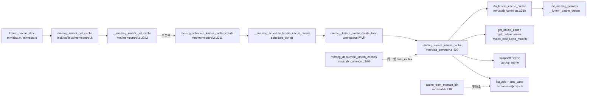

# 每日内核源码分析：memcg_create_kmem_cache

- **日期**：2026-11-14
- **子系统**：mm
- **源文件**：mm/slab_common.c:499-568（Linux v4.3）
- **类型**：function

---

## 1. 功能作用

`memcg_create_kmem_cache()` 为某个 memory cgroup（memcg）创建一个**专属的 kmem_cache**（per-memcg 子缓存），使该 cgroup 内的内核对象分配可以被独立记账、限额和回收。

它解决的问题是：全局 slab 缓存（root cache）是所有 cgroup 共享的，无法精确统计“某个 cgroup 用了多少 kmem 内存”。当用户第一次给某个 memcg 设置 `kmem.limit_in_bytes`（或在 v4.3 中通过 kmem 限额激活记账）后，该 memcg 会获得一个全局唯一的 `kmemcg_id`；此后该 cgroup 的进程再分配某个 root cache 的对象时，内核会尝试为它建立同名的子缓存，挂在 root cache 的 `memcg_params.list` 上，并通过 `memcg_params.memcg_caches[]` 数组按 `kmemcg_id` 索引快速查找。

关键点是“**异步、尽力而为**”：

- 真正创建 cache 的动作由 workqueue 回调 `memcg_kmem_cache_create_func()` 执行，不在分配快路径上同步完成。
- 创建失败不报错，当前分配继续使用 root cache，后续分配再触发重试。
- 多个 CPU 可能同时发现“子缓存不存在”并各自排队创建工作项，因此本函数必须做**幂等检查**。

典型触发链：`kmem_cache_alloc()` → `memcg_kmem_get_cache()` → `__memcg_kmem_get_cache()` → `memcg_schedule_kmem_cache_create()` → `schedule_work()` → `memcg_kmem_cache_create_func()` → **`memcg_create_kmem_cache()`**。

## 2. 关键数据结构

### 2.1 `struct mem_cgroup`（include/linux/memcontrol.h:183）

本函数只关心 kmem 相关字段：

| 字段 | 含义 |
|------|------|
| `struct cgroup_subsys_state css` | 对应的 cgroup 子系统状态，`css->id` 用于生成缓存名，`css->cgroup` 用于取 cgroup 名 |
| `int kmemcg_id` | 该 memcg 在 `memcg_caches[]` 数组中的下标；`-1` 表示尚未启用 kmem 记账 |
| `bool kmem_acct_activated` | kmem 记账是否曾经启用（不可逆） |
| `bool kmem_acct_active` | kmem 记账当前是否有效；`memcg_kmem_is_active()` 直接读它 |
| `struct page_counter kmem` | kmem 用量计数器，与 `memory`、`memsw` 并列 |

### 2.2 `struct kmem_cache` 与 `struct memcg_cache_params`（include/linux/slab.h:515）

```c
struct memcg_cache_params {
    bool is_root_cache;
    struct list_head list;          /* 同一 root cache 的所有子缓存串成链表 */
    union {
        struct memcg_cache_array __rcu *memcg_caches;  /* root cache 使用 */
        struct {
            struct mem_cgroup *memcg;                  /* 子缓存所属 memcg */
            struct kmem_cache *root_cache;             /* 指向派生它的 root cache */
        };
    };
};
```

- root cache：`is_root_cache = true`，持有按 `memcg_nr_cache_ids` 大小动态分配的 `memcg_caches` 数组。
- 子缓存：`is_root_cache = false`，记录 `memcg` 与 `root_cache`，并挂到 root cache 的 `memcg_params.list` 上。
- 子缓存创建时继承 root cache 的 `object_size / size / align / flags / ctor`。

### 2.3 `struct memcg_cache_array`（include/linux/slab.h:494）

```c
struct memcg_cache_array {
    struct rcu_head rcu;
    struct kmem_cache *entries[0];   /* 柔性数组，下标 = memcg->kmemcg_id */
};
```

读取端 `cache_from_memcg_idx()`（mm/slab.h:216-234）在 `rcu_read_lock()` 下用 `lockless_dereference(arr->entries[idx])` 无锁读取；数组扩容时通过 `update_memcg_params()` 重新分配并用 `kfree_rcu()` 延迟释放旧数组。

### 2.4 `struct memcg_kmem_cache_create_work`（mm/memcontrol.c:2271）

工作项载体，保存 `memcg`、`cachep` 和 `work_struct`；工作项持有 `css_get()` 引用，保证异步执行期间 memcg 不会被释放。

## 3. 核心逻辑流程图

```mermaid
flowchart TD
  A["入口 memcg_create_kmem_cache(memcg, root_cache)"] --> B["get_online_cpus()<br/>get_online_mems()"]
  B --> C["mutex_lock(&slab_mutex)"]
  C --> D{"memcg_kmem_is_active(memcg)?"}
  D -->|否，cgroup 已失活| Z1["out_unlock：解锁并 put_online_mems/cpus"]
  D -->|是| E["idx = memcg_cache_id(memcg)<br/>arr = root_cache->memcg_params.memcg_caches"]
  E --> F{"arr->entries[idx] 已存在?"}
  F -->|是，其他线程已创建| Z1
  F -->|否| G["cgroup_name() 取 cgroup 名<br/>kasprintf 生成 \"root(id:name)\""]
  G --> H{"cache_name 分配成功?"}
  H -->|否| Z1
  H -->|是| I["do_kmem_cache_create(...)<br/>继承 root cache 属性"]
  I --> J{"IS_ERR(s)?"}
  J -->|是，创建失败| K["kfree(cache_name)"] --> Z1
  J -->|否| L["list_add(&s->memcg_params.list,<br/>&root_cache->memcg_params.list)"]
  L --> M["smp_wmb()<br/>arr->entries[idx] = s"]
  M --> Z1
  Z1 --> N["返回（void）"]
```

ASCII 兜底版本：

```text
memcg_create_kmem_cache(memcg, root_cache)
  |
  +-- get_online_cpus(); get_online_mems()
  +-- mutex_lock(&slab_mutex)
  |
  +-- memcg_kmem_is_active(memcg)? --否--> unlock; return
  |
  +-- idx = memcg->kmemcg_id
  |   arr = root_cache->memcg_params.memcg_caches
  |
  +-- arr->entries[idx] != NULL? --是--> unlock; return   (幂等：别人已创建)
  |
  +-- 生成缓存名 "root_cache->name(css->id:cgroup_name)"
  |     kasprintf 失败 ------------------> unlock; return
  |
  +-- do_kmem_cache_create(name, root 的 object_size/size/align/
  |                         flags/ctor, memcg, root_cache)
  |     IS_ERR(s) ----------------------> kfree(name); unlock; return
  |
  +-- list_add(child->memcg_params.list, root->memcg_params.list)
  +-- smp_wmb(); arr->entries[idx] = s   (发布给无锁读者)
  |
  +-- mutex_unlock(&slab_mutex)
  +-- put_online_mems(); put_online_cpus()
```

关键决策点说明：

1. **先 `get_online_cpus/mems` 再拿 `slab_mutex`**：阻止 CPU/内存热插拔与按 node 建缓存并发，且固定锁顺序，避免与 `memcg_deactivate_kmem_caches()` 等路径形成 ABBA 死锁。
2. **拿到 `slab_mutex` 后重新检查 `memcg_kmem_is_active()`**：工作项可能在 memcg 失活之后才被执行；只靠入队时的状态判断会产生“已失活 cgroup 又新建缓存”的竞态。
3. **`arr->entries[idx]` 幂等检查**：同一个 `(memcg, root_cache)` 可能被多个 CPU 同时触发创建，只有第一个能成功发布，后来者直接退出。
4. **缓存名必须在 `slab_mutex` 下生成**：`memcg_name_buf` 是函数内 `static` 缓冲区，注释明确写出 `protected by slab_mutex`。
5. **失败不报错**：`do_kmem_cache_create()` 失败只释放缓存名并返回，分配路径会退回到 root cache，不把内存压力升级为分配失败。
6. **`smp_wmb()` + `lockless_dereference()`**：读者不持 `slab_mutex`，必须用写屏障保证 `kmem_cache` 的初始化字段先于数组指针可见。

## 4. 调用关系

### 4.1 调用者（who calls me）

直接调用者只有 workqueue 回调；下表同时列出完整的异步触发链，便于追踪。

| 调用方 | 所在文件 | 调用场景 |
|--------|----------|----------|
| `memcg_kmem_cache_create_func` | `mm/memcontrol.c:2277-2288` | **唯一直接调用者**：workqueue 回调，执行异步建缓存，随后 `css_put()` 并释放工作项 |
| `__memcg_schedule_kmem_cache_create` | `mm/memcontrol.c:2293-2309` | `kmalloc(GFP_NOWAIT)` 工作项、`css_get()`、`schedule_work()` |
| `memcg_schedule_kmem_cache_create` | `mm/memcontrol.c:2311-2328` | 在 `memcg_kmem_skip_account = 1` 保护下调度，防止分配递归 |
| `__memcg_kmem_get_cache` | `mm/memcontrol.c:2343-2379` | 分配快路径未命中子缓存时，调度异步创建并先返回 root cache |
| `memcg_kmem_get_cache`（inline） | `include/linux/memcontrol.h:848-863` | 快路径总入口；过滤中断上下文、内核线程、`__GFP_NOFAIL/__GFP_NOACCOUNT`、致命信号等 |
| `slab_alloc_node` / `slab_pre_alloc_hook` | `mm/slab.c:3168`、`mm/slub.c:1271` | SLAB/SLUB 的 `kmem_cache_alloc` 实现调用 `memcg_kmem_get_cache()` |

### 4.2 被调用者（who I call）

- **核心路径调用**
  - `do_kmem_cache_create()`（`mm/slab_common.c:319-357`）：分配 `struct kmem_cache`，设置名字/尺寸/对齐/ctor，调用 `init_memcg_params()` 初始化子缓存关系，再调用 `__kmem_cache_create()` 建立 slab 管理结构，最后 `list_add()` 到全局 `slab_caches`。
  - `init_memcg_params()`（`mm/slab_common.c:138-163`）：`memcg != NULL` 时设置 `is_root_cache=false`、`memcg`、`root_cache`。
- **同步与保护**
  - `get_online_cpus()` / `put_online_cpus()`（`kernel/cpu.c`）：阻止 CPU 热插拔。
  - `get_online_mems()` / `put_online_mems()`（`mm/memory_hotplug.c:79/91`）：阻止内存热插拔。
  - `mutex_lock/unlock(&slab_mutex)`：保护 `slab_caches` 链表、root cache 的 `memcg_caches` 数组和静态名字缓冲区。
  - `rcu_dereference_protected(..., lockdep_is_held(&slab_mutex))`：在持锁前提下读取 RCU 指针，并让 lockdep 校验。
  - `smp_wmb()`：发布子缓存指针前的写屏障。
- **辅助调用**
  - `memcg_kmem_is_active()`（inline，`include/linux/memcontrol.h:733-736`）：读取 `memcg->kmem_acct_active`。
  - `memcg_cache_id()`（inline，`include/linux/memcontrol.h:760-763`）：返回 `memcg->kmemcg_id`。
  - `cgroup_name()`（`include/linux/cgroup.h:509`）：把 cgroup 名写入静态缓冲区。
  - `kasprintf(GFP_KERNEL, ...)` / `kfree()`：生成/释放子缓存名。
  - `list_add()`：把子缓存挂入 root cache 的 `memcg_params.list`。

### 4.3 调用关系图（Mermaid）



## 5. 易错点 / 边界场景 / 设计权衡

1. **异步创建导致的重复工作与幂等性**
   `__memcg_kmem_get_cache()` 发现子缓存不存在时只负责 `schedule_work()`，多个 CPU 会重复排队。真正去重发生在 `memcg_create_kmem_cache()` 内的 `arr->entries[idx]` 检查——它必须在 `slab_mutex` 下完成，否则两个 worker 可能同时通过检查并创建出两个同名 cache。

2. **“工作项排队后 memcg 已失活”的竞态**
   `memcg_deactivate_kmem()` 先把 `kmem_acct_active` 置为 `false`，再调用 `memcg_deactivate_kmem_caches()` 拿 `slab_mutex` 清空 `arr->entries[idx]`。本函数在持锁后重新检查 active 标志，配合同一把锁，保证失活完成后不会再有新缓存被创建。

3. **内存屏障不是可选项**
   读者 `cache_from_memcg_idx()` 只持 `rcu_read_lock()`，不持 `slab_mutex`。如果先执行 `arr->entries[idx] = s` 而不做 `smp_wmb()`，CPU/编译器可能让读者看到尚未初始化完成的 `kmem_cache`。写端 `smp_wmb()` 与读端 `lockless_dereference()` 必须成对理解。

4. **`static char memcg_name_buf` 的隐含约束**
   它是函数级静态缓冲区，靠 `slab_mutex` 串行化。若未来有人在未持锁路径复用该缓冲区，会直接破坏缓存名的正确性。名字格式为 `"root_cache->name(css->id:cgroup_name)"`，`NAME_MAX + 1` 长度可能截断过长的 cgroup 名。

5. **失败路径的资源归属**
   成功时 `cache_name` 的所有权转移给 `s->name`，最终由 `slab_kmem_cache_release()` 用 `kfree_const()` 释放；失败时必须在本函数内 `kfree(cache_name)`。两条路径的所有权规则不同，是常见的泄漏/重复释放点。

6. **为什么可以在持 `slab_mutex` 时用 `GFP_KERNEL` 分配**
   本函数运行在 workqueue 内核线程上下文，可以睡眠；并且 `PF_KTHREAD` 会让 `memcg_kmem_get_cache()` 直接返回 root cache，从而避免“为创建子缓存而分配对象又触发子缓存创建”的递归。注意 `__memcg_kmem_get_cache()` 的注释明确说明它不能在中断上下文或内核线程中调用。

7. **配置与版本边界**
   整个函数位于 `#ifdef CONFIG_MEMCG_KMEM` 内；未开启时不存在该函数，`memcg_kmem_get_cache()` 直接返回原 cache。v4.3 之后 memcg kmem 的实现经历多轮重构（`memcg_params` 布局、`kmemcg_id` 管理、是否默认开启等均有变化），跨版本阅读时不要直接套用本笔记的字段与锁假设。

---

## 附：核心源码片段

```c
// mm/slab_common.c:489-568 (Linux v4.3)
#ifdef CONFIG_MEMCG_KMEM
/*
 * memcg_create_kmem_cache - Create a cache for a memory cgroup.
 * @memcg: The memory cgroup the new cache is for.
 * @root_cache: The parent of the new cache.
 *
 * This function attempts to create a kmem cache that will serve allocation
 * requests going from @memcg to @root_cache. The new cache inherits properties
 * from its parent.
 */
void memcg_create_kmem_cache(struct mem_cgroup *memcg,
			     struct kmem_cache *root_cache)
{
	static char memcg_name_buf[NAME_MAX + 1]; /* protected by slab_mutex */
	struct cgroup_subsys_state *css = &memcg->css;
	struct memcg_cache_array *arr;
	struct kmem_cache *s = NULL;
	char *cache_name;
	int idx;

	get_online_cpus();
	get_online_mems();

	mutex_lock(&slab_mutex);

	/*
	 * The memory cgroup could have been deactivated while the cache
	 * creation work was pending.
	 */
	if (!memcg_kmem_is_active(memcg))
		goto out_unlock;

	idx = memcg_cache_id(memcg);
	arr = rcu_dereference_protected(root_cache->memcg_params.memcg_caches,
					lockdep_is_held(&slab_mutex));

	/*
	 * Since per-memcg caches are created asynchronously on first
	 * allocation (see memcg_kmem_get_cache()), several threads can try to
	 * create the same cache, but only one of them may succeed.
	 */
	if (arr->entries[idx])
		goto out_unlock;

	cgroup_name(css->cgroup, memcg_name_buf, sizeof(memcg_name_buf));
	cache_name = kasprintf(GFP_KERNEL, "%s(%d:%s)", root_cache->name,
			       css->id, memcg_name_buf);
	if (!cache_name)
		goto out_unlock;

	s = do_kmem_cache_create(cache_name, root_cache->object_size,
				 root_cache->size, root_cache->align,
				 root_cache->flags, root_cache->ctor,
				 memcg, root_cache);
	/*
	 * If we could not create a memcg cache, do not complain, because
	 * that's not critical at all as we can always proceed with the root
	 * cache.
	 */
	if (IS_ERR(s)) {
		kfree(cache_name);
		goto out_unlock;
	}

	list_add(&s->memcg_params.list, &root_cache->memcg_params.list);

	/*
	 * Since readers won't lock (see cache_from_memcg_idx()), we need a
	 * barrier here to ensure nobody will see the kmem_cache partially
	 * initialized.
	 */
	smp_wmb();
	arr->entries[idx] = s;

out_unlock:
	mutex_unlock(&slab_mutex);

	put_online_mems();
	put_online_cpus();
}
```
