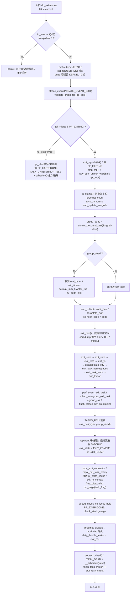
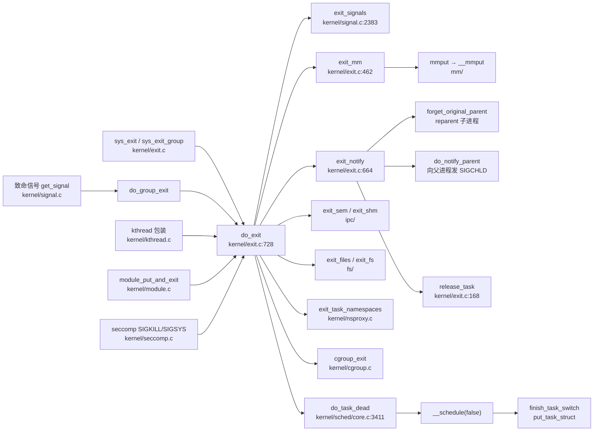

# 每日内核源码分析：do_exit

- **日期**：2026-11-15
- **子系统**：kernel
- **源文件**：kernel/exit.c:728-887（Linux v4.9）
- **类型**：function（导出符号，`EXPORT_SYMBOL_GPL`）

---

## 1. 功能作用

`do_exit()` 是 Linux 中**所有进程/线程终止的唯一最终归宿**。无论是用户态调用 `exit(2)`、`exit_group(2)`，还是内核线程函数返回、致命信号触发进程组退出、`seccomp` 强杀、模块卸载时 `module_put_and_exit()`，最终都会汇聚到这里。

它完成三件事：

1. **资源拆解**：按“信号 → 内存地址空间 → IPC（SysV sem/shm）→ 文件 → 文件系统上下文 → 命名空间 → task_work → 架构相关线程资源 → perf → cgroup → 通知父进程”的顺序，逐层释放该任务独占的资源。
2. **状态迁移**：把任务从 `TASK_RUNNING` 迁移到僵尸态（`EXIT_ZOMBIE`，等待父进程 `wait4` 回收）或直接死亡态（`EXIT_DEAD`，由 `release_task()` 自行回收）。
3. **永不返回**：函数标记 `__noreturn`，末尾调用 `do_task_dead()` 置 `TASK_DEAD` 并主动让出 CPU；真正的 `task_struct` 内存在下一次上下文切换的 `finish_task_switch()` 中通过 `put_task_struct()` 释放。

典型触发场景：

- 用户进程调用 `exit()` / 从 `main()` 返回（glibc 走 `exit_group`）。
- 进程收到 `SIGKILL` 等致命信号，`get_signal()` → `do_group_exit()`。
- 内核线程函数执行完毕返回（`kthread()` 包装函数调用 `do_exit(ret)`）。
- 内核 oops / 递归异常时的“最后一搏”。
- `call_usermodehelper` 的 modprobe 辅助进程、`reboot` 内核线程等主动调用。

---

## 2. 关键数据结构

### 2.1 `struct task_struct`（include/linux/sched.h:1549-1880）

| 字段 | 作用 |
|------|------|
| `struct mm_struct *mm, *active_mm` | `mm` 是进程地址空间；内核线程借用 `active_mm`。`exit_mm()` 会把 `mm` 置 NULL 并转入 lazy TLB 模式。 |
| `unsigned int flags` | 关键位：`PF_EXITING`（正在退出）、`PF_EXITPIDONE`（futex 清理完成）、`PF_KTHREAD`（内核线程）、`PF_NOFREEZE`（冻结器忽略）。 |
| `int exit_state` | `EXIT_ZOMBIE` / `EXIT_DEAD`，决定是否由父进程回收还是立即 `release_task()`。 |
| `int exit_code, exit_signal` | 退出码与向父进程发送的信号（通常 `SIGCHLD`）。 |
| `struct signal_struct *signal` | 线程组共享的退出状态（见下）。 |
| `struct futex_pi_state *pi_state_cache` | futex 优先级继承状态缓存，退出时需要释放。 |
| `struct io_context *io_context` | I/O 调度上下文，退出时 `exit_io_context()`。 |
| `struct pipe_inode_info *splice_pipe` | splice 使用的临时管道，退出时 `free_pipe_info()`。 |
| `struct page_frag task_frag` | 任务级 page_frag 缓存，退出时归还最后一页。 |
| `int nr_dirtied` | 本任务弄脏的页数，退出时冲入 per-CPU 的 `dirty_throttle_leaks`，避免脏页配额“随进程消失”。 |
| `raw_spinlock_t pi_lock` | 与 `try_to_wake_up()` / futex 的优先级继承同步点。 |

### 2.2 `struct signal_struct`（include/linux/sched.h:675-798）

| 字段 | 作用 |
|------|------|
| `atomic_t live` | 线程组中仍存活线程数。`do_exit()` 中 `atomic_dec_and_test()` 判定 `group_dead`——最后一个线程退出才做进程级清理。 |
| `int group_exit_code` | `exit_group` 时整组统一的退出码。 |
| `int group_exit_task` / `int notify_count` | mt-exec 场景：`de_thread()` 等待旧 group leader 退出；`notify_count < 0` 时需唤醒 `group_exit_task`。 |
| `struct hrtimer real_timer` | 进程级 ITIMER_REAL 定时器，组死亡时取消。 |
| `unsigned long maxrss, cmaxrss` | 进程组峰值 RSS，退出时与 mm 的 hiwater 取最大值。 |
| `struct tty_struct *tty` / `tty_audit_buf` | 控制终端与 TTY 审计缓冲区，会话首进程退出时解除关联。 |

### 2.3 `struct mm_struct`（include/linux/mm_types.h）

- `mm_users`：用户态地址空间使用者计数，`mmput()` 递减，归零后销毁页表/VMA。
- `mm_count`：内核引用计数（含 lazy TLB），`exit_mm()` 先 `atomic_inc(&mm->mm_count)` 再清空 `tsk->mm`，保证 `active_mm` 仍有效。
- `core_state`：coredump 协调结构，`exit_mm()` 必须与其握手，防止线程在 core dump 过程中消失。
- `mmap_sem`：读写信号量，保护 `core_state` 检查与 `tsk->mm` 清空。

### 2.4 关键枚举 / 宏

- `EXIT_ZOMBIE`：已死但 `task_struct` 保留，等待父进程读取退出码。
- `EXIT_DEAD`：无父进程关注（或被 reparent 后已处理），可立即回收。
- `PF_EXITING`：由 `exit_signals()` 设置，是“不可再接收组信号”的分界线。
- `TASKS_RCU(...)`：4.9 中基于 SRCU 的 Tasks RCU，保护 `exit_notify()` 遍历任务链表期间不会与 trampoline 释放竞争。

---

## 3. 核心逻辑流程图



关键决策点说明：

1. **中断上下文 / idle 任务不可退出**：`in_interrupt()` 为真说明栈上还有中断帧，退出会导致栈无法回收；`pid == 0` 是 idle 线程，杀掉它系统即停摆，故直接 panic。
2. **`set_fs(USER_DS)` 是安全兜底**：若进程因 oops 进入 `do_exit()`，此前可能残留 `KERNEL_DS`，`mm_release() → clear_child_tid()` 会向用户提供的地址写 0，若不限制会变成内核任意地址写。
3. **递归故障不尝试恢复**：第二次进入 `do_exit()`（`PF_EXITING` 已置位）说明清理路径本身又崩了，继续拆资源只会二次破坏，因此永久睡眠等待重启。
4. **`smp_mb() + raw_spin_unlock_wait(pi_lock)`**：保证 futex 的 `attach_to_pi_owner()` 能看到 `PF_EXITING`，并且在 `exit_mm() → exit_pi_state_list()` 前观察到已取得的 PI state。
5. **`group_dead` 区分线程退出与进程退出**：`live` 是线程组共享计数，只有最后一个线程才做定时器、记账、控制终端等“进程级”清理。
6. **`exit_mm()` 的 coredump 握手**：若正在 core dump，线程需登记到 `core_state->dumper` 链表并睡眠，等 core dump 完成后才能继续，避免地址空间被提前拆掉。
7. **`exit_notify()` 的僵尸化**：普通子进程置 `EXIT_ZOMBIE` 等待父进程 `wait4`；被 ptrace 跟踪或已无父进程关注的置 `EXIT_DEAD` 并立即 `release_task()`。
8. **`do_task_dead()` 后不再触碰 `current`**：`TASK_DEAD` 让 `finish_task_switch()` 执行最终的 `put_task_struct()`，此后 `task_struct` 可能已被释放。

---

## 4. 调用关系

### 4.1 调用者（who calls me）

| 调用方 | 所在文件 | 调用场景 |
|--------|----------|----------|
| `SYSCALL_DEFINE1(exit)` | kernel/exit.c:899 | 用户态 `exit(2)`，退出码左移 8 位 |
| `do_group_exit` | kernel/exit.c:932 | `exit_group(2)` 或致命信号，先 zap 同组线程再退出 |
| `kthread` 包装函数 | kernel/kthread.c:212 | 内核线程函数返回，`do_exit(ret)` |
| `complete_and_exit` | kernel/exit.c:895 | 完成 completion 后退出，供内核线程使用 |
| `__module_put_and_exit` | kernel/module.c:338-343 | 模块引用计数减一后退出（nfsd / lockd 使用） |
| `__secure_computing_strict` / `__seccomp_filter` | kernel/seccomp.c:537,640 | 违反 seccomp 策略，`SIGKILL` / `SIGSYS` 强杀 |
| `SYSCALL_DEFINE4(reboot)` | kernel/reboot.c:330,335 | `LINUX_REBOOT_CMD_HALT` / `POWER_OFF` 停机后退出 |
| `call_usermodehelper_exec_async` | kernel/kmod.c:265 | usermode helper 子进程 exec 失败时退出 |
| `SYSCALL_DEFINE2(bdflush)` | fs/buffer.c:3344 | 兼容废弃的 bdflush 守护进程，`func == 1` 时退出 |

### 4.2 被调用者（who I call）

**核心路径调用**

- `exit_signals()`（kernel/signal.c:2383）：置 `PF_EXITING`，重定向共享待处理信号。
- `exit_mm()`（kernel/exit.c:462）：`mm_release()`、coredump 握手、lazy TLB、`mmput()`。
- `exit_notify()`（kernel/exit.c:664）：`forget_original_parent()` 重新挂接子进程、`do_notify_parent()` 通知父进程、`release_task()`。
- `exit_sem()` / `exit_shm()`（ipc/）：释放 SysV 信号量与共享内存。
- `exit_files()`（fs/file.c）/ `exit_fs()`（fs/fs_struct.c）：关闭文件表、释放 `fs_struct`。
- `exit_task_namespaces()`（kernel/nsproxy.c）：释放命名空间引用。
- `exit_task_work()` / `exit_thread()`：清理 task_work 与架构相关资源。
- `cgroup_exit()`（kernel/cgroup.c）：移出 cgroup。
- `do_task_dead()`（kernel/sched/core.c:3411）：置 `TASK_DEAD`，调度走完最后一程。

**辅助调用**

- `acct_collect()` / `acct_process()`：BSD 进程记账。
- `taskstats_exit()`：向 taskstats 监听者发送退出统计。
- `audit_free()` / `tty_audit_exit()`：审计子系统清理。
- `perf_event_exit_task()`：解绑 perf 事件。
- `exit_itimers()` / `hrtimer_cancel()`：进程级定时器清理。
- `mpol_put_task_policy()`：释放 NUMA mempolicy。
- `exit_io_context()` / `free_pipe_info()`：释放 I/O 上下文与 splice 管道。
- `exit_rcu()`：把任务从 RCU 相关链表中摘除。

**宏 / 内联**

- `TASKS_RCU(...)`：Tasks RCU 的 SRCU 读侧临界区。
- `atomic_dec_and_test()`：线程组存活计数判定。
- `sync_mm_rss()`（SPLIT_RSS_COUNTING 下把 per-CPU RSS 差值同步回 mm）。
- `preempt_count_set(PREEMPT_ENABLED)`：异常路径预抢占计数复位。
- `PF_*` 位操作与 `smp_mb()` / `raw_spin_unlock_wait()` 内存序原语。

### 4.3 调用关系图



---

## 5. 易错点 / 边界场景 / 设计权衡

1. **`PF_EXITING` 递归路径是“故意的死胡同”**：注释明确写“leave this task alone and wait for reboot”。这里既不释放也不返回，是最小化二次破坏的取舍；不要把这段当成可修复路径去理解。
2. **`tsk->mm` 与 `active_mm` 的引用顺序**：`exit_mm()` 必须先 `atomic_inc(&mm->mm_count)`，再在 `task_lock` 下把 `tsk->mm = NULL`。若顺序反了，`active_mm` 可能指向已释放的 mm，内核线程下一次上下文切换就会踩空。
3. **为什么 `exit_notify()` 用 `tasklist_lock` 写锁，而 `release_task()` 放到锁外**：reparent 与僵尸化必须原子，否则父进程可能在子进程尚未挂接新父时就被唤醒；而 `release_task()` 内部还要拿 `siglock` 和 `tasklist_lock`，在写锁内调用会造成锁序问题，因此先收集到 `dead` 链表，解锁后统一释放。
4. **`EXIT_ZOMBIE` vs `EXIT_DEAD` 的判定依赖 ptrace 与线程组状态**：被跟踪任务即使父进程未 wait 也不会立即回收，避免调试器丢失退出事件；非 leader 线程通常 `autoreap = true`，直接进入 `EXIT_DEAD`。
5. **`exit_mm()` 的 coredump 窗口**：如果线程在 core dump 期间退出，必须通过 `core_state->dumper` 链表登记并睡眠；否则 coredump 线程会读到已释放的 VMA。`xchg()` 隐含的内存屏障是正确性的关键。
6. **`nr_dirtied` 不能随进程丢弃**：脏页配额是全局资源，进程退出时必须把计数累加到 per-CPU 的 `dirty_throttle_leaks`，否则系统脏页会“无主”地超出配额。这也是 `preempt_disable()` 保护 per-CPU 变量的原因。
7. **`do_task_dead()` 后访问 `current` 是未定义行为**：`TASK_DEAD` 触发 `finish_task_switch()` 释放 `task_struct`，因此 `do_exit()` 末尾的 `exit_rcu()`、`TASKS_RCU` 解锁必须在此之前完成；调试时不要在这之后打印 `current->comm`。
8. **跨版本差异**：4.9 使用 `set_fs()` / `get_fs()` 与 `TASKS_RCU`；5.x 后期移除 `set_fs()`，`do_exit()` 中的 `set_fs(USER_DS)` 被删除；6.x 的 `exit_mm()` 改用 `mmap_read_lock()` 命名，且 `do_exit()` 拆分出更多 helper。阅读新版本时不要直接套用本笔记的调用细节。

---

## 附：核心源码片段

```c
/* kernel/exit.c:728-887 (Linux v4.9，去冗) */
void __noreturn do_exit(long code)
{
	struct task_struct *tsk = current;
	int group_dead;
	TASKS_RCU(int tasks_rcu_i);

	profile_task_exit(tsk);
	kcov_task_exit(tsk);
	WARN_ON(blk_needs_flush_plug(tsk));

	if (unlikely(in_interrupt()))
		panic("Aiee, killing interrupt handler!");
	if (unlikely(!tsk->pid))
		panic("Attempted to kill the idle task!");

	set_fs(USER_DS);
	ptrace_event(PTRACE_EVENT_EXIT, code);
	validate_creds_for_do_exit(tsk);

	if (unlikely(tsk->flags & PF_EXITING)) {
		pr_alert("Fixing recursive fault but reboot is needed!\n");
		tsk->flags |= PF_EXITPIDONE;
		set_current_state(TASK_UNINTERRUPTIBLE);
		schedule();
	}

	exit_signals(tsk);	/* sets PF_EXITING */
	smp_mb();
	raw_spin_unlock_wait(&tsk->pi_lock);

	if (unlikely(in_atomic())) {
		pr_info("note: %s[%d] exited with preempt_count %d\n",
			current->comm, task_pid_nr(current), preempt_count());
		preempt_count_set(PREEMPT_ENABLED);
	}

	if (tsk->mm)
		sync_mm_rss(tsk->mm);
	acct_update_integrals(tsk);
	group_dead = atomic_dec_and_test(&tsk->signal->live);
	if (group_dead) {
		hrtimer_cancel(&tsk->signal->real_timer);
		exit_itimers(tsk->signal);
		if (tsk->mm)
			setmax_mm_hiwater_rss(&tsk->signal->maxrss, tsk->mm);
	}
	acct_collect(code, group_dead);
	if (group_dead)
		tty_audit_exit();
	audit_free(tsk);

	tsk->exit_code = code;
	taskstats_exit(tsk, group_dead);

	exit_mm(tsk);

	if (group_dead)
		acct_process();
	trace_sched_process_exit(tsk);

	exit_sem(tsk);
	exit_shm(tsk);
	exit_files(tsk);
	exit_fs(tsk);
	if (group_dead)
		disassociate_ctty(1);
	exit_task_namespaces(tsk);
	exit_task_work(tsk);
	exit_thread(tsk);

	perf_event_exit_task(tsk);
	sched_autogroup_exit_task(tsk);
	cgroup_exit(tsk);
	flush_ptrace_hw_breakpoint(tsk);

	TASKS_RCU(preempt_disable());
	TASKS_RCU(tasks_rcu_i = __srcu_read_lock(&tasks_rcu_exit_srcu));
	TASKS_RCU(preempt_enable());
	exit_notify(tsk, group_dead);
	proc_exit_connector(tsk);
	mpol_put_task_policy(tsk);
#ifdef CONFIG_FUTEX
	if (unlikely(current->pi_state_cache))
		kfree(current->pi_state_cache);
#endif
	debug_check_no_locks_held();
	tsk->flags |= PF_EXITPIDONE;

	if (tsk->io_context)
		exit_io_context(tsk);
	if (tsk->splice_pipe)
		free_pipe_info(tsk->splice_pipe);
	if (tsk->task_frag.page)
		put_page(tsk->task_frag.page);

	validate_creds_for_do_exit(tsk);
	check_stack_usage();
	preempt_disable();
	if (tsk->nr_dirtied)
		__this_cpu_add(dirty_throttle_leaks, tsk->nr_dirtied);
	exit_rcu();
	TASKS_RCU(__srcu_read_unlock(&tasks_rcu_exit_srcu, tasks_rcu_i));

	do_task_dead();
}
EXPORT_SYMBOL_GPL(do_exit);
```
