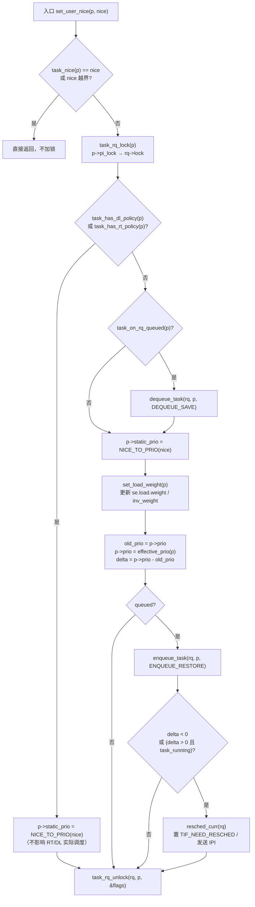
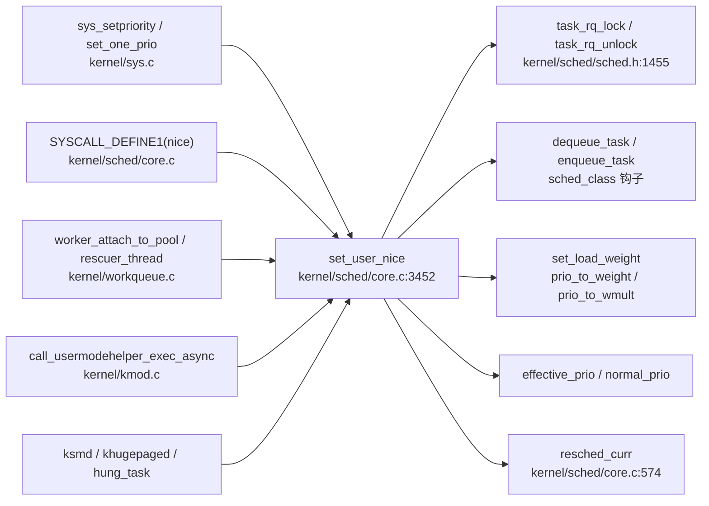

# 每日内核源码分析：set_user_nice

- **日期**：2026-11-16
- **子系统**：kernel/sched
- **源文件**：kernel/sched/core.c:3452-3497（Linux v4.4）
- **类型**：function

---

## 1. 功能作用

`set_user_nice()` 是内核中修改「普通任务 nice 值」的最终落地点。

用户态通过 `nice(2)`、`setpriority(2)` 调整进程优先级，最终都会走到这里；内核线程（`kworker`、`ksmd`、`khugepaged`、`hung_task`、`call_usermodehelper` 的子进程等）也直接调用它来设置自身 nice 值。

它完成三件事：

1. 把用户语义的 nice 值 `[-20, 19]` 转换成内核内部的 `static_prio`（`NICE_TO_PRIO`）。
2. 重新计算 CFS 调度实体 `se.load` 的权重 `weight / inv_weight`，从而改变该任务在 CFS 红黑树中「每单位实际运行时间消耗多少虚拟时间」。
3. 若任务正处于运行队列中，按新权重把它摘下再挂回，并在「优先级升高」或「正在运行时优先级降低」的情况下设置 `TIF_NEED_RESCHED`，让调度器尽快重新选择。

一个容易误解的点：**nice 只对 CFS（`SCHED_NORMAL` / `SCHED_BATCH` / `SCHED_IDLE`）真正起作用**。对 `SCHED_FIFO` / `SCHED_RR` / `SCHED_DEADLINE` 任务，本函数只记录 `static_prio`，不会改变当前调度优先级；等该任务切回 CFS 策略时该值才会生效。

## 2. 关键数据结构

### 2.1 `struct task_struct`（include/linux/sched.h:1396-1404）

```c
int prio, static_prio, normal_prio;
unsigned int rt_priority;
const struct sched_class *sched_class;
struct sched_entity se;
struct sched_rt_entity rt;
struct sched_dl_entity dl;
unsigned int policy;
int on_rq;
int on_cpu;          /* CONFIG_SMP */
```

- `static_prio`：由 nice 值直接换算而来（`nice + 120`），**只由 nice 决定**，本函数首先改它。
- `normal_prio`：考虑调度策略后的「正常优先级」：CFS 等于 `static_prio`，RT 为 `MAX_RT_PRIO-1-rt_priority`，DL 为 `MAX_DL_PRIO-1`。
- `prio`：调度器实际使用的动态优先级，可能被 PI（优先级继承，如 rt_mutex boosting）临时抬高，因此不能简单等同于 nice。
- `policy`：`SCHED_NORMAL / BATCH / IDLE / FIFO / RR / DEADLINE`，决定走哪条分支。
- `on_rq`：`TASK_ON_RQ_QUEUED / MIGRATING / ...`，本函数用 `task_on_rq_queued()` 判断是否需要 dequeue/enqueue。
- `on_cpu`：SMP 下表示任务正在某个 CPU 上运行，`task_running()` 用它判断「正在运行」。

### 2.2 `struct sched_entity` 与 `struct load_weight`（include/linux/sched.h:1183-1265）

```c
struct load_weight {
    unsigned long weight;
    u32 inv_weight;
};

struct sched_entity {
    struct load_weight load;   /* 权重，供负载均衡与 vruntime 计算 */
    struct rb_node run_node;   /* CFS 红黑树节点 */
    unsigned int on_rq;
    u64 exec_start;
    u64 sum_exec_runtime;
    u64 vruntime;              /* 虚拟运行时间，红黑树排序键 */
    ...
};
```

CFS 的核心公式（简化）是：

```
vruntime += delta_exec * (NICE_0_LOAD / se->load.weight)
```

权重越大，同样的实际运行时间换来的 `vruntime` 增长越慢，任务就能获得更多 CPU。`set_load_weight()` 正是修改这个 `weight`。

### 2.3 权重表（kernel/sched/sched.h:1128-1155）

- `prio_to_weight[40]`：nice `-20..19` 对应的权重，nice 0 为 `1024`；每降 1 级约乘 `1.25`（即多约 10% CPU 份额）。
- `prio_to_wmult[40]`：权重倒数 `2^32/weight` 的预计算值，用乘法代替除法。
- `WEIGHT_IDLEPRIO = 3`、`WMULT_IDLEPRIO`：`SCHED_IDLE` 任务使用的最小权重。

### 2.4 `struct rq` 与锁

- 每个 CPU 一个 `struct rq`，内含 `raw_spinlock_t lock`、`curr`、`nr_running`、CFS 根队列 `cfs_rq` 等。
- `task_rq_lock(p, &flags)` 的加锁顺序是 **`p->pi_lock` → `rq->lock`**，并在循环中校验 `task_rq(p)` 与 `on_rq == TASK_ON_RQ_MIGRATING`，以应对任务恰好在另一 CPU 上被迁移的竞态。
- `task_rq_unlock()` 按相反顺序释放。

### 2.5 优先级转换宏（include/linux/sched/prio.h）

- `MIN_NICE = -20`、`MAX_NICE = 19`
- `DEFAULT_PRIO = MAX_RT_PRIO + NICE_WIDTH / 2 = 120`
- `NICE_TO_PRIO(nice) = nice + 120`，`PRIO_TO_NICE(prio) = prio - 120`
- `task_nice(p)` 等价于 `PRIO_TO_NICE(p->static_prio)`

## 3. 核心逻辑流程图



关键决策点说明：

1. **快速返回**：nice 未变化或越界时直接返回。这里比较的是 `task_nice()`（即 `static_prio`），而不是 `p->prio`，因为 `p->prio` 可能被 PI boosting 临时改变。
2. **RT/DL 旁路**：RT/DL 任务的 nice 没有调度意义，只更新 `static_prio` 就退出，避免破坏 RT 队列。
3. **先摘后挂**：CFS 的排序键 `vruntime` 依赖权重，直接改权重会让红黑树中的位置失效，所以必须 `dequeue_task()` 再 `enqueue_task()`。
4. **`DEQUEUE_SAVE` / `ENQUEUE_RESTORE`**：这对标志让调度类保留实体状态、跳过 `sched_info` 的 queued/dequeued 统计，避免一次「伪出队」污染等待时间统计。
5. **`effective_prio()`**：先刷新 `normal_prio`；若当前 `prio` 属于 RT 区间（被 boosting），保留 `prio` 不变。
6. **是否触发抢占**：`delta < 0` 表示优先级提高，应立即让出 CPU；`delta > 0` 表示降低优先级，只有任务正在运行时才有必要抢占（否则它下次被选中时自然按新权重执行）。
7. **锁与迁移竞态**：`task_rq_lock()` 在 `p->pi_lock` 保护下反复确认 `task_rq(p)`，若任务正在迁移则自旋等待，保证拿到的 `rq` 就是任务真正所属的队列。

## 4. 调用关系

### 4.1 调用者（who calls me）

| 调用方 | 所在文件 | 调用场景 |
|--------|----------|----------|
| `set_one_prio`（由 `SYSCALL_DEFINE3(setpriority)` 调用） | `kernel/sys.c:151-173` | 用户态 `setpriority(2)`，对单个/进程组/用户的所有任务设置 nice |
| `SYSCALL_DEFINE1(nice)` | `kernel/sched/core.c:3522-3544` | 用户态 `nice(2)`，对 `current` 增减 nice |
| `worker_attach_to_pool` | `kernel/workqueue.c:1716` | 按 workqueue 属性 `pool->attrs->nice` 设置 kworker 优先级 |
| `rescuer_thread` | `kernel/workqueue.c:2215` | rescuer 线程提升到 `RESCUER_NICE_LEVEL` |
| `call_usermodehelper_exec_async` | `kernel/kmod.c:229` | 避免把 unbound workqueue 的高优先级继承给用户态子进程，重置为 nice 0 |
| `ksmd` | `mm/ksm.c:1735` | KSM 扫描线程设置为 nice 5 |
| `khugepaged` | `mm/huge_memory.c:2917` | 透明大页合并线程设置为 `MAX_NICE` |
| `watchdog` | `kernel/hung_task.c:227` | hung task 检测线程重置为 nice 0 |
| `normalize_rt_tasks` | `kernel/sched/core.c:7631` | SysRq 归一化：把负 nice 的用户任务改回 0 |

### 4.2 被调用者（who I call）

- **核心路径调用**
  - `dequeue_task()` / `enqueue_task()`：间接调用 `p->sched_class->dequeue_task/enqueue_task`；对于 CFS 会进入 `dequeue_task_fair()` → `dequeue_entity()` / `enqueue_task_fair()` → `enqueue_entity()`，真正操作红黑树。
  - `set_load_weight()`：按 `static_prio` 查 `prio_to_weight[]` / `prio_to_wmult[]`，写入 `p->se.load`。
  - `effective_prio()` → `normal_prio()` → `__normal_prio()`：刷新 `normal_prio` 并计算新的 `p->prio`。
  - `resched_curr()`：对当前 CPU 置 `TIF_NEED_RESCHED`，对其他 CPU 通过 `smp_send_reschedule()` 发 IPI。
- **辅助调用**
  - `task_rq_lock()` / `task_rq_unlock()`：`p->pi_lock` 与 `rq->lock` 的成对加解锁。
  - `task_nice()`、`task_has_rt_policy()`、`task_has_dl_policy()`、`task_on_rq_queued()`、`task_running()`：均为内联判断。
  - `update_rq_clock()`：由 `enqueue_task` / `dequeue_task` 内部调用，保证队列时间基准最新。
- **宏 / 内联**
  - `NICE_TO_PRIO()`、`PRIO_TO_NICE()`、`scale_load()`、`idle_policy()`。
  - `idle_policy(p->policy)` 为真时（`SCHED_IDLE`），`set_load_weight()` 直接使用 `WEIGHT_IDLEPRIO` 并提前返回。

### 4.3 调用关系图



## 5. 易错点 / 边界场景 / 设计权衡

1. **比较对象是 `task_nice()` 而非 `p->prio`**：`p->prio` 可能因优先级继承被临时抬高，用它做「是否需要修改」的判断会漏掉真正的 nice 变化或产生误判。
2. **RT/DL 的 nice 是「休眠值」**：调用后 `/proc/<pid>/stat` 里的 nice 会变，但调度行为不变；只有策略切回 CFS 时 `static_prio` 才被真正使用。
3. **必须摘链重挂**：CFS 用 `vruntime` 排序，而 `vruntime` 的增速由权重决定；原地改权重会破坏红黑树不变量，因此要 `dequeue_task()` + `enqueue_task()`，并配合 `DEQUEUE_SAVE/ENQUEUE_RESTORE` 跳过统计。
4. **锁顺序不可颠倒**：`p->pi_lock` 先于 `rq->lock`，并且在 `task_rq_lock()` 的循环里处理 `TASK_ON_RQ_MIGRATING`；若直接读 `task_cpu(p)` 后加锁，可能与 `move_queued_task()` 竞争。
5. **降低优先级不一定立即抢占**：`delta > 0` 且任务不在运行时无需 `resched_curr()`，否则会给每次 renice 都制造无谓的 IPI/调度开销。
6. **SCHED_IDLE 的特殊权重**：权重被固定为 3（远小于 nice 19 的 15），使其只在 CPU 空闲时才获得运行机会；`set_user_nice` 本身不改变 class，只改权重。
7. **`MIN_NICE/MAX_NICE` 检查在入口处做**：越界值直接丢弃而不是返回 `-EINVAL`，因为该函数返回 `void`；参数合法性由 `sys_setpriority` / `nice` 系统调用层保证。

---

## 附：核心源码片段

```c
// kernel/sched/core.c:3452-3497 (Linux v4.4)
void set_user_nice(struct task_struct *p, long nice)
{
	int old_prio, delta, queued;
	unsigned long flags;
	struct rq *rq;

	if (task_nice(p) == nice || nice < MIN_NICE || nice > MAX_NICE)
		return;
	/*
	 * We have to be careful, if called from sys_setpriority(),
	 * the task might be in the middle of scheduling on another CPU.
	 */
	rq = task_rq_lock(p, &flags);
	/*
	 * The RT priorities are set via sched_setscheduler(), but we still
	 * allow the 'normal' nice value to be set - but as expected
	 * it wont have any effect on scheduling until the task is
	 * SCHED_DEADLINE, SCHED_FIFO or SCHED_RR:
	 */
	if (task_has_dl_policy(p) || task_has_rt_policy(p)) {
		p->static_prio = NICE_TO_PRIO(nice);
		goto out_unlock;
	}
	queued = task_on_rq_queued(p);
	if (queued)
		dequeue_task(rq, p, DEQUEUE_SAVE);

	p->static_prio = NICE_TO_PRIO(nice);
	set_load_weight(p);
	old_prio = p->prio;
	p->prio = effective_prio(p);
	delta = p->prio - old_prio;

	if (queued) {
		enqueue_task(rq, p, ENQUEUE_RESTORE);
		/*
		 * If the task increased its priority or is running and
		 * lowered its priority, then reschedule its CPU:
		 */
		if (delta < 0 || (delta > 0 && task_running(rq, p)))
			resched_curr(rq);
	}
out_unlock:
	task_rq_unlock(rq, p, &flags);
}
EXPORT_SYMBOL(set_user_nice);
```
